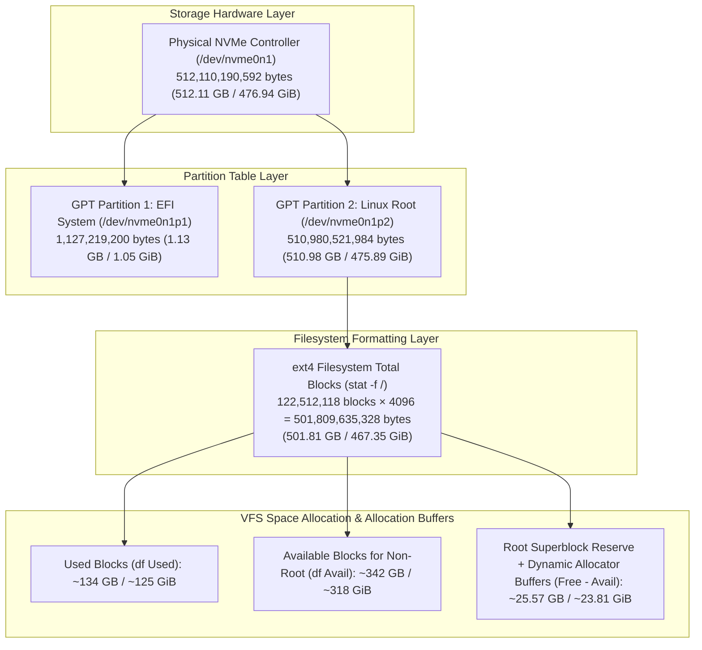
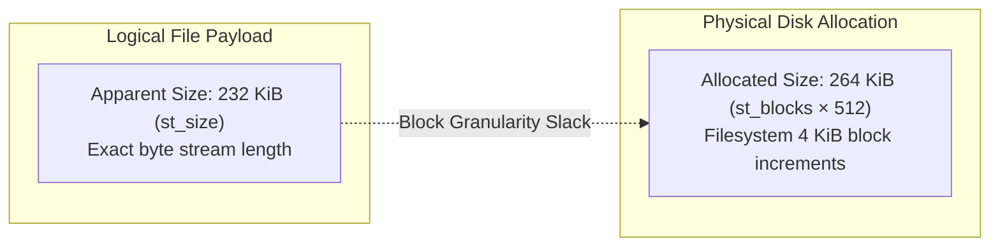

# Linux Disk Capacity, Free Space & Inode Monitoring

**Project:** Linux System Monitoring & Reliability Lab  
**Phase:** 1.2.3 — Disk Capacity, Free Space & Inode Monitoring  
**Author:** Senior Site Reliability Engineer, Linux Systems Engineer & Storage Reliability Engineer  
**Target Host:** Ubuntu 24.04.5 LTS (`rubi`, Linux 7.0.0-38-generic)  

---

## 1. Storage Capacity Architecture & Measurement Fundamentals

### 1.1 The Multiple Layers of Storage Capacity
In Linux system administration and Site Reliability Engineering, "disk space" is not a single scalar metric. Capacity exists across distinct abstraction layers, and an SRE must know precisely which layer is being reported:



#### Partition Capacity vs. Formatted Filesystem Capacity:
On the host, the partition `/dev/nvme0n1p2` provides $510,980,521,984\text{ bytes}$ ($510.98\text{ GB} / 475.89\text{ GiB}$). However, `df` reports total formatted filesystem capacity as $501,809,635,328\text{ bytes}$ ($501.81\text{ GB} / 467.35\text{ GiB}$).

This delta ($9,170,886,656\text{ bytes} \approx 9.17\text{ GB} / 8.54\text{ GiB}$) represents the difference between the partition boundary capacity and formatted filesystem data capacity. While ext4 formatting structures and filesystem metadata contribute directly to this difference, it represents the overall capacity difference between the raw partition container and usable formatted filesystem data blocks, rather than an individually measured metadata total. Key structures contributing to this difference include:
- Primary and backup superblocks.
- Block group descriptor tables (GDT) and reserved GDT blocks for online volume expansion.
- Pre-allocated inode tables ($31,195,136$ inodes distributed across all block groups).
- Block allocation bitmaps and inode allocation bitmaps.
- The ext4 internal journal inode (typically 1 GiB for large volumes).

---

### 1.2 Capacity Terminology, Arithmetic & Dynamic Kernel Reservations

When querying filesystem capacity with `df` or the `statfs(2)` / `statvfs(3)` system call, the kernel exposes several distinct fields:

| Field | Kernel Symbol (`struct statvfs`) | Definition & Operational Meaning |
|---|---|---|
| **Filesystem Size** | `f_blocks * f_frsize` | Total data blocks formatted and addressable in the filesystem. |
| **Free Space** | `f_bfree * f_frsize` | Total unallocated blocks remaining in the filesystem, including root-reserved blocks and internal safety buffers. |
| **Available Space** | `f_bavail * f_frsize` | Blocks available for allocation by **unprivileged users**. Once this reaches zero, unprivileged writes fail with `ENOSPC`. |
| **Used Space** | `(f_blocks - f_bfree) * f_frsize` | Blocks currently allocated to user files, directories, and filesystem structures. |
| **Reserved & Allocator Buffer** | `(f_bfree - f_bavail) * f_frsize` | Unallocated capacity unavailable to unprivileged processes; accounts for the root superblock reservation plus active kernel allocator buffers (`resv_blocks`). |

#### The Coreutils `df` Identity:
$$\text{Total Space} - \text{Used Space} - \text{Available Space} = (f\_bfree - f\_bavail) \times f\_frsize$$

In `coreutils` `df`, the fields are computed directly from `statvfs`:
$$\text{Total} = f\_blocks \times f\_frsize$$
$$\text{Used} = (f\_blocks - f\_bfree) \times f\_frsize$$
$$\text{Available} = f\_bavail \times f\_frsize$$

Substituting these definitions into the difference yields:
$$\text{Total} - \text{Used} - \text{Available} = f\_blocks - (f\_blocks - f\_bfree) - f\_bavail = f\_bfree - f\_bavail$$

This algebraic equivalence proves that `Total - Used - Available` is identically equal to $(f\_bfree - f\_bavail) \times f\_frsize$ at any given moment.

#### Why `Total - Used - Available` Reflects Dynamic Runtime Allocations:
A common misconception is that $f\_bfree - f\_bavail$ is a static, unchanging constant representing only the root superblock reservation configured by `tune2fs -m`. In reality, the Linux kernel computes $f\_bavail$ dynamically in `fs/ext4/super.c: ext4_statfs()`:

```c
overhead = ext4_r_blocks_count(es) + resv_blocks;
if (buf->f_bfree <= overhead)
    buf->f_bavail = 0;
else
    buf->f_bavail = buf->f_bfree - overhead;
```

This reveals that the gap between free and available blocks comprises two distinct components:
$$f\_bfree - f\_bavail = \text{ext4\_r\_blocks\_count}(es) + resv\_blocks$$

1. **`ext4_r_blocks_count(es)` (Static Root Reservation)**: The fixed block reservation configured in the on-disk superblock for privileged processes (`CAP_SYS_RESOURCE`). On this host, the baseline superblock reservation is $5,194,843\text{ blocks}$ ($21,278,076,928\text{ bytes} \approx 21.28\text{ GB} / 19.82\text{ GiB}$, or $4.24\%$).
2. **`resv_blocks` (Dynamic In-Kernel Reservation Pool)**: The kernel's runtime cluster reservation pool (`s_resv_clusters`), designed to prevent `ENOSPC` during delayed allocation (`delalloc`) writebacks and extent tree splits.
3. **Dirty Cluster Accounting**: Additionally, `f_bfree` itself dynamically subtracts pending dirty clusters awaiting writeback (`s_dirtyclusters_counter`).

#### Reconciling the Empirical Host Discrepancy:
- **Phase 1.2.2 Point-in-Time Snapshot**:
  - `Free`: $88,713,028\text{ blocks}$, `Available`: $83,518,185\text{ blocks}$
  - $f\_bfree - f\_bavail = 5,194,843\text{ blocks} = 21,278,076,928\text{ bytes}$ ($\approx 21.28\text{ GB} / 19.82\text{ GiB}$)
  - At this measurement point, runtime allocation buffers were at baseline, matching the static root reservation.
- **Phase 1.2.3 Point-in-Time Snapshot**:
  - `Free`: $89,731,143\text{ blocks}$, `Available`: $83,489,492\text{ blocks}$
  - $f\_bfree - f\_bavail = 6,241,651\text{ blocks} = 25,565,802,496\text{ bytes}$ ($\approx 25.57\text{ GB} / 23.81\text{ GiB}$)
  - Running `df -B1 /` simultaneously showed:
    $$\text{Total } (501,809,635,328) - \text{Used } (134,273,101,824) - \text{Available } (341,970,731,008) = 25,565,802,496\text{ bytes}$$
- **Root Cause Reconciliation**: The $25,565,802,496\text{ bytes}$ difference matches $6,241,651\text{ blocks} \times 4096\text{ bytes}$ exactly. It is not an error in calculation, but the direct consequence of the kernel's dynamic `resv_blocks` allocation buffer expanding under active filesystem operations. `Total - Used - Available` reflects dynamic runtime allocation reservations rather than an invariant static constant.

---

### 1.3 Measurement Units: GB (Decimal) vs. GiB (Binary)

Storage engineers must strictly distinguish decimal and binary units to avoid false reporting:

| Standard | Unit Symbol | Base | Calculation | Common Context |
|---|---|---|---|---|
| **Decimal (SI)** | **GB** (Gigabyte) | $10^9$ ($1,000^3$) | $1,000,000,000\text{ bytes}$ | Storage drive marketing, networking bandwidth, `df -H`. |
| **Binary (IEC)** | **GiB** (Gibibyte) | $2^{30}$ ($1,024^3$) | $1,073,741,824\text{ bytes}$ | Linux kernel memory, operating system tools, `df -h`. |

#### Host Case Study:
On the audited Ubuntu host, running `df` with different flags illustrates this divergence:
- `df -h /` (Binary, base-2): `Size: 468G`, `Used: 126G`, `Avail: 319G`.
- `df -H /` (Decimal, base-10): `Size: 502G`, `Used: 135G`, `Avail: 342G`.
- `df -B1 /` (Exact byte counts):
  - Total: `501809635328 bytes`
  - Used: `134273101824 bytes`
  - Available: `341970731008 bytes`

$$\frac{501,809,635,328}{10^9} \approx 501.81\text{ GB} \quad \text{vs.} \quad \frac{501,809,635,328}{2^{30}} \approx 467.35\text{ GiB}$$

**Golden SRE Practice**: When authoring automated monitoring scripts or Prometheus alert rules, **always collect raw bytes** (`node_filesystem_avail_bytes`, `node_filesystem_size_bytes`). Let the visualization layer (Grafana) format bytes into human-readable units.

---

### 1.4 Mount Classification in Capacity Monitoring
Not all mounted filesystems should be evaluated with the same disk-capacity alert logic:

1. **Persistent Block Filesystems (`ext4`, `xfs`)**: Primary targets for storage capacity alerting. Runaway writes cause application outages.
2. **Read-Only Loop Mounts (`squashfs` on `/snap/*`)**: Immutable application packages that are intentionally **100% full by design**. Must be excluded from general capacity alerting.
3. **Memory-Backed Filesystems (`tmpfs`)**: Ephemeral RAM allocations. High usage reflects memory consumption or uncleaned temporary files, requiring memory-specific thresholds.
4. **Kernel Pseudo-Filesystems (`proc`, `sysfs`, `devtmpfs`, `cgroup2`)**: Virtual interfaces exposing kernel objects. Capacity reporting is non-applicable or reflects RAM state.

---

## 2. Directory Usage Investigation with `du`

### 2.1 How `du` Works
The `du` (Disk Usage) utility estimates file space usage by recursively traversing directory trees, calling `lstat(2)` or `fstatat(2)` on every entry, and aggregating block allocations.

### 2.2 Allocated Disk Space vs. Apparent File Size
There is a fundamental difference between how much data a file logically contains and how much physical storage it occupies:



- **Apparent Size (`st_size`)**: The logical length of the file in bytes, queried via `du --apparent-size`. A 100-byte file has an apparent size of 100 bytes.
- **Allocated Size (`st_blocks * 512`)**: The actual physical disk space allocated by the filesystem in units of 512-byte sectors or 4096-byte blocks, queried via `du`. A 100-byte file on an ext4 filesystem with 4 KiB blocks consumes one full 4096-byte block (internal fragmentation).

#### Host Empirical Observation:
Testing a bounded system directory on the host (`/usr/share/common-licenses`):
```bash
du -sh /usr/share/common-licenses
# Output: 264K /usr/share/common-licenses

du --apparent-size -sh /usr/share/common-licenses
# Output: 232K /usr/share/common-licenses
```
The allocated disk space ($264\text{ KiB}$) exceeds the apparent logical payload ($232\text{ KiB}$) by an observed difference of $32\text{ KiB}$. While filesystem block allocation granularity (the standard 4 KiB ext4 allocation block size inducing internal tail fragmentation across multiple small license files) is a primary contributor to this observed gap, directory structure allocations and metadata also influence overall disk layout. SREs should treat this as an observed difference to which block allocation granularity contributes, rather than an isolated single-cause proof.

#### Sparse Files (The Inverted Case):
In sparse files (e.g., virtual machine disks or database pre-allocated files), applications write data at high offsets without writing the intervening bytes.
- Apparent size might be $100\text{ GiB}$.
- Allocated size might be only $2\text{ MiB}$ because ext4 allocates extent blocks only for sectors containing actual written data.

---

### 2.3 Why `du` and `df` Report Different Totals
During an outage, SREs frequently observe that `df` reports 95% disk usage, but running `du -sh /*` accounts for only 60%. The six classic causes are:

| Cause | Mechanism | SRE Detection Command |
|---|---|---|
| **1. Deleted-but-Open Files** | A process holds an open file descriptor to an unlinked file. `du` cannot see it in the directory tree, but `df` accounts for its allocated blocks. | `lsof +L1` or `ls -l /proc/*/fd/* \| grep deleted` |
| **2. Directory Masking** | Files were written into a mountpoint directory prior to mounting. The mount masks them from `du`, but they consume blocks on root. | Bind-mount root: `mount --bind / /mnt/recovery` |
| **3. Permission Restrictions** | An unprivileged `du` cannot traverse directories with mode `700` owned by root (e.g. `/var/log/private`, `/root`). | Check `du` stderr for `Permission denied` |
| **4. Filesystem Metadata Overhead** | `df` accounts for blocks used by the ext4 journal, superblock backups, and inode tables. `du` only traverses user directory entries. | Compare `stat -f` total used blocks vs `du` |
| **5. Hard Links** | Multiple directory entries point to the same inode. `du` counts hard-linked blocks only once, preventing double counting. | Check inode link count via `stat -c %h <file>` |
| **6. Filesystem Boundaries** | Without `-x`, `du` traverses into `/proc`, `/sys`, or external mounts. With `-x`, it isolates the single filesystem. | Use `du -xhd1 /` |

---

### 2.4 Crossing Filesystem Boundaries (`-x` / `--one-file-system`)
When investigating disk usage on the root volume, **never run `du` without `-x`**:
```bash
# Correct bounded invocation:
sudo du -xhd1 / | sort -h
```
- The `-x` flag directs `du` not to cross mount boundaries. It skips `/boot/efi`, `/proc`, `/sys`, `/dev`, `/run`, and all 41 `/snap/*` SquashFS mounts, reporting strictly the space consumed on the root partition.

---

## 3. Inode Capacity & Inode Exhaustion

### 3.1 What is an Inode?
An **inode (index node)** is a fixed-size on-disk data structure (256 bytes in ext4) that stores all metadata about a filesystem object except its filename:
- File type (regular file, directory, symlink, socket, FIFO, block/char device).
- File size in bytes.
- Ownership (UID, GID).
- Access permissions (mode bits, ACLs).
- Timestamps (access time `atime`, modification time `mtime`, status change time `ctime`, creation/birth time `crtime`).
- Extent tree pointers linking to physical block addresses.
- Hard link reference count (`i_links_count`).

Every file, directory, and symbolic link requires exactly one inode.

---

### 3.2 Inode Exhaustion: The "Phantom Full Disk" Outage
In filesystems with static inode tables (like `ext4`), the total number of inodes is fixed when the filesystem is formatted:

$$\text{Total Inodes} = \frac{\text{Total Partition Blocks}}{\text{Bytes per Inode Ratio}}$$

On the audited host:
```bash
df -i /
```
```
Filesystem       Inodes   IUsed    IFree IUse% Mounted on
/dev/nvme0n1p2 31195136 1327507 29867629    5% /
```

#### Failure Scenario:
If an application creates tens of millions of zero-byte or tiny files (e.g., runaway PHP session files in `/var/lib/php/sessions`, an uncleaned mail spool, or micro-caching files):
- The filesystem consumes all $31,195,136$ inodes.
- **Result**: Any new file creation fails immediately with:
  ```text
  touch: cannot touch 'test.txt': No space left on device
  ```
  `errno: 28 (ENOSPC)`.
- **The Operational Trap**: Running `df -h` shows hundreds of gigabytes of free space (`Avail: 319G`). Junior engineers conclude disk space is fine, delaying root cause resolution.
- **SRE Rule**: Always inspect both `df -h` (block capacity) and `df -i` (inode capacity) during storage triage.

---

### 3.3 Inode Architecture Across Filesystem Types

| Filesystem Type | Inode Allocation Model | Behavior in `df -i` | Monitoring Consideration |
|---|---|---|---|
| **ext4** | Static fixed allocation at format time. | Reports exact total, used, and free inodes. | Critical to alert on `node_filesystem_files_free / node_filesystem_files`. |
| **XFS** | Dynamic allocation in 64-inode chunks up to `maxpct` limit (default 25% of disk). | Reports dynamic total and free count. | Inode capacity grows dynamically with disk size. |
| **Btrfs** | Fully dynamic; subvolumes share an unallocated metadata pool. | Reports dummy/infinite values or variable counts. | Inode exhaustion is bounded only by metadata space. |
| **FAT32 (vfat)** | No Unix inodes. Allocates 32-byte directory table records and cluster chains. | Reports `0` total, `0` used, `0` free. | Inode metrics are non-meaningful; alerts must exclude `vfat`. |

---

## 4. ext4 Reserved Blocks & Availability Mechanics

### 4.1 Purpose & Operational Realities of Reserved Blocks
ext4 reserves a portion of filesystem blocks exclusively for processes possessing `CAP_SYS_RESOURCE` (typically UID 0 / root):
1. **Preserving Allocation Headroom for Privileged Recovery**: When user-space workloads (such as databases, application caches, or container runtimes) consume all available space (`f_bavail == 0`, throwing `ENOSPC`), the kernel preserves an unallocated reserve exclusively for privileged processes. This preserves allocation opportunities for administrative recovery tasks—such as establishing SSH connections, running diagnostic tools, and allowing system logging daemons (`sshd`, `systemd-journald`) to capture incident telemetry.
2. **Combating Allocator Fragmentation Collapse**: When an ext4 volume approaches 100% capacity, the multiblock allocator (`mballoc`) struggles to locate contiguous extents, causing severe allocation search latencies and severe file fragmentation. The reserved margin acts as an allocation cushion to prevent total allocator degradation.

#### SRE Reality Check — What Reserved Blocks Do NOT Guarantee:
- **No Absolute Immunity Against Host Lockout**: Reserved capacity preserves allocation opportunities for privileged tasks, but it is **not an absolute availability guarantee**. Runaway processes executing as root (e.g., recursive root shell scripts, unchecked root cron jobs, or unrotated systemd journal logs) can allocate directly from the reserved pool until `f_bfree == 0`, causing root writes to also fail with `ENOSPC`.
- **No Protection Against Underlying Storage Failures**: Reserved capacity provides no protection against hardware controller timeouts, NVMe bus resets, I/O errors, or kernel read-only remounts triggered by filesystem corruption.

---

### 4.2 Verified Host Telemetry & Arithmetic Reconciliation

On the audited Ubuntu host, the relationship between static superblock reservation and dynamic kernel allocation buffers was empirically reconciled:

#### 1. Baseline On-Disk Superblock Reservation:
- **Total Filesystem Capacity**: $122,512,118\text{ blocks}$ ($501,809,635,328\text{ bytes} \approx 501.81\text{ GB} / 467.35\text{ GiB}$)
- **Baseline Root Reservation (`ext4_r_blocks_count`)**: $5,194,843\text{ blocks}$
- **Exact Unit Conversion**:
  $$5,194,843 \times 4,096\text{ bytes} = 21,278,076,928\text{ bytes}$$
  $$\text{Decimal GB } (10^9) = \frac{21,278,076,928}{1,000,000,000} \approx \mathbf{21.28\text{ GB}}$$
  $$\text{Binary GiB } (2^{30}) = \frac{21,278,076,928}{1,073,741,824} \approx \mathbf{19.82\text{ GiB}}$$
  $$\text{Superblock Reserve Percentage} = \frac{5,194,843}{122,512,118} \times 100 \approx \mathbf{4.24\%}$$

#### 2. Live Dynamic Allocation Telemetry (`stat -f /` and `df -B1 /`):
- **Observed Free Blocks (`f_bfree`)**: $89,731,143\text{ blocks}$ ($367,538,761,984\text{ bytes}$)
- **Observed Available Blocks (`f_bavail`)**: $83,489,492\text{ blocks}$ ($341,970,731,008\text{ bytes}$)
- **Observed Difference (`f_bfree - f_bavail`)**:
  $$89,731,143 - 83,489,492 = 6,241,651\text{ blocks} = 25,565,802,496\text{ bytes} \approx 25.57\text{ GB} / 23.81\text{ GiB}$$
- **Reconciliation with `df -B1`**:
  $$\text{Total } (501,809,635,328) - \text{Used } (134,273,101,824) - \text{Available } (341,970,731,008) = 25,565,802,496\text{ bytes}$$

The difference between the active gap ($6,241,651\text{ blocks}$) and the static superblock reservation ($5,194,843\text{ blocks}$) is $1,046,808\text{ blocks}$ ($\approx 4.29\text{ GB}$). As established in Section 1.2, this dynamic buffer represents active kernel allocator safety reserves (`resv_blocks`) and dirty clusters awaiting writeback, proving that `Total - Used - Available` reflects dynamic runtime allocation state rather than an invariant constant.

*Architectural Principle*: Reserved capacity is **not** an independent partition, virtual volume, or separate storage pool. It is an internal accounting threshold enforced dynamically by the kernel's block allocator.

---

### 4.3 `reserved_clusters` sysfs Tunable vs. Root Superblock Reservation

The Linux kernel exposes filesystem tunables under `/sys/fs/ext4/<device>/`. A common point of confusion is the relationship between `/sys/fs/ext4/<device>/reserved_clusters` and the root reserved space:

#### Host Empirical Value:
```bash
cat /sys/fs/ext4/nvme0n1p2/reserved_clusters
# Output: 4096
```

#### Architectural Purpose & Sizing:
1. **Internal Kernel Delayed-Allocation Tuning Buffer**:
   - `/sys/fs/ext4/<dev>/reserved_clusters` is an internal kernel parameter controlling the reservation pool (`s_resv_clusters`) for ext4 delayed allocation (`delalloc`).
   - In modern ext4, writes are buffered in pagecache without immediate physical block allocation. When dirty pages are later flushed to disk during writeback, ext4 must allocate physical extents and indirect/extent tree index blocks. If the filesystem runs completely out of blocks before writeback completes, writes fail with `ENOSPC`, risking data loss or read-only filesystem remounts.
   - To prevent this, the kernel maintains an in-memory safety reserve calculated by default as $\min(2\% \text{ of fs}, 4096\text{ clusters})$.
2. **Cluster-to-Block Sizing**:
   - On standard ext4 filesystems without the `bigalloc` feature (as verified on this Ubuntu 24.04 host where fundamental block size is 4096 bytes), **one cluster equals exactly one filesystem block**:
     $$1\text{ cluster} = 1\text{ block} = 4,096\text{ bytes}$$
   - Consequently, the $4,096\text{ clusters}$ parameter represents:
     $$4,096\text{ clusters} \times 4,096\text{ bytes/cluster} = 16,777,216\text{ bytes} = \mathbf{16\text{ MiB}}$$
3. **Strict Terminology Distinction (Blocks vs. Clusters)**:
   - SREs must **not use "blocks" and "clusters" interchangeably**.
   - Modern ext4 internally accounts for allocations in units of clusters. On conventional filesystems, cluster size and block size are identical ($4\text{ KiB}$). However, when `bigalloc` is enabled, a single cluster can aggregate 16 or more blocks (e.g., 64 KiB clusters).
4. **Separation from Root Superblock Reservation**:
   - The $16\text{ MiB}$ delayed-allocation tuning buffer (`reserved_clusters: 4096`) must never be conflated with the root superblock reservation ($21.28\text{ GB}$ / $5,194,843\text{ blocks}$).
   - The root reservation is stored on-disk in the superblock (`s_r_blocks_count`), configured via `tune2fs -m`, and privileges UID 0 / `CAP_SYS_RESOURCE`.
   - The sysfs `reserved_clusters` tunable is an in-memory allocator safeguard managed by the kernel VFS writeback subsystem.

---

## 5. Deleted-but-Open Files

### 5.1 POSIX File Unlink Mechanics
In Unix-like operating systems, deleting a file via the `rm` command invokes the `unlink(2)` system call.

```mermaid
sequenceDiagram
    participant User as SRE / User
    participant VFS as Linux VFS
    participant Inode as Inode & Block Allocator
    participant Proc as Running Process (e.g., Daemon)

    Proc->>VFS: open("/var/log/app.log") -> fd 3
    VFS-->>Proc: Open file handle (inode refcount = 1)
    User->>VFS: rm /var/log/app.log (unlink syscall)
    VFS->>VFS: Remove dentry from directory tree
    Note over VFS: Inode link count (st_nlink) drops to 0
    Note over VFS,Inode: Inode refcount > 0 (proc holds fd 3)
    Note over Inode: Storage blocks remain ALLOCATED!
    Note over User: du cannot see file; df still counts blocks!
    Proc->>VFS: close(fd 3) or Process Terminates
    Note over VFS,Inode: Inode refcount drops to 0
    VFS->>Inode: Evict inode & free data blocks to bitmap
    Note over Inode: Storage blocks FINALLY released!
```

#### Why This Occurs:
1. `unlink()` removes the directory entry (dentry), decrementing the inode's hard link counter (`st_nlink`) to 0.
2. Because the filename is gone, directory traversal tools like `du` or `find` cannot find the file.
3. However, if a running daemon (e.g. `nginx`, `mysqld`, a log parser) still holds an open file descriptor (`struct file`) to that inode, the kernel maintains the inode in memory and preserves its allocated physical data blocks in the block bitmap.
4. The blocks remain occupied and continue to consume disk space until the holding process closes the file descriptor or exits.

---

### 5.2 SRE Investigation with `lsof`
To identify processes holding deleted files open:

```bash
lsof +L1
```
- `+L`: Directs `lsof` to inspect file link counts.
- `1`: Filters for regular files whose link count is strictly less than 1 (`st_nlink == 0`).

#### Host Empirical Observation (Unprivileged Query):
```bash
lsof +L1 2>/dev/null | head -n 10
```
```text
COMMAND       PID   USER   FD   TYPE DEVICE   SIZE/OFF NLINK     NODE NAME
pipewire  1210704 dineth   36u   REG    0,1       2312     0   192258 /memfd:pipewire-memfd (deleted)
gnome-she 1210953 dineth  136r   REG  259,2         64     0 22644219 /home/[USER]/.local/share/gvfs-metadata/root (deleted)
gnome-she 1210953 dineth  137r   REG  259,2      32768     0 22644248 /home/[USER]/.local/share/gvfs-metadata/root-log (deleted)
```

#### SRE Security & Privilege Boundary:
- Running `lsof +L1` as an unprivileged user inspects only processes owned by the current UID.
- To detect deleted-but-open files held by system daemons (e.g., `rsyslog`, `dockerd`, `postgres`), `sudo` or `CAP_SYS_PTRACE` is required:
  ```bash
  sudo lsof +L1
  ```
- If root access is unavailable or constrained by security policies, SREs can inspect accessible process descriptors directly via `/proc/<PID>/fd/` by looking for broken symlinks marked `(deleted)`.

---

## 6. SRE Filesystem Capacity Troubleshooting Runbooks

### Scenario A: Filesystem Usage High, Responsible Directory Unclear
- **Symptom**: `df -h /` reports 92% usage, but the responsible service or directory is unknown.
- **Diagnostic Procedure**:
  1. Identify top-level consumption without crossing filesystem boundaries:
     ```bash
     sudo du -xhd1 / | sort -h
     ```
  2. Drill down into the largest directory (e.g., if `/var` is largest):
     ```bash
     sudo du -xhd1 /var | sort -h
     ```
  3. Continue descending into subdirectories (e.g., `/var/log`, `/var/lib/docker`) until the specific file path or runaway dataset is isolated.
- **Unsafe Actions**: Never run recursive deletion `rm -rf` on unfamiliar directories without identifying the owning package or service (`dpkg -S <path>`).

---

### Scenario B: `df` Reports High Usage, but `du` Reports Substantially Less
- **Symptom**: `df -h /` reports 120 GiB used, but `du -xsh /` accounts for only 40 GiB.
- **Diagnostic Procedure**:
  1. **Check for Deleted-but-Open Files**:
     ```bash
     sudo lsof +L1
     ```
     Identify holding PIDs and file sizes. If a 70 GiB deleted log is held by `nginx`, signal the process to reopen logs:
     ```bash
     sudo systemctl reload nginx
     # Or if reload is unsupported and daemon cannot be restarted:
     sudo truncate -s 0 /proc/<PID>/fd/<FD>
     ```
  2. **Check for Masked Mountpoints**:
     If `lsof` reveals nothing, files were likely written to a mountpoint directory prior to mounting. Inspect the raw root disk using a bind mount:
     ```bash
     sudo mkdir -p /mnt/recovery
     sudo mount --bind / /mnt/recovery
     sudo du -xhd1 /mnt/recovery/mnt
     sudo umount /mnt/recovery
     ```
- **Unsafe Actions**: Do not restart arbitrary system services simultaneously; restart or reload only the verified holding process.

---

### Scenario C: Filesystem Has Free Bytes but Cannot Create Files (ENOSPC)
- **Symptom**: Creating a file fails with `No space left on device`, but `df -h` shows 200 GiB available.
- **Diagnostic Procedure**:
  1. Inspect inode capacity:
     ```bash
     df -i /
     ```
     Confirm if `IUse%` is 100%.
  2. Locate directories containing massive inode concentrations:
     ```bash
     sudo find / -xdev -type d -exec sh -c 'echo $(ls -1 "$1" | wc -l) "$1"' _ {} \; | sort -n | tail -n 20
     ```
  3. Common culprits: uncleaned PHP session files, mail queue spools (`/var/spool/postfix`), cache directories, or recursive error logs.
- **Unsafe Actions**: Avoid running `rm -rf *` inside a directory containing millions of files; shell glob expansion will fail with `Argument list too long`. Use `find . -name "*.tmp" -delete` instead.

---

### Scenario D: Filesystem Full, but Physical Disk Has Unallocated Space
- **Symptom**: `df -h /` shows 100 GiB total capacity, but `lsblk` shows the physical disk is 500 GiB.
- **Diagnostic Procedure**:
  1. Compare physical disk, partition, and filesystem sizes:
     ```bash
     lsblk
     ```
  2. If partition table has unallocated space, expand the partition:
     ```bash
     sudo growpart /dev/nvme0n1 2
     ```
  3. Expand the ext4 filesystem online to consume the new partition space:
     ```bash
     sudo resize2fs /dev/nvme0n1p2
     ```
  4. Verify with `df -h /`.
- **Unsafe Actions**: Never modify partition tables without verifying backup status and confirming partition geometry.

---

### Scenario E: Process Continues Consuming Storage After File Deletion
- **Symptom**: An engineer ran `rm /var/log/heavy.log`, but free space did not increase, and available space continues dropping.
- **Diagnostic Procedure**:
  1. Locate the process holding the unlinked file descriptor:
     ```bash
     sudo lsof +L1 | grep heavy.log
     ```
  2. Notice the file descriptor number (e.g. `FD 4`) and PID (e.g. `PID 1420`).
  3. If the process cannot be restarted immediately due to SLA constraints, truncate the file descriptor directly via `procfs`:
     ```bash
     sudo truncate -s 0 /proc/1420/fd/4
     ```
     This instantly frees the underlying data blocks in ext4 while preserving the open file descriptor for the running application.
- **Unsafe Actions**: Never kill critical daemons with `kill -9` without attempting graceful reload or standard shutdown.

---

## 7. SRE Observability & Monitoring Implications

### 7.1 Essential Capacity Metric Families
In modern Prometheus-based monitoring architectures, host storage telemetry is exposed via `node_exporter`:

| Metric Name | Type | Description |
|---|---|---|
| `node_filesystem_size_bytes` | Gauge | Total capacity of the filesystem in bytes. |
| `node_filesystem_free_bytes` | Gauge | Total unallocated bytes (including root reserve). |
| `node_filesystem_avail_bytes` | Gauge | Bytes available for allocation by **unprivileged users**. |
| `node_filesystem_files` | Gauge | Total inode capacity of the filesystem. |
| `node_filesystem_files_free` | Gauge | Available inodes for file creation. |
| `node_filesystem_readonly` | Gauge | Boolean indicator ($1 = \text{read-only}, 0 = \text{read-write}$). |

---

### 7.2 Why Percentage-Based Thresholds Alone Are Insufficient
A classic monitoring flaw is establishing uniform percentage alerts across all volumes:
```yaml
# Flawed naive alert rule:
expr: (node_filesystem_avail_bytes / node_filesystem_size_bytes) < 0.10
```

#### Why This Fails in Production:
- **Large Volumes (Scale Problem)**: On a 20 TiB storage volume, 10% remaining is **2 TiB**. Firing a critical page to an on-call engineer when 2,000 gigabytes remain creates unnecessary alert fatigue.
- **Small Volumes (Latency Problem)**: On a 10 GiB volume, 10% remaining is **1 GiB**. A runaway service writing at 100 MB/s will exhaust this space in under 10 seconds, causing an outage long before a 5-minute alert threshold triggers.

#### Modern SRE Recommended Approach:
Combine remaining capacity percentage with **linear capacity exhaustion forecasting**:
$$\text{Time to Exhaustion} \approx \frac{\text{node\_filesystem\_avail\_bytes}}{\text{rate(node\_filesystem\_avail\_bytes[1h])}}$$

Using PromQL's `predict_linear()`:
```promql
# Alert if filesystem is forecasted to exhaust available capacity within 4 hours based on linear regression over 1 hour
predict_linear(node_filesystem_avail_bytes{fstype=~"ext4|xfs"}[1h], 4 * 3600) < 0
  and
(node_filesystem_avail_bytes{fstype=~"ext4|xfs"} / node_filesystem_size_bytes{fstype=~"ext4|xfs"}) < 0.20
```

#### SRE Terminology Precision — Forecasting vs. Burn Rate:
- **`predict_linear()` is Linear Capacity Forecasting**: PromQL's `predict_linear(v[t], s)` applies simple linear regression (least squares fit) across range vector `v[t]` to extrapolate the value forward by `s` seconds. In storage reliability, this provides **time-to-exhaustion forecasting** based on recent consumption trends.
- **"Burn Rate" is Strictly an SLO / Error Budget Concept**: In Google Site Reliability Engineering principles, *burn rate* is exclusively defined as the consumption speed of an SLO error budget (e.g. $1\times\text{ burn rate}$ exhausts 100% of an error budget across the full SLO window, while $14.4\times\text{ burn rate}$ consumes 2% of the budget in 1 hour). SREs should avoid using "burn rate" as a colloquial synonym for storage fill rates, reserving the term specifically for SLI/SLO error budget monitoring.

This ensures high-signal alerting: alerts fire only when disk space is genuinely depleting rapidly towards zero based on verified linear regression trends.
