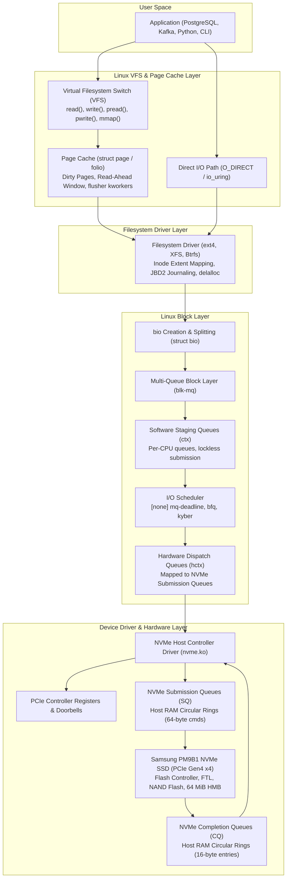

# Linux Disk I/O Performance: Architecture, Telemetry & NVMe Multi-Queue Mechanics

**Project:** Linux System Monitoring & Reliability Lab  
**Phase:** 1.2.4 — Linux Disk I/O, Throughput, IOPS & Latency  
**Author:** Senior Linux Storage Engineer & Site Reliability Engineer  
**Target Host:** Ubuntu 24.04.5 LTS (`rubi`, Linux 7.0.0-38-generic, Samsung MZVL4512HBLU-00BTW NVMe SSD)  

---

## 1. Executive Summary & Architectural Overview

In modern Linux systems engineering, storage I/O performance analysis requires navigating multiple layers of abstraction—from user-space system calls and the Virtual Filesystem (VFS), through the kernel Page Cache and Multi-Queue Block Layer (`blk-mq`), down to PCIe NVMe controller command queues and solid-state flash memory.

A primary failure mode in systems monitoring is applying legacy rotational-disk mental models (e.g., treating high `%util` in `iostat` as an indicator of drive saturation) to modern solid-state NVMe drives. Because NVMe devices handle thousands of requests concurrently across parallel hardware queues without mechanical head movement, traditional metrics must be paired with Multi-Queue queue depth analysis, request latency decomposition, and Linux kernel Pressure Stall Information (PSI).



---

## 2. Linux Block I/O Subsystem Architecture

### 2.1 The Application I/O Layer
Application programs interact with persistent storage via POSIX system calls or high-performance asynchronous kernel interfaces:

1. **Standard Buffered I/O (`read(2)`, `write(2)`)**:
   - `write()` copies data from user-space buffers into the kernel Page Cache. It returns immediately to the caller once the memory copy completes, without waiting for physical storage writes (asynchronous write buffering).
   - `read()` checks if requested file offsets are resident in the Page Cache. A "cache hit" satisfies the read purely from DRAM without issuing block I/O. A "cache miss" triggers synchronous or read-ahead block requests to disk.
2. **Synchronous Durability Calls (`fsync(2)`, `fdatasync(2)`, `sync(2)`)**:
   - `fsync(fd)` blocks the calling process until all dirty pages and metadata belonging to the file descriptor are transferred to underlying storage and committed to non-volatile media.
   - `fdatasync(fd)` flushes dirty data pages, skipping non-essential metadata changes (such as file access times) unless required for subsequent data retrieval (e.g., file size changes).
3. **Direct I/O (`O_DIRECT`)**:
   - Opened with the `O_DIRECT` flag, system calls bypass the Page Cache entirely. Data transfers occur directly between user-space memory buffers and the block device driver via Direct Memory Access (DMA).
   - Alignment constraint: Memory buffers, file offsets, and I/O lengths must typically align to the logical block size of the underlying storage (512 or 4096 bytes).
4. **Memory-Mapped I/O (`mmap(2)`)**:
   - Maps file contents directly into the process virtual address space. File accesses trigger page faults (`major` page faults when data must be loaded from disk into memory, `minor` page faults when mapping existing page cache pages).
5. **Modern Asynchronous Interfaces (`io_uring`, `linux-aio`)**:
   - `io_uring` provides lockless submission and completion ring buffers shared between user space and the kernel. It avoids system call overhead, supports submission polling (`IORING_SETUP_SQPOLL`), and delivers millions of IOPS on NVMe arrays.

---

### 2.2 The Filesystem Layer & Journaling
The filesystem layer translates logical byte offsets into physical block addresses (LBAs) on storage media:
- **Extent Mapping**: Modern filesystems (ext4, XFS) organize continuous block allocations into extents (`(block, length, lba)`), minimizing metadata fragmentation.
- **Delayed Allocation (`delalloc`)**: The filesystem defers allocating physical disk blocks until the Page Cache flushes dirty pages. This allows the allocator to aggregate multiple sequential writes into single, contiguous extents, reducing fragmentation.
- **Filesystem Journaling (JBD2)**:
  - ext4 uses the Journaling Block Device (`jbd2`) subsystem to guarantee metadata consistency across unexpected crashes.
  - In default `data=ordered` mode, data blocks are forced to storage before associated transaction metadata is committed to the on-disk journal. Journal commits generate periodic write spikes accompanied by cache flushes (`fua` / `flush` commands).

---

### 2.3 The Linux Page Cache & Writeback Mechanics
The Page Cache buffers file data in physical RAM as 4 KiB pages (or variable-sized compound `folios`).

#### Read-Ahead Heuristics:
When the kernel detects sequential read patterns, it issues asynchronous read-ahead requests to pre-populate the Page Cache ahead of application demand.
- Tunable via sysfs: `/sys/block/<dev>/queue/read_ahead_kb` (on the target host: `128 KiB`).
- Read-ahead window starts small and doubles dynamically up to `read_ahead_kb` upon continuous sequential hits. Random I/O cancels read-ahead to conserve bandwidth.

#### Dirty Page Lifecycle & Flushing Tunables:
When an application modifies buffered data, the corresponding page is marked "dirty" in its `struct address_space` radix tree. Dirty pages are flushed to block storage by kernel flusher threads (`wb_workfn` / `kworker` threads):

```mermaid
stateDiagram-v2
    [*] --> Clean: File page read from disk into Page Cache
    Clean --> Dirty: App writes data via write()
    Dirty --> Flushing: Flusher thread (wb_workfn) picks up page
    Dirty --> Throttled: Memory hits vm.dirty_ratio (20%)
    Throttled --> Flushing: App blocked; forced synchronous writeout
    Flushing --> Clean: Block I/O completed & acknowledged
```



Host tunables verified on `rubi`:
- `vm.dirty_background_ratio = 10`: When dirty pages reach 10% of available memory, kernel background threads (`wb_workfn`) wake up and start asynchronous writeback.
- `vm.dirty_ratio = 20`: If dirty pages reach 20% of available memory, writing application threads are blocked in uninterruptible sleep and forced into synchronous writeout until dirty memory drops below the threshold.
- `vm.dirty_expire_centisecs = 3000`: Dirty pages older than 30 seconds (3,000 centiseconds) are considered expired and flagged for mandatory writeback.
- `vm.dirty_writeback_centisecs = 500`: Flusher threads wake up every 5 seconds (500 centiseconds) to check for expired dirty pages.

---

### 2.4 The Multi-Queue Block Layer (`blk-mq`)
In early Linux kernels, the block layer maintained a single global request queue protected by a single lock (`request_queue->queue_lock`). This single-queue model became a severe bottleneck when high-speed PCIe SSDs exceeded 100,000 IOPS, causing extreme CPU lock contention across multi-core systems.

In Linux 3.13, the kernel introduced **`blk-mq` (Multi-Queue Block Layer)**, which became mandatory in Linux 5.0 (completely replacing the legacy single-queue subsystem).

```
┌────────────────────────────────────────────────────────────────────────┐
│                        blk-mq Architecture                             │
├────────────────────────────────────────────────────────────────────────┤
│ Software Staging Queues (per-CPU ctx):                                │
│   [CPU 0]      [CPU 1]      [CPU 2]      ...      [CPU 11]            │
│      │            │            │                     │                 │
│      └────────────┼────────────┼─────────────────────┘                 │
│                   ▼            ▼                                       │
│          Optional I/O Scheduler (e.g. none / mq-deadline)             │
│                   │            │                                       │
│                   ▼            ▼                                       │
│ Hardware Dispatch Queues (hctx):                                       │
│   [HW Queue 0] [HW Queue 1] [HW Queue 2] ... [HW Queue 11]             │
│        │            │            │                 │                   │
│        ▼            ▼            ▼                 ▼                   │
│   NVMe SQ 0    NVMe SQ 1    NVMe SQ 2        NVMe SQ 11                │
└────────────────────────────────────────────────────────────────────────┘
```

1. **Software Staging Queues (`ctx`)**:
   - Allocated per CPU core (12 software queues on the audited host).
   - When a thread submits a `bio`, it enters the staging queue corresponding to the local CPU core. This operation is lockless and eliminates cross-core cache invalidation.
2. **Hardware Dispatch Queues (`hctx`)**:
   - Represent hardware submission channels provided by the device driver.
   - For NVMe devices, the kernel creates one hardware context per CPU core, directly mapping Software Staging Queues to Hardware Submission Queues.
3. **Request Merging & Splitting**:
   - **Front Merge / Back Merge**: Adjacent contiguous block requests are merged into a single `struct request` to minimize command counts.
   - **Splitting**: If a request exceeds `/sys/block/<dev>/queue/max_sectors_kb` (on this host: `128 KiB`), it is split into multiple sub-requests before submission.

---

### 2.5 I/O Schedulers in `blk-mq`
In modern Linux kernels, the I/O scheduler operates between the software staging queues and the hardware dispatch queues.

| Scheduler | Architecture & Strategy | Best Workload Fit | Host Default |
|---|---|---|---|
| **`none`** | Direct pass-through; bypasses scheduler queues; requests flow straight into hardware queues. Minimal CPU overhead. | NVMe SSDs, high-performance SAN arrays | **Active** (`[none]`) |
| **`mq-deadline`** | Splits requests into sorted read/write queues with strict timeout deadlines (500ms read, 5000ms write) to prevent starvation. | SATA SSDs, slow flash, mixed read/write workloads | Available |
| **`bfq`** | Budget Fair Queueing; allocates disk bandwidth slices per cgroup/process; complex heuristics for interactive desktop latency. | Single SATA HDDs, desktop interactive responsiveness | Not loaded |
| **`kyber`** | Lightweight latency-target scheduler; self-tunes dispatch queue depths based on read/write latency targets. | Fast NVMe storage under severe multi-tenant contention | Not loaded |

#### Why NVMe Uses `none` by Default:
On modern NVMe SSDs, hardware internal controllers already feature sophisticated multi-core command processors, out-of-order execution, and wear-leveling engines. Adding a software scheduler in kernel space introduces CPU cache invalidation, increases lock contention, and adds instruction latency without improving throughput. Thus, `none` is optimal for NVMe.

---

### 2.6 The Device Driver & PCIe NVMe Subsystem
The Linux NVMe driver (`drivers/nvme/host/`) communicates with the physical SSD over the PCIe bus using the NVMe standard interface:

1. **Submission Queues (SQ) & Completion Queues (CQ)**:
   - SQs and CQs are circular ring buffers allocated in host physical DRAM.
   - Submission Queue Entries (SQE) are fixed at 64 bytes (containing opcode, namespace ID, memory pointers, start LBA, sector count).
   - Completion Queue Entries (CQE) are fixed at 16 bytes (containing status code, command ID, SQ head pointer).
2. **Doorbell Registers**:
   - When the host driver writes SQEs into host RAM, it writes the new queue tail index into the controller's memory-mapped PCIe register (the **Submission Queue Tail Doorbell**).
   - This single 32-bit register write signals the NVMe controller to initiate DMA transfers.
3. **Interrupt Handling (MSI-X)**:
   - When the controller completes an I/O command, it writes a CQE to host RAM and fires an MSI-X interrupt directed to the CPU core that originated the command.
   - The host ISR (Interrupt Service Routine) reads the CQE and writes to the **Completion Queue Head Doorbell** to release the entry.
4. **Host Memory Buffer (HMB)**:
   - Many cost-effective NVMe drives (such as the audited `Samsung PM9B1`) are "DRAM-less," lacking on-board DRAM chips.
   - Through NVMe HMB, the Linux kernel allocates a dedicated buffer of host physical RAM (observed in host logs: `64 MiB`) to the NVMe controller via PCIe DMA. The controller uses this RAM to cache its Flash Translation Layer (FTL) lookup tables, achieving DRAM-grade random read latency.

---

## 3. Linux Storage Telemetry & Monitoring Sources

### 3.1 `/proc/diskstats`
The kernel exports block I/O counters in `/proc/diskstats`. In Linux 5.5+ and 7.0+, each line for a full disk device contains 20 space-separated fields (defined in `block/genhd.c: diskstats_show()`):

```text
259 0 nvme0n1 7647356 696714 767458348 16685468 3720322 4767699 288043866 10950524 0 1411942 27912924 145944 0 745775456 22977 525808 253954
```

#### Complete Field Breakdown:
| Field # | Kernel Identifier | Units | Description & Semantic |
|---|---|---|---|
| **1** | `major` | Integer | Device major number (`259` = NVMe block device). |
| **2** | `minor` | Integer | Device minor number (`0` = first namespace/disk). |
| **3** | `disk_name` | String | Block device name (`nvme0n1`). |
| **4** | `reads_completed` | Counter | Total successful read requests completed. |
| **5** | `reads_merged` | Counter | Number of adjacent read requests merged by the block layer. |
| **6** | `sectors_read` | Sectors (512B) | Total sectors read from device ($1\text{ sector} = 512\text{ bytes}$). |
| **7** | `read_time_ms` | Milliseconds | Total time spent reading (summed across all read requests). |
| **8** | `writes_completed`| Counter | Total successful write requests completed. |
| **9** | `writes_merged`| Counter | Number of adjacent write requests merged by the block layer. |
| **10** | `sectors_written` | Sectors (512B) | Total sectors written to device. |
| **11** | `write_time_ms` | Milliseconds | Total time spent writing (summed across all write requests). |
| **12** | `ios_in_progress` | Gauge | Instantaneous number of I/O requests currently in flight. |
| **13** | `io_ticks` | Milliseconds | Total time the device had at least one I/O request in progress. |
| **14** | `weighted_io_ticks`| Milliseconds | Cumulative time requests spent in queue or service ($\sum (\text{in\_flight} \times \Delta t)$). |
| **15** | `discards_completed`| Counter | Total discard/TRIM requests completed. |
| **16** | `discards_merged`| Counter | Number of adjacent discard requests merged. |
| **17** | `sectors_discarded`| Sectors (512B)| Total sectors discarded. |
| **18** | `discard_time_ms` | Milliseconds | Total time spent processing discards. |
| **19** | `flushes_completed`| Counter | Total flush/FUA cache sync requests completed. |
| **20** | `flush_time_ms` | Milliseconds | Total time spent waiting for cache flush requests to complete. |

> [!NOTE]
> Sectors in `/proc/diskstats` are **always 512 bytes**, even if the underlying device uses 4096-byte physical sectors (`hw_sector_size: 512` or `4096`).

---

### 3.2 `iostat` (`sysstat`)
`iostat` queries `/proc/diskstats` across a sampling interval $\Delta t$ and computes rates and averages.

#### Column Derivations & Mathematical Formulas:
Let $\Delta X = X_{t_2} - X_{t_1}$ represent the counter delta over sample duration $\Delta t$ seconds:

1. **Read IOPS (`r/s`)**:
   $$r/s = \frac{\Delta \text{reads\_completed}}{\Delta t}$$
2. **Write IOPS (`w/s`)**:
   $$w/s = \frac{\Delta \text{writes\_completed}}{\Delta t}$$
3. **Read Throughput (`rkB/s`)**:
   $$rkB/s = \frac{\Delta \text{sectors\_read} \times 512}{1024 \times \Delta t} = \frac{\Delta \text{sectors\_read}}{2 \times \Delta t}$$
4. **Write Throughput (`wkB/s`)**:
   $$wkB/s = \frac{\Delta \text{sectors\_written} \times 512}{1024 \times \Delta t} = \frac{\Delta \text{sectors\_written}}{2 \times \Delta t}$$
5. **Read Request Merge Ratio (`%rrqm`)**:
   $$\%rrqm = \frac{\Delta \text{reads\_merged}}{\Delta \text{reads\_completed} + \Delta \text{reads\_merged}} \times 100\%$$
6. **Average Read Latency (`r_await`)**:
   $$r\_await = \frac{\Delta \text{read\_time\_ms}}{\Delta \text{reads\_completed}} \quad [\text{ms}]$$
   *Note*: `r_await` reflects the total time a read request spent waiting in software queues plus hardware device execution time.
7. **Average Write Latency (`w_await`)**:
   $$w\_await = \frac{\Delta \text{write\_time\_ms}}{\Delta \text{writes\_completed}} \quad [\text{ms}]$$
8. **Average Read Request Size (`rareq-sz`)**:
   $$rareq\text{-}sz = \frac{\Delta \text{sectors\_read} \times 0.5}{\Delta \text{reads\_completed}} \quad [\text{KiB}]$$
9. **Average Write Request Size (`wareq-sz`)**:
   $$wareq\text{-}sz = \frac{\Delta \text{sectors\_written} \times 0.5}{\Delta \text{writes\_completed}} \quad [\text{KiB}]$$
10. **Average Queue Length (`aqu-sz`)**:
    $$aqu\text{-}sz = \frac{\Delta \text{weighted\_io\_ticks}}{1000 \times \Delta t}$$
    By Little’s Law ($L = \lambda W$), average queue length equals arrival rate multiplied by average residence time.
11. **Device Utilization (`%util`)**:
    $$\%util = \frac{\Delta \text{io\_ticks}}{1000 \times \Delta t} \times 100\%$$
    Represents the percentage of time during the interval that the device had at least one active request.

---

### 3.3 `vmstat`
`vmstat` reports system-wide memory, swap, and I/O rates.

- **`bi` (Blocks In)**: Total blocks read from block devices per second ($1\text{ block} = 1024\text{ bytes} = 1\text{ KiB}$).
- **`bo` (Blocks Out)**: Total blocks written to block devices per second ($1\text{ block} = 1024\text{ bytes} = 1\text{ KiB}$).
- **`si` / `so` (Swap In / Swap Out)**: Kilobytes per second read from / written to swap storage. Non-zero continuous values indicate active memory thrashing.
- **`b` (Blocked Processes)**: Number of processes in uninterruptible sleep state (`D` state), waiting on I/O operations (such as disk reads or synchronous fsyncs).
- **`wa` (`iowait`)**: The percentage of CPU time that CPU cores were idle while at least one process was blocked waiting for outstanding block I/O.
  > [!WARNING]
  > `iowait` is a CPU metric, not a storage metric. On a system with 12 CPU cores, if 1 core is waiting on disk while 11 cores are 100% busy running user calculations, `iowait` is mathematically clamped to 0%. Never rely on `iowait` alone to detect storage bottlenecks.

---

### 3.4 `pidstat -d` and `/proc/[pid]/io`
To trace storage consumption to specific processes, the kernel tracks I/O counters in `/proc/[pid]/io` (requiring `CONFIG_TASK_IO_ACCOUNTING`):

```text
rchar: 9016
wchar: 0
syscr: 17
syscw: 0
read_bytes: 0
write_bytes: 0
cancelled_write_bytes: 0
```

| Counter | Metric in `pidstat -d` | Meaning & SRE Interpretation |
|---|---|---|
| `rchar` | - | Bytes read via system calls (`read`, `pread`). Counts data served from Page Cache as well as disk. |
| `wchar` | - | Bytes written via system calls (`write`, `pwrite`). Counts dirty data added to Page Cache. |
| `syscr` | - | Read system call invocations count. High `syscr` with low `rchar` indicates inefficient small-buffer I/O. |
| `syscw` | - | Write system call invocations count. |
| `read_bytes` | `kB_rd/s` | Actual bytes fetched from physical block storage (cache misses). |
| `write_bytes` | `kB_wr/s` | Actual bytes submitted to physical block storage by this task. |
| `cancelled_write_bytes` | `kB_ccwr/s` | Bytes written to Page Cache that were unlinked or truncated before writeback flusher threads wrote them to disk. |

---

### 3.5 Linux Pressure Stall Information (`/proc/pressure/io`)
Pressure Stall Information (PSI) is the modern Linux kernel facility (Linux 4.20+) for detecting resource starvation.

```text
some avg10=0.00 avg60=0.00 avg300=0.00 total=461495192
full avg10=0.00 avg60=0.00 avg300=0.00 total=158592154
```

- **`some`**: The percentage of wall-clock time in which at least one non-idle task was stalled waiting for storage I/O (e.g., waiting for page cache read-in, swap-in, or synchronous writeback).
- **`full`**: The percentage of wall-clock time in which **ALL** non-idle tasks were simultaneously stalled on storage I/O. During `full` stall time, CPU cycles are completely wasted because no runnable thread can make progress.
- **Decaying Averages (`avg10`, `avg60`, `avg300`)**: Exponentially decaying percentages over 10-second, 60-second, and 300-second windows.
- **`total`**: Cumulative microseconds of total stall time since system boot.

---

## 4. Storage Metrics Calculation & Limitations Matrix

| Metric | Calculation Formula | Source | Operational Meaning | SRE Limitations & Blind Spots |
|---|---|---|---|---|
| **Read IOPS** | $\Delta \text{reads} / \Delta t$ | `/proc/diskstats` (Field 4) | Discrete read operations completed per second. | Does not indicate transfer size; 1000 4KB IOPS (4 MB/s) and 1000 1MB IOPS (1 GB/s) show the same IOPS. |
| **Write IOPS** | $\Delta \text{writes} / \Delta t$ | `/proc/diskstats` (Field 8) | Discrete write operations completed per second. | Does not reflect write amplification inside SSD flash translation layer (FTL). |
| **Read Throughput** | $\Delta \text{sec\_read} \times 0.5 / \Delta t$ | `/proc/diskstats` (Field 6) | Data volume transferred from media per second (KiB/s or MB/s). | High throughput does not imply healthy latency; streaming sequential reads can achieve high MB/s while starvation occurs on small random reads. |
| **Write Throughput** | $\Delta \text{sec\_write} \times 0.5 / \Delta t$ | `/proc/diskstats` (Field 10) | Data volume transferred to media per second. | Burst writeback spikes can mask periods of zero throughput. |
| **Average Request Size** | $\Delta \text{sec} \times 0.5 / \Delta \text{req}$ | `/proc/diskstats` | Mean payload per block I/O command. | Averages hide bimodal distributions (e.g. mixture of 4 KiB log writes and 2 MiB backup reads). |
| **Average Queue Depth (`aqu-sz`)** | $\Delta \text{weighted\_ticks} / (\Delta t \times 1000)$ | `/proc/diskstats` (Field 14) | Average number of I/O requests outstanding across software + hardware queues. | Little's Law average obscures short, extreme burst queuing spikes. |
| **Average Read Latency (`r_await`)** | $\Delta \text{read\_time} / \Delta \text{reads}$ | `/proc/diskstats` (Fields 7, 4) | Mean response time per read request (queue wait + device service). | Arithmetic mean completely hides tail latency (p99, p99.9 spikes) caused by flash garbage collection or bus resets. |
| **Average Write Latency (`w_await`)** | $\Delta \text{write\_time} / \Delta \text{writes}$ | `/proc/diskstats` (Fields 11, 8) | Mean response time per write request. | Hides tail latency; write latencies may appear low due to drive volatile write cache. |
| **Device Utilization (`%util`)** | $\Delta \text{io\_ticks} / (\Delta t \times 1000) \times 100\%$ | `/proc/diskstats` (Field 13) | Percentage of time the device had $\ge 1$ active request. | **Completely broken as a saturation gauge on NVMe/SSD**. Indicates device "busyness" in time, not capacity saturation. |
| **I/O Pressure (`PSI full`)** | Decaying average of complete task stall time | `/proc/pressure/io` | Percentage of time all active threads are stalled on I/O. | Threshold metric; small background delays may not trigger `full` pressure if one compute thread remains active. |

---

## 5. NVMe Multi-Queue Architecture vs. Rotational Disk Assumptions

### 5.1 The Mechanical Disk Model vs. The NVMe Parallel Architecture

For decades, storage telemetry was designed around the physics of spinning hard disk drives (HDDs):
- A mechanical HDD has a single spindle and a single actuator arm holding physical read/write heads.
- It can execute exactly **one** physical request at a time.
- Servicing a request requires mechanical seek time (moving the arm across cylinders, 3–10ms) and rotational latency (waiting for the platter sector to spin beneath the head, 2–4ms).
- If an HDD has at least one request active for 100% of an interval (`%util = 100%`), the mechanical head is continuously busy. Submitting additional requests inevitably causes queueing delay.

In contrast, NVMe solid-state storage operates on fundamentally different physical and architectural principles:
- **NAND Flash Parallelism**: An NVMe drive contains multiple internal flash memory channels (typically 4 to 16 channels), each connected to multiple flash dies and planes capable of simultaneous operation.
- **Multi-Queue Hardware Interface**: NVMe defines a multi-queue interface supporting up to 64,000 independent queues, each holding up to 64,000 entries.
- **Direct Core Affinity**: Each CPU core submits commands directly to its own dedicated hardware queue without locking.

```
Rotational Disk (Single Head Bottleneck):
Request A ──► [ Head Moves to Cylinder X ] ──► [ Wait Platter Spin ] ──► Completed
Request B ──► [ Queued in Software... Cannot Execute in Parallel ]

NVMe Solid State (Multi-Channel Parallelism):
CPU 0 ──► NVMe SQ 0 ──► Channel 0 / Die 0 ──┐
CPU 1 ──► NVMe SQ 1 ──► Channel 1 / Die 1 ──┼──► Parallel Simultaneous Execution
CPU 2 ──► NVMe SQ 2 ──► Channel 2 / Die 2 ──┤    (No Seek Delay, Pure Electronic)
CPU 3 ──► NVMe SQ 3 ──► Channel 3 / Die 3 ──┘
```

---

### 5.2 Why `%util` Cannot Prove Device Saturation on NVMe

The device utilization metric in `iostat` (`%util`) is calculated strictly from Field 13 of `/proc/diskstats` (`io_ticks`):

$$\%util = \frac{\Delta \text{io\_ticks}}{\Delta t \times 1000} \times 100\%$$

In the Linux kernel source code (`block/genhd.c` and `block/blk-core.c`), `io_ticks` increments whenever the number of in-flight requests is greater than or equal to one:

$$\text{io\_ticks increments if } \text{inflight} \ge 1$$

#### Mathematical Demonstration of the NVMe `%util` Paradox:
Consider a single-threaded application performing synchronous, unbuffered 4 KiB random reads against an NVMe SSD with an average round-trip read latency of $1\text{ ms}$ ($0.001\text{ s}$):

1. The thread issues a 4 KiB read.
2. The NVMe drive services the read in $1\text{ ms}$.
3. As soon as the read completes, the application immediately issues the next 4 KiB read.
4. Over a 1-second measurement window ($\Delta t = 1.0\text{ s}$):
   - Total reads completed: $1,000\text{ IOPS}$.
   - Total throughput: $1,000 \times 4\text{ KiB} = 4,000\text{ KiB/s} = 3.9\text{ MB/s}$.
   - Number of active requests at any microsecond: exactly $1$.
   - Time device had $\ge 1$ request active: $1,000\text{ ms} = 1.0\text{ s}$.
   - Calculated `%util`:
     $$\%util = \frac{1000\text{ ms}}{1000\text{ ms}} \times 100\% = \mathbf{100\%}$$

`iostat` reports `%util = 100%`. An administrator adhering to spinning-disk mental models would conclude the drive is completely saturated.

However, the audited NVMe device (`Samsung PM9B1`) is rated for **500,000 Read IOPS** and **3,500 MB/s Throughput** across its 12 hardware queues:
- Current Throughput: $3.9\text{ MB/s} \ll 3,500\text{ MB/s}$ ($0.11\%$ of drive bandwidth).
- Current IOPS: $1,000\text{ IOPS} \ll 500,000\text{ IOPS}$ ($0.20\%$ of drive IOPS).
- Remaining Concurrency: $12\text{ queues} \times 512\text{ depth} = 6,144$ hardware command slots available. Exactly 1 slot was utilized; 6,143 slots were idle!

The device was operating at less than **1% of its actual physical capability**, despite `%util` reporting 100%.

> [!IMPORTANT]
> On multi-queue NVMe devices, `%util` measures **non-idle time**, NOT **capacity utilization**. A utilization of 100% merely indicates that at least one request was active throughout the interval. It provides zero evidence of device saturation.

---

### 5.3 How to Accurately Detect NVMe Saturation

Because `%util` cannot detect saturation on NVMe drives, Site Reliability Engineers must rely on a three-tier validation framework:

1. **Latency Curve Inflection (Hockey-Stick Degradation)**:
   - On an under-saturated NVMe drive, latency remains flat as concurrency increases (e.g., $r\_await \approx 0.1 - 0.3\text{ ms}$).
   - When the flash channels, controller processing capacity, or PCIe bus saturate, requests begin queuing up in host memory.
   - True saturation is proven when `r_await` or `w_await` escalates exponentially while IOPS and throughput reach a flat ceiling.

2. **Linux Pressure Stall Information (`/proc/pressure/io`)**:
   - Query `cat /proc/pressure/io`.
   - If `full avg10` or `full avg60` rises above `0.00%`, active threads are experiencing true starvation because storage I/O cannot keep pace with workload demands.

3. **Queue Depth vs. Hardware Limits (`aqu-sz`)**:
   - Compare `aqu-sz` against the hardware concurrency ceiling.
   - On the audited host, with 12 queues of depth 512, an `aqu-sz` of $1 - 5$ represents light concurrency. An `aqu-sz` climbing into hundreds with escalating latency indicates hardware queue saturation.

---

## 6. Host Hardware Architecture & Empirical Telemetry Verification

### 6.1 Hardware Topology & NVMe Queue Mapping
Observations extracted directly from the target host (`rubi`):

```bash
# 1. Controller Identification
cat /sys/class/nvme/nvme0/model
# SAMSUNG MZVL4512HBLU-00BTW (Samsung PM9B1 PCIe Gen4 x4 NVMe SSD)

# 2. Host CPU Topology
nproc
# 12 (13th Gen Intel Core i7-1355U, 12 logical execution threads)

# 3. NVMe Hardware Queue Count
cat /sys/class/nvme/nvme0/queue_count
# 13 (1 Admin Queue + 12 Hardware I/O Queues)

# 4. Hardware Queue Submission Depth
cat /sys/class/nvme/nvme0/sqsize
# 511 (512 entries per queue, 0-indexed)

# 5. Host Memory Buffer (HMB) Status
cat /sys/class/nvme/nvme0/hmb
# 1 (Active, 64 MiB host DRAM allocated to NVMe controller)
```

#### Architectural Correlation:
The Linux NVMe driver allocated exactly **12 hardware I/O queues** matching the **12 CPU cores** of the host. Each CPU core maps directly to an independent NVMe Submission/Completion Queue pair with a depth of 512 entries:
$$\text{Total Hardware In-Flight Capacity} = 12 \times 512 = \mathbf{6,144\text{ concurrent commands}}$$

### 6.2 Block Layer & Sysfs Queue Configuration

```bash
# Query active queue parameters for nvme0n1
/sys/block/nvme0n1/queue/scheduler:        [none] mq-deadline
/sys/block/nvme0n1/queue/rotational:       0
/sys/block/nvme0n1/queue/nr_requests:      511
/sys/block/nvme0n1/queue/read_ahead_kb:    128
/sys/block/nvme0n1/queue/max_sectors_kb:   128
/sys/block/nvme0n1/queue/logical_block_size: 512
/sys/block/nvme0n1/queue/physical_block_size: 512
/sys/block/nvme0n1/queue/wbt_lat_usec:     2000
/sys/block/nvme0n1/queue/fua:              1
```

- **`scheduler = [none]`**: Confirms blk-mq scheduler bypass; I/O requests flow straight into the NVMe driver dispatch queues.
- **`rotational = 0`**: Informs the kernel block layer that seek penalties do not exist, disabling rotational head-positioning optimizations.
- **`wbt_lat_usec = 2000`**: Writeback Throttling is active with a 2,000 $\mu\text{s}$ (2 ms) latency target, preventing heavy background writeback from starving interactive read operations.
