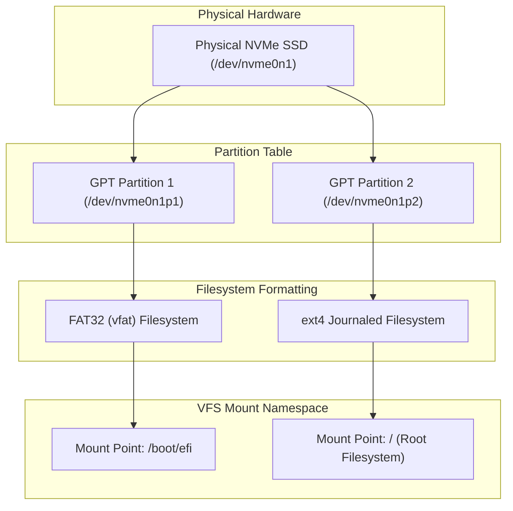
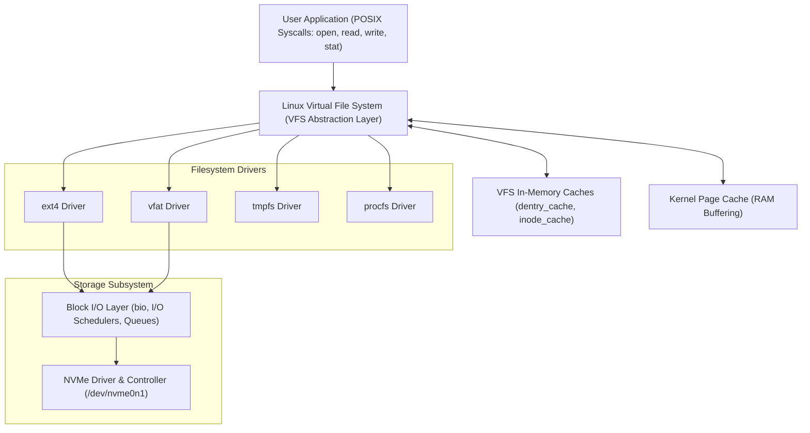
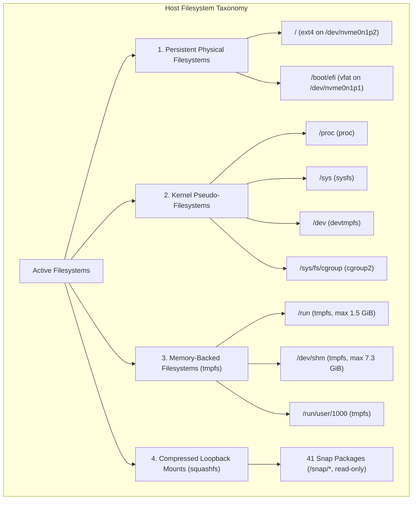
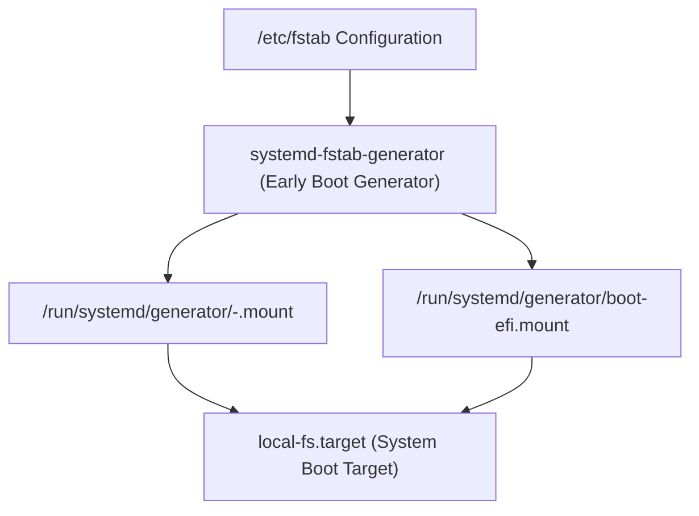

# Linux Filesystems, Mounting & /etc/fstab

**Project:** Linux System Monitoring & Reliability Lab  
**Phase:** 1.2.2 — Linux Filesystems, Mounting & /etc/fstab  
**Author:** Senior Linux Systems Engineer, Filesystem Engineer & Site Reliability Engineer  
**Target Host:** Ubuntu 24.04.5 LTS (`rubi`, Linux 7.0.0-38-generic)  

---

## 1. Linux Filesystem Architecture & Fundamentals

### 1.1 What is a Filesystem?
A **filesystem** is an organized data structure and collection of algorithms that allows an operating system to store, locate, retrieve, and manage data persistently on storage media.

While a **block device** provides only an unorganized, linearly indexed array of raw sectors (accessible via Logical Block Addressing - LBA), a filesystem translates this raw block array into human-readable, hierarchical file and directory trees with ownership, access permissions, timestamps, and extended attributes.

### 1.2 Storage Hierarchy: Block Device vs. Partition vs. Filesystem
In production SRE operations, understanding the separation between storage layers is fundamental to diagnosing disk exhaustion, latency spikes, and boot failures:



- **Physical Block Device (`/dev/nvme0n1`)**: The underlying non-volatile storage hardware.
- **Partition (`/dev/nvme0n1p2`)**: A logically carved, contiguous subset of blocks recorded in the GUID Partition Table (GPT).
- **Filesystem (`ext4`)**: The on-disk metadata structure (superblocks, inode tables, extent trees, journal) laid down across the partition by `mkfs.ext4`.
- **Mount Point (`/`)**: The location in the Linux Virtual File System (VFS) tree where the filesystem’s root directory is attached and made accessible to user-space processes.

---

### 1.3 Core Filesystem Structural Components
Unix-style filesystems (such as `ext4`, `xfs`, and `ext3`) organize on-disk storage into four primary abstraction units:

1. **Superblock**:
   - Stores critical filesystem-wide metadata: filesystem size, block size, total and free inode counts, total and free block counts, mount count, filesystem state flags (clean/dirty/errors), and feature compatibility flags.
   - Because corruption of the primary superblock makes the filesystem unmountable, ext4 automatically maintains redundant backup copies of the superblock in multiple block groups.
2. **Inodes (Index Nodes)**:
   - Data structures that represent unique filesystem objects (regular files, directories, symlinks, block/character devices, FIFO pipes, sockets).
   - An inode contains all object metadata: file size, owner UID, group GID, permission bits, access/modify/change/birth timestamps, hard link count, and pointers to the physical data blocks (or extent trees).
   - **Crucial SRE Principle**: An inode does **not** store the file name or file path. File names exist solely inside directory data blocks (dentries).
3. **Dentries (Directory Entries)**:
   - Glue data structures that link human-readable path strings (filenames) to specific inode numbers.
   - A directory is simply a specialized file whose data blocks contain a list of `(inode_number, filename, file_type)` tuples.
   - The kernel maintains an in-memory directory cache (**dcache**) to accelerate path resolution without requiring repeated disk I/O.
4. **Data Blocks**:
   - The fixed-size allocations (typically 4096 bytes) where actual user payload or directory contents are persisted on the block device.

---

### 1.4 Journaling Mechanics & Crash Consistency
In traditional non-journaled filesystems (e.g., ext2 or FAT32), writing a file requires multiple separate disk updates:
1. Allocating an inode in the inode bitmap.
2. Allocating data blocks in the block bitmap.
3. Writing the user data to the allocated blocks.
4. Updating the directory block to insert the new dentry.
5. Updating the superblock statistics.

If power fails or the kernel panics mid-sequence, the filesystem is left in an inconsistent state (e.g., blocks allocated with no referencing inode, or an inode pointing to unallocated blocks). Recovering required scanning the entire disk with `fsck`, which takes hours on large volumes.

#### How Journaling Solves This:
Modern filesystems implement **Write-Ahead Logging (WAL)** using a dedicated circular log area called the **journal** (the `jbd2` - Journaling Block Device layer in ext4):
- Changes to metadata (and optionally data) are bundled into a filesystem transaction.
- The transaction is written sequentially to the journal on disk and committed.
- Once committed in the journal, the changes are flushed asynchronously to their permanent locations in the filesystem (checkpointing).
- If a crash occurs, the kernel replays the journal during boot in seconds, ensuring atomic consistency without requiring a full `fsck` scan.

---

### 1.5 The Virtual File System (VFS) Layer
The Linux **Virtual File System (VFS)** is the kernel subsystem that provides an abstract, unified interface for all file operations. User-space programs execute standard POSIX system calls (`open`, `read`, `write`, `close`, `stat`) regardless of whether the target file resides on local ext4, FAT32, an NFS network share, a pseudo-filesystem (`/proc`, `/sys`), or a memory-backed `tmpfs`.



#### Key VFS Kernel Objects:
- `struct file_operations`: Function pointers implemented by filesystem drivers for operations on open files (`read`, `write`, `mmap`, `fsync`, `splice`).
- `struct inode_operations`: Operations on inodes (`create`, `lookup`, `link`, `unlink`, `mkdir`, `permission`).
- `struct dentry_operations`: Operations on directory cache entries (`d_revalidate`, `d_hash`, `d_compare`, `d_delete`).
- `struct super_operations`: Operations on filesystems (`alloc_inode`, `destroy_inode`, `write_inode`, `sync_fs`, `statfs`).

---

### 1.6 Lifecycle of a File Read and Write Operation

#### The Read Path (`read` syscall):
1. **Syscall Invocation**: Application calls `read(fd, buffer, count)`.
2. **Descriptor Lookup**: Kernel resolves file descriptor `fd` in the process's file descriptor table to `struct file`.
3. **VFS Dispatch**: VFS routes the call to the filesystem's `file_operations->read_iter()`.
4. **Page Cache Lookup**: The kernel checks if the requested file offset is already buffered in RAM (the page cache).
   - **Cache Hit**: Data is copied directly from kernel page cache memory to user-space buffer. Zero physical disk I/O occurs.
   - **Cache Miss**: The filesystem maps the file offset to physical block numbers (using ext4 extent trees), constructs a `struct bio` (block I/O) request, and submits it to the block layer queue.
5. **Hardware DMA**: The NVMe controller DMA-transfers the sectors from SSD flash to system RAM.
6. **Completion**: An interrupt signals completion, the page is marked up-to-date, and data is copied to the application buffer.

#### The Write Path (`write` syscall):
1. **Syscall Invocation**: Application calls `write(fd, buffer, count)`.
2. **Page Cache Buffering**: By default (buffered I/O), data is written directly into kernel memory pages in the page cache, which are marked **dirty**. The syscall returns immediately (low application latency).
3. **Delayed Allocation**: In ext4, block allocation is delayed until flusher threads (`wb_workfn`) decide to flush the dirty pages to disk, maximizing contiguous block allocations and reducing fragmentation.
4. **Flushing & Journaling**: Dirty pages are converted to `bio` requests, the ext4 journal transaction commits metadata, and blocks are written to the NVMe device.
5. **Synchronous Writes**: If the application passes `O_SYNC` or explicitly invokes `fsync()`, the syscall blocks until data and metadata are committed to non-volatile storage.

---

## 2. ext4 Filesystem Deep-Dive

### 2.1 ext4 Architectural Features
The Fourth Extended Filesystem (**ext4**) is the default, production-proven general-purpose filesystem for Ubuntu Linux. Key architectural enhancements over ext3 include:

1. **Extent-Based Allocation**:
   - Rather than mapping files using indirect block pointers (which required one pointer for every 4 KiB block), ext4 uses **extents**.
   - An extent represents a single descriptor pointing to a range of up to $2^{15}$ (32,768) contiguous blocks (up to 128 MiB with 4 KiB blocks).
   - This drastically reduces metadata footprint, accelerates sequential I/O, and accelerates file deletion.
2. **Delayed Allocation (`delalloc`)**:
   - Delays the assignment of physical disk blocks until dirty buffers are written to storage. This allows the block allocator to know the total file size and allocate large contiguous chunks, combating fragmentation.
3. **Multiblock Allocator (`mballoc`)**:
   - Allocates multiple physical blocks in a single operation rather than one-by-one.
4. **48-Bit Block Addressing**:
   - Supports filesystem volumes up to 1 Exbibyte ($1\text{ EiB} = 2^{60}\text{ bytes}$) and individual file sizes up to 16 Tebibytes ($16\text{ TiB}$).
5. **Nanosecond Timestamps**:
   - Supports timestamp resolution down to nanoseconds with timestamp range extending beyond the 2038 epoch problem (up to the year 2446).

---

### 2.2 Block Size Analysis (4096 Bytes vs. 512-Byte Sectors)
On the audited host, the ext4 block size was verified using `stat -f /`:
```bash
stat -f /
```
```
  File: "/"
    ID: cb7207604a11b7df Namelen: 255     Type: ext2/ext3
Block size: 4096       Fundamental block size: 4096
Blocks: Total: 122512118  Free: 88713028   Available: 83518185
Inodes: Total: 31195136   Free: 29868511
```

#### Engineering Tradeoffs of 4096-Byte Block Size:
- **Sector vs Block**: The physical storage sector size is 512 bytes (logical) or 4096 bytes (physical Advanced Format). The ext4 block size is 4096 bytes (4 KiB), grouping 8 logical sectors into one atomic allocation unit.
- **Internal Fragmentation**: Any file smaller than 4096 bytes (e.g., a 100-byte shell script) consumes a full 4096-byte block on disk. The unused 3996 bytes represent internal fragmentation.
- **Performance Advantage**: 4096-byte blocks match the architecture of the Linux CPU Virtual Memory system (where `PAGESIZE = 4096`). A 1:1 mapping between kernel memory pages and filesystem disk blocks eliminates split-page boundary overhead and maximizes I/O efficiency.

---

### 2.3 Reserved Blocks (Root Reservation)
ext4 reserves a portion of total blocks (traditionally 5%) exclusively for processes running with `CAP_SYS_RESOURCE` (root):

$$\text{Reserved Blocks} = \text{Total Blocks} \times 0.05$$

On this host:
- Total Blocks: $122,512,118$
- Free Blocks: $88,713,028$
- Available Blocks (for non-root users): $83,518,185$
- Difference ($\text{Free} - \text{Available}$): $88,713,028 - 83,518,185 = 5,194,843\text{ blocks}$.
- **Storage Unit Conversion**:
  - Exact Bytes: $5,194,843 \times 4,096\text{ bytes} = 21,278,076,928\text{ bytes}$
  - Decimal GB ($10^9\text{ bytes}$): $\frac{21,278,076,928}{1,000,000,000} \approx 21.28\text{ GB}$
  - Binary GiB ($2^{30} = 1,073,741,824\text{ bytes}$): $\frac{21,278,076,928}{1,073,741,824} \approx 19.82\text{ GiB}$
  - Capacity Share: $\frac{5,194,843}{122,512,118} \times 100 \approx 4.24\%$ of total capacity.

#### SRE Importance of Reserved Blocks:
1. **Prevents Host Lockout**: If unprivileged applications (e.g., logging runaways or uncontrolled user uploads) fill the disk to 100% user capacity, root services (such as `sshd`, `syslog`, `systemd-journald`, and administrative shells) can still write logs, create lock files, and allow SRE intervention.
2. **Mitigates Fragmentation Deadlock**: Filesystem allocators become severely fragmented and slow down exponentially as free space approaches zero. The reserve provides a buffer to maintain allocation efficiency.

---

### 2.4 ext4 Journaling Modes

ext4 supports three distinct journaling modes configured via mount options:

| Mode | Mount Option | Data Integrity | Metadata Integrity | I/O Performance | Operational Behavior |
|---|---|---|---|---|---|
| **Data Journaling** | `data=journal` | **Highest** | **Highest** | Lowest (Double write overhead) | Both file data and metadata are committed to the journal before being written to disk. Highest safety against power failure, but all data is written twice. |
| **Ordered Mode** *(Default)* | `data=ordered` | **High** | **High** | Balanced / Optimal | Only metadata is written to the journal. Crucially, the kernel guarantees that file data blocks are dispatched to the storage driver **before** the associated metadata transaction commits in the journal. Prevents metadata from pointing to unallocated or stale data after a crash replay. |
| **Writeback Mode** | `data=writeback` | **Lower** | **High** | Highest Throughput | Metadata is journaled, but file data blocks may be written after metadata commits. If a crash occurs, files may point to unwritten blocks containing previous garbage data. |

#### Host Observation & Boot Lifecycle Progression:
The host's active journal mode was observed from the early kernel boot log:
```bash
journalctl -b -k --grep="EXT4-fs"
```
```
EXT4-fs (nvme0n1p2): mounted filesystem [SANITIZED_ROOT_UUID] ro with ordered data mode. Quota mode: none.
EXT4-fs (nvme0n1p2): re-mounted [SANITIZED_ROOT_UUID] r/w.
```

##### Distinguishing Boot-Time and Current Mount States:
These log lines reflect standard Linux initialization stages rather than the ongoing runtime state:
1. **Initial Root Mount (Observed Early Boot State)**: The early kernel boot log records `EXT4-fs (nvme0n1p2): mounted filesystem [SANITIZED_ROOT_UUID] ro with ordered data mode`. In standard Linux boot architecture, the kernel or initial RAM disk (initramfs) mounts the root filesystem read-only (`ro`) during early initialization.
2. **Subsequent Read-Write Remount**: The boot log subsequently records `EXT4-fs (nvme0n1p2): re-mounted [SANITIZED_ROOT_UUID] r/w`. During the userspace boot transition, systemd runs `systemd-remount-fs.service` (invoked via `local-fs.target.wants`), which remounts the root filesystem read-write (`rw`) according to the mount options configured in `/etc/fstab` (`defaults`).
3. **Current Steady-State**: Live inspection via `findmnt` and `/proc/self/mountinfo` confirms the root filesystem operates in steady-state **read-write (`rw`)** mode. It is not currently read-only.

##### Journaling Policies vs. Hardware-Level Persistence:
While the boot log verifies that the ext4 filesystem driver operates in `data=ordered` mode, this log reflects filesystem-level software ordering policies. It does **not** by itself establish that data was physically flushed to persistent NAND flash cells on the SSD:
- Modern NVMe solid-state storage devices typically incorporate onboard DRAM write caches.
- True hardware-level persistence requires explicit cache flush commands (e.g., NVMe flush commands, Force Unit Access - FUA, or block-layer barrier flushes) to be issued by the kernel and acknowledged by the drive controller.
- SREs must distinguish filesystem crash consistency (recovering to a consistent metadata state via journal replay) from hardware-level persistence guarantees against sudden power interruption.

---

### 2.5 Live ext4 Telemetry via `/sys/fs/ext4`
Linux exposes ext4 filesystem health telemetry through `sysfs` without requiring root permissions. On this host:

```bash
cat /sys/fs/ext4/nvme0n1p2/errors_count \
    /sys/fs/ext4/nvme0n1p2/lifetime_write_kbytes \
    /sys/fs/ext4/nvme0n1p2/session_write_kbytes \
    /sys/fs/ext4/nvme0n1p2/reserved_clusters
```
- **`errors_count: 0`**: The inspected ext4 error counter currently reports zero kernel-detected errors for this filesystem.
- **`lifetime_write_kbytes: 4993517728`**: Total cumulative logical writes dispatched through the ext4 writeback layer over the lifetime of this filesystem ($4,993,517,728\text{ KiB} \approx 4.76\text{ TiB}$).
- **`session_write_kbytes: 136856592`**: Cumulative logical writes during the current mount session ($136,856,592\text{ KiB} \approx 130.52\text{ GiB}$).
- **`reserved_clusters: 4096`**: Reserved allocation clusters.

#### SRE Boundaries of Filesystem Telemetry:
To prevent misleading operational conclusions, SREs must recognize what these sysfs counters can and cannot establish:
1. **Logical Filesystem Writes vs. Physical Device Writes**:
   - `lifetime_write_kbytes` measures logical data and metadata passed into the ext4 filesystem layer.
   - It does **not** directly correspond to physical NAND flash writes on the SSD. Physical writes differ substantially due to SSD controller write amplification (WA), flash translation layer (FTL) garbage collection, wear-leveling block moves, TRIM/discard processing, and controller DRAM write caching.
   - This value must **not** be used as a direct indicator of SSD wear, Total Bytes Written (TBW), or remaining drive lifespan. Drive wear metrics must be gathered directly from the NVMe controller via SMART telemetry (e.g. `Data Units Written` via `smartctl` or `nvme-cli`).
2. **Interpretation of `errors_count`**:
   - `errors_count = 0` means that the inspected sysfs error counter currently reports zero. This indicates that the ext4 kernel driver has not recorded an active filesystem error through this interface during operation so far.
   - This observed zero does **not** prove that:
     - The filesystem has never experienced any error in its history (e.g., prior to counter resets or clean reformatting).
     - The filesystem is completely free of corruption (latent or unaccessed structural inconsistencies may exist in regions of the disk that have not been read or written).
     - The physical SSD hardware is healthy (device-level errors, flash block retirement, or bad sectors managed by the SSD controller do not increment ext4 filesystem error counters unless they surface as unrecovered I/O errors to the driver).

---

## 3. Linux VFS Directory Hierarchy & Mount Mechanics

### 3.1 The Single-Tree Hierarchy
Unlike Windows (which assigns distinct drive letters like `C:`, `D:`, `E:` to different block devices), Linux organizes all storage under a single, unified inverted directory tree originating at the root directory (`/`).

Every filesystem is attached to an existing directory node in this tree via the **mount** mechanism.

---

### 3.2 Directory Masking (The "Hidden Data" Disk Space Trap)
When a filesystem is mounted on a directory (e.g. `/mnt/data`), the contents of the mounted filesystem become visible at that path.

**The Masking Phenomenon**:
- If files or directories existed inside `/mnt/data` **before** the mount operation occurred, those files do not disappear and are not deleted.
- Instead, the mount operation **masks** them: the directory's inode is superseded by the root inode of the mounted filesystem.
- Those pre-existing files become completely invisible and inaccessible to user applications.
- **SRE Severity**: If a backup script or daemon writes 50 GiB of data to `/mnt/data` while the target volume is unmounted, and the disk is subsequently mounted, the root filesystem (`/`) loses 50 GiB of capacity. `du -sh /` will struggle to find the files, but `df -h /` will report that the space is consumed.

#### Recovery Runbook for Masked Space:
To inspect and recover disk space consumed by masked directories without unmounting production services, use a **bind mount** of the root filesystem:
```bash
# 1. Create a temporary inspection mountpoint
sudo mkdir -p /mnt/root_recovery

# 2. Bind-mount the root filesystem to the temporary location
sudo mount --bind / /mnt/root_recovery

# 3. Inspect the underlying mountpoint directory on the raw root disk
ls -la /mnt/root_recovery/mnt/data

# 4. Clean up the masked files from the underlying root disk
# 5. Unmount the recovery view
sudo umount /mnt/root_recovery
```

---

### 3.3 Key Filesystem Paths & Architectural Roles

| Path | Purpose & Storage Nature | Filesystem Type | Volatility |
|---|---|---|---|
| `/` | System root holding base binaries, libraries, configuration, user data | `ext4` (persistent block device) | Persistent |
| `/boot/efi` | UEFI boot loaders (`grubx64.efi`), EFI binaries, firmware boot configs | `vfat` (FAT32 partition) | Persistent |
| `/proc` | Kernel and process information interface (virtual memory metrics, sysctl) | `proc` (pseudo-filesystem) | Pure RAM (ephemeral) |
| `/sys` | Hardware topology, device drivers, power management, block device queues | `sysfs` (pseudo-filesystem) | Pure RAM (ephemeral) |
| `/dev` | Hardware device nodes created dynamically by `systemd-udevd` | `devtmpfs` (pseudo-filesystem) | Pure RAM (ephemeral) |
| `/run` | Runtime process state, lock files, Unix sockets, systemd IPC | `tmpfs` (memory-backed) | Volatile (cleared on reboot) |
| `/dev/shm` | POSIX shared memory segments used for inter-process communication | `tmpfs` (memory-backed) | Volatile (cleared on reboot) |
| `/tmp` | Temporary files created by applications; cleaned periodically or on boot | Bound to `/` or `tmpfs` | Semi-ephemeral |
| `/snap/*` | Sandboxed, immutable application container packages | `squashfs` (read-only loopback) | Immutable |

---

## 4. Host Mount Taxonomy & Filesystem Classification

Inspection of the Ubuntu host via `findmnt` and `/proc/self/mountinfo` reveals four distinct categories of active filesystems:



### 4.1 Physical vs Pseudo vs Memory vs Loop Filesystems

1. **Persistent Physical Filesystems**:
   - Backed by physical flash storage blocks. State survives power cycles.
   - Examples on host: `/` (ext4), `/boot/efi` (FAT32).

#### Comparative Analysis: ext4 Inodes vs. FAT32 Architecture
When querying inode utilization via `df -i` or `stat -f`, the host displays a fundamental divergence between the root and EFI partitions:
- **ext4 (`/`)**: Allocates a fixed on-disk table of $31,195,136$ inodes at format time. Each file, directory, or symlink consumes exactly one inode.
- **FAT32 (`/boot/efi`)**: Reports `0` total, used, and free inodes (`df -i` returns `Inodes: 0, IUsed: 0, IFree: 0`).

##### Crucial SRE Clarification on FAT32 Inodes:
- FAT32 does **not** provide the same native inode accounting model as ext4.
- `df -i` and `statfs(2)` report zero or otherwise non-meaningful inode statistics because the Linux VFS `fat` driver does not maintain an on-disk fixed inode table, setting `f_files = 0` and `f_ffree = 0`.
- **This does not mean the filesystem contains no files or has no file capacity**. In fact, `/boot/efi` holds essential UEFI boot files (e.g. `grubx64.efi`).
- FAT32 stores file metadata directly within directory table entries (32-byte directory records) and allocates data blocks via cluster chains in the File Allocation Table.
- **Observability Impact**: Standard inode alerts (`node_filesystem_files_free / node_filesystem_files`) cannot be applied to `vfat` filesystems and will generate division-by-zero errors or invalid alerts if not filtered by filesystem type (`fstype=~"ext4|xfs"`).

2. **Kernel Pseudo-Filesystems**:
   - Zero physical storage. They represent kernel data structures exposed as directories and files to facilitate interaction between user space and kernel space.
   - Reading a file in `/proc` invokes a kernel function that formats internal memory structures into ASCII text on-the-fly.
3. **Memory-Backed Filesystems (`tmpfs`)**:
   - Reside entirely in the kernel page cache (RAM) and swap.
   - Provide sub-microsecond access times for transient runtime state (`/run`, `/dev/shm`). If RAM becomes constrained, pages can be paged to swap.
4. **Loopback Filesystems (`squashfs`)**:
   - Highly compressed, read-only filesystem images mounted via virtual loop devices (`/dev/loop0` to `/dev/loop40`). Used extensively by Ubuntu's Snap package manager for dependency isolation.

---

### 4.2 Anatomy of `/proc/self/mountinfo`
While `/etc/mtab` and `mount` provide basic summaries, `/proc/self/mountinfo` is the authoritative kernel interface for mount states, providing detailed namespace propagation information:

Example entry from the host:
```
33 2 259:2 / / rw,relatime shared:1 - ext4 /dev/nvme0n1p2 rw
```

| Field Position | Value on Host | Meaning |
|---|---|---|
| **1** (Mount ID) | `33` | Unique kernel identifier for this mount. |
| **2** (Parent ID) | `2` | ID of the parent mount (for root, points to rootfs). |
| **3** (Major:Minor) | `259:2` | Major and minor number of the backing block device (`/dev/nvme0n1p2`). |
| **4** (Root) | `/` | Root directory of the filesystem within this mount. |
| **5** (Mount Point) | `/` | Destination mount path in the current VFS hierarchy. |
| **6** (Mount Options) | `rw,relatime` | Per-mount options. |
| **7** (Optional Fields) | `shared:1` | Mount propagation flag (`shared`, `master`, `propagate_from`, `unbindable`). `shared:1` indicates mount events propagate across peer namespaces. |
| **8** (Separator) | `-` | Marks the end of optional fields. |
| **9** (Filesystem Type)| `ext4` | Concrete filesystem driver. |
| **10** (Mount Source) | `/dev/nvme0n1p2`| Underlying block device or virtual source. |
| **11** (Super Options)| `rw` | Superblock-level options. |

---

## 5. `/etc/fstab` Architecture & Persistent Mount Configuration

### 5.1 Anatomy of `/etc/fstab`
The `/etc/fstab` (File System Table) configuration file defines static filesystem mount configurations executed at system boot.

Each line consists of exactly six whitespace-separated fields:
$$\text{[Field 1: Device]} \quad \text{[Field 2: Mountpoint]} \quad \text{[Field 3: FSType]} \quad \text{[Field 4: Options]} \quad \text{[Field 5: Dump]} \quad \text{[Field 6: Passno]}$$

#### Host `/etc/fstab` Verification:
```
/dev/disk/by-uuid/[SANITIZED_ROOT_UUID] /         ext4 defaults 0 1
/dev/disk/by-uuid/[SANITIZED_ESP_UUID]  /boot/efi vfat defaults 0 1
/swap.img                               none      swap sw       0 0
```

---

### 5.2 Field-by-Field Breakdown

| Field # | Header | Host Configuration | Technical Purpose & Engineering Best Practice |
|---|---|---|---|
| **1** | `<file system>` | `/dev/disk/by-uuid/...` | Backing device identifier. **Always use UUID** in production. Avoid raw kernel device nodes (`/dev/sda` or `/dev/nvme0n1p2`) because device node numbering can change if drive cables are swapped or PCIe buses enumerate in a different order. |
| **2** | `<mount point>` | `/`, `/boot/efi`, `none` | Path in the VFS tree where the device is mounted. For swap, this is set to `none`. |
| **3** | `<type>` | `ext4`, `vfat`, `swap` | Filesystem driver type. Linux kernel loads the matching driver module (`ext4.ko`, `vfat.ko`). |
| **4** | `<options>` | `defaults`, `sw` | Comma-delimited list of mount options controlling caching, execution permissions, and reliability semantics. |
| **5** | `<dump>` | `0` | Controls whether the obsolete Unix `dump` utility should back up the filesystem. Modern Linux systems invariably set this to `0` (disabled). |
| **6** | `<pass>` | `1`, `1`, `0` | Defines the sequence in which `fsck` (filesystem check) verifies filesystems during boot. Root (`/`) must be `1`. Other physical partitions are typically `2`. Virtual, network, or swap mounts must be `0` (bypass fsck). |

---

### 5.3 Critical Mount Options Reference

- **`defaults`**: A meta-option that expands to `rw, suid, dev, exec, auto, nouser, async`.
- **`noatime` vs `relatime`**:
  - `atime` (access time) updates the inode's timestamp on every single read operation. On busy systems, this creates massive write amplification (every read causes a disk write).
  - `noatime`: Disables access time updates completely. Highly recommended for database and high-throughput servers.
  - `relatime` (Host default): Updates access time only if the previous access time is older than the modify/change time, or more than 24 hours in the past. Balances application compatibility (e.g. `mutt`, mail spools) with I/O efficiency.
- **`nodev`, `nosuid`, `noexec`** (Security Hardening):
  - `nodev`: Prevents character or block special devices from being interpreted on this mount.
  - `nosuid`: Ignores set-user-identifier (SUID) and set-group-identifier (SGID) bits, preventing privilege escalation.
  - `noexec`: Blocks binary execution from this filesystem (recommended for `/tmp`, `/var/tmp`, and user upload directories).
- **`nofail`**:
  - Directs systemd not to fail boot or drop into emergency mode if this device is absent at boot time. **Essential for secondary data disks, USB drives, or cloud-attached storage volumes**.
- **`ro` / `rw`**: Mounts the filesystem as read-only (`ro`) or read-write (`rw`).
- **`x-systemd.automount`**: Configures on-demand mounting via autofs. The filesystem is not mounted during boot, but instantly mounts the first time a process accesses its directory.
- **`x-systemd.device-timeout=N`**: Configures how many seconds systemd waits for the backing device to appear before giving up (default is 90 seconds).

---

### 5.4 How `systemd-fstab-generator` Translates `/etc/fstab`
In modern systemd-based Linux systems, `/etc/fstab` is not parsed directly by the `mount` command during boot.

Instead, during early initialization, the kernel runs **`systemd-fstab-generator`**, which parses `/etc/fstab` and dynamically generates native systemd mount units in `/run/systemd/generator/`:



#### Empirical Verification from Host:
Direct inspection of the generator files under `/run/systemd/generator/` and `systemctl cat` reveals the exact directives emitted by `systemd-fstab-generator` on Ubuntu 24.04:

```bash
systemctl cat -- -.mount boot-efi.mount
```
```ini
# /run/systemd/generator/-.mount
# Automatically generated by systemd-fstab-generator

[Unit]
Documentation=man:fstab(5) man:systemd-fstab-generator(8)
SourcePath=/etc/fstab
Before=local-fs.target
After=blockdev@dev-disk-by\x2duuid-[SANITIZED_ROOT_UUID].target

[Mount]
What=/dev/disk/by-uuid/[SANITIZED_ROOT_UUID]
Where=/
Type=ext4

# /run/systemd/generator/boot-efi.mount
# Automatically generated by systemd-fstab-generator

[Unit]
Documentation=man:fstab(5) man:systemd-fstab-generator(8)
SourcePath=/etc/fstab
Before=local-fs.target
Requires=systemd-fsck@dev-disk-by\x2duuid-[SANITIZED_ESP_UUID].service
After=systemd-fsck@dev-disk-by\x2duuid-[SANITIZED_ESP_UUID].service
After=blockdev@dev-disk-by\x2duuid-[SANITIZED_ESP_UUID].target

[Mount]
What=/dev/disk/by-uuid/[SANITIZED_ESP_UUID]
Where=/boot/efi
Type=vfat
```

##### Generator Filesystem Links & Boot Ordering (`/run/systemd/generator/`):
Inspecting the directory structure created by `systemd-fstab-generator` demonstrates how target dependencies are wired into the boot sequence:
- **`local-fs.target.requires/`**: Contains symlinks to `-.mount` and `boot-efi.mount`, ensuring `local-fs.target` unconditionally requires both filesystems.
- **`local-fs.target.wants/`**: Contains symlinks to:
  - `systemd-fsck-root.service`: Verifies root filesystem integrity during early boot.
  - `systemd-remount-fs.service`: Remounts the root filesystem read-write (`rw`) once early initialization completes.

##### Distinguishing Generator Directives from Runtime Dependencies:
A rigorous SRE analysis must distinguish what is written directly by the generator from the runtime dependency graph constructed by systemd:

1. **Directives Written into Generated Mount Units**:
   - In `/run/systemd/generator/-.mount`: Contains only `Documentation`, `SourcePath=/etc/fstab`, `Before=local-fs.target`, `After=blockdev@dev-disk-by\x2duuid-[SANITIZED_ROOT_UUID].target`, and the `[Mount]` definition (`What`, `Where`, `Type`).
   - In `/run/systemd/generator/boot-efi.mount`: Contains `Documentation`, `SourcePath=/etc/fstab`, `Before=local-fs.target`, `Requires=systemd-fsck@...`, `After=systemd-fsck@...`, `After=blockdev@dev-disk-by\x2duuid-[SANITIZED_ESP_UUID].target`, and the `[Mount]` definition.
   - *Note on `blockdev@...target`*: The `After=blockdev@dev-disk-by\x2duuid-...target` directive is an explicit directive generated by `systemd-fstab-generator` on Ubuntu 24.04 (systemd v255). It orders the mount unit after the corresponding udev-managed block device target.

2. **Runtime Dependencies via `systemctl show`**:
   Querying the active units via `systemctl show -p Requires,Wants,After,Before -- -.mount boot-efi.mount` reports a much broader set of relationships:
   - For `-.mount`: `Requires=-.slice`, `After="blockdev@...target" -.slice`, `Before=local-fs.target ...`.
   - For `boot-efi.mount`: `Requires=dev-nvme0n1p1.device systemd-fsck@... -.mount system.slice`, `After=blockdev@dev-nvme0n1p1.target dev-nvme0n1p1.device systemd-fsck@... -.mount local-fs-pre.target blockdev@...target system.slice`, `Before=local-fs.target umount.target`.

   **SRE Architectural Qualification**:
   Not every dependency shown by `systemctl show` is authored by `systemd-fstab-generator`. Rather, runtime output includes dependencies automatically synthesized by systemd's broader dependency and device-unit machinery:
   - **Device Unit Binding**: systemd automatically associates mount points with the active kernel device unit (`dev-nvme0n1p1.device`) discovered by udev.
   - **Hierarchy Ordering**: systemd automatically ensures child mounts (such as `/boot/efi`) are ordered `After` parent mounts (such as `-.mount`).
   - **Default Unit Ordering**: Default dependencies (e.g., ordering `Before=umount.target`, binding to `-.slice` or `system.slice`, and ordering after `local-fs-pre.target`) are standard features of systemd's mount handling rather than directives emitted by the fstab generator.

---

## 6. SRE Operational Runbooks & Failure Scenarios

### Scenario 1: Host Drops into Emergency Shell Due to Invalid `/etc/fstab` UUID
- **Symptom**: System fails to boot; console displays `You are in emergency mode. After logging in, type "journalctl -xb" to view system logs.`
- **Root Cause**: A secondary disk was removed, reformatted (changing its UUID), or an engineer made a typo in `/etc/fstab`. Without `nofail`, systemd waits 90 seconds for the device before aborting boot.
- **Runbook / Remediation**:
  1. Boot into emergency mode and provide the root password.
  2. Notice that the root filesystem may be mounted read-only (`ro`). Remount it read-write:
     ```bash
     mount -o remount,rw /
     ```
  3. Inspect `/etc/fstab` and identify the failing device line.
  4. Run `blkid` to verify actual UUIDs of all attached block devices.
  5. Either correct the UUID, comment out the line, or append `nofail` to the mount options:
     ```
     UUID=... /data ext4 defaults,nofail 0 2
     ```
  6. Reload systemd daemon units and test mounting:
     ```bash
     systemctl daemon-reload
     mount -a
     ```
  7. Reboot: `reboot`.

---

### Scenario 2: Unexpected Read-Only Remount (`errors=remount-ro`)
- **Symptom**: Applications throw `Read-only file system` errors (errno 30). Writes, log updates, and temporary files fail.
- **Root Cause**: The storage device timed out, suffered hardware I/O read/write errors, or ext4 detected metadata inconsistency. To prevent cascading corruption, the ext4 driver executes its default error behavior: remounting the filesystem read-only.
- **Detection & Investigation**:
  1. Check kernel ring buffer for filesystem error events:
     ```bash
     dmesg -T | grep -E "EXT4-fs error|remounting filesystem read-only"
     ```
  2. Query ext4 error counter in sysfs:
     ```bash
     cat /sys/fs/ext4/*/errors_count
     ```
  3. Verify mount status via `findmnt`:
     ```bash
     findmnt -o TARGET,SOURCE,OPTIONS /
     ```
- **Remediation**:
  - Do NOT blindly remount `mount -o remount,rw /` without investigating; doing so on corrupted storage can destroy data.
  - Schedule immediate maintenance, unmount the volume, and run manual integrity checking:
    ```bash
    e2fsck -fvy /dev/nvme0n1p2
    ```

---

### Scenario 3: Phantom Disk Exhaustion via Directory Masking
- **Symptom**: `df -h /` shows 100% capacity used, but running `du -sh /*` accounts for only 20 GiB.
- **Root Cause**: A heavy workload (e.g. Docker container storage, database backups) wrote 100 GiB directly into `/mnt/storage` while the storage drive was disconnected or unmounted. When the drive was subsequently mounted, it masked the 100 GiB lying on the underlying root disk.
- **Runbook / Remediation**:
  1. Bind-mount the root filesystem to an unmasked temporary directory:
     ```bash
     mkdir -p /mnt/raw_root
     mount --bind / /mnt/raw_root
     ```
  2. Check the masked mountpoint directory on the underlying raw root:
     ```bash
     du -sh /mnt/raw_root/mnt/storage
     ```
  3. If masked files are found, delete or migrate them:
     ```bash
     rm -rf /mnt/raw_root/mnt/storage/*
     ```
  4. Unmount the temporary bind mount:
     ```bash
     umount /mnt/raw_root
     ```

---

### Scenario 4: Testing `/etc/fstab` Modifications Safely
- **Golden SRE Rule**: **Never edit `/etc/fstab` and reboot without testing first**.
- **Runbook**:
  1. Make edits to `/etc/fstab`.
  2. Run the test command:
     ```bash
     sudo mount -a
     ```
     - `mount -a` mounts all filesystems mentioned in `/etc/fstab` that have the `auto` option (which is included in `defaults`).
     - If `/etc/fstab` contains syntax errors, invalid mount options, or non-existent devices, `mount -a` will fail immediately with an explicit error message in your active terminal session—sparing your host from a disastrous boot failure.

---

## 7. SRE Observability & Monitoring Implications

### 7.1 Block Device Metrics vs. Filesystem Metrics
A common operational mistake is conflating block device metrics with filesystem metrics:

| Metric Category | Observable Subsystem | Telemetry Source | Primary SRE Indicators |
|---|---|---|---|
| **Block Device Metrics** | Physical controller, queue, sectors | `/sys/block/`, `/proc/diskstats`, `node_disk_*` | IOPS, Read/Write throughput (MB/s), average I/O latency, queue depth, disk saturation time (`%util`). |
| **Filesystem Metrics** | VFS, ext4 directory structure | `statvfs()`, `/proc/self/mountinfo`, `node_filesystem_*` | Used capacity, free capacity, inode utilization, read-only degradation, filesystem error count. |

*Example*: A filesystem can report 95% free space while the underlying NVMe block device is completely saturated at 100% I/O utilization with 500 ms read latency due to random queue congestion. Conversely, a block device can show 0% I/O activity while the filesystem fails every write because it has reached 100% inode capacity.

---

### 7.2 Inode Exhaustion: The Silent Outage
Filesystems allocate a fixed number of inodes when formatted. Every file, directory, and symlink consumes exactly one inode.

- If a host runs a runaway logging script, uncleaned session files (e.g. `/var/lib/php/sessions`), or a million zero-byte cache files, the filesystem will run out of available inodes.
- **Result**: Any attempt to create a new file fails with `No space left on device` (errno 28), **even if `df -h` shows 400 GiB of free disk space**!
- **Observability Requirement**: Always monitor and alert on inode utilization (`node_filesystem_files_free / node_filesystem_files * 100`), not just byte capacity.

---

### 7.3 Filtering Virtual & Loop Filesystems in Prometheus
On Ubuntu systems, the Prometheus `node_exporter` default configuration will scrape every active mount. On this audited host, that includes 41 SquashFS snap mounts, dozens of tmpfs allocations, and kernel pseudo-filesystems.

#### Why This Causes SRE Incidents:
1. **Snap Mount Alert Floods**: SquashFS images are read-only, compressed packages that are intentionally **100% full by design** (`Use% = 100%`). An uncalibrated alert rule like `node_filesystem_free_bytes / node_filesystem_size_bytes < 0.1` will fire 41 simultaneous critical alerts!
2. **Metrics Bloat**: Scraping 50+ virtual filesystems inflates Prometheus time-series storage and slows down PromQL evaluation.

#### Illustrative `node_exporter` Configuration Flags:
To illustrate high-signal alerting patterns, Node Exporter's filesystem collector supports command-line regular expressions to filter out virtual and loop filesystems:

```bash
# Illustrative node_exporter collector flags (for reference; not deployed in Phase 1.2.2)
--collector.filesystem.mount-points-exclude="^/(dev|proc|sys|snap)($|/)" \
--collector.filesystem.fs-types-exclude="^(autofs|binfmt_misc|bpf|cgroup2?|configfs|debugfs|devpts|devtmpfs|fusectl|hugetlbfs|iso9660|mqueue|nsfs|overlay|proc|procfs|pstore|rpc_pipefs|securityfs|selinuxfs|squashfs|sysfs|tracefs)$"
```

##### SRE Guidelines for Filesystem Filtering:
1. **Separation of Concerns**: Filesystem metrics (`node_filesystem_*`) and block-device metrics (`node_disk_*`) measure completely different architectural layers. Exclusions applied to the filesystem collector do not impact disk I/O metrics collected from `/proc/diskstats`.
2. **Caution Against Overly Broad Exclusions**:
   - Broadly excluding mountpoint trees such as `^/run($|/)` can inadvertently hide legitimate filesystems. For example, systemd services, container runtimes (such as containerd/Docker), or encrypted secrets engines may mount valid tmpfs or persistent storage volumes under `/run` or `/var/run`.
   - Prefer filtering by concrete pseudo-filesystem types (`fstype-exclude`) rather than broad mount paths whenever possible.
3. **Validation Against Live Metric Labels**:
   - Monitoring policies and alert rules must be validated against the exact metric labels (`mountpoint`, `fstype`, `device`) produced by the running Node Exporter version and matched against the host's actual monitoring requirements.
   - Note: In Phase 1.2.2, Node Exporter and Prometheus configurations are not installed or modified. Full deployment and rule calibration will occur in Phases 3 and 4.

---

### 7.4 Core Prometheus Alert Rules for Filesystems

```yaml
groups:
  - name: filesystem_alerts
    rules:
      - alert: HostFilesystemSpaceFillingUp
        expr: (node_filesystem_avail_bytes{fstype=~"ext4|xfs"} / node_filesystem_size_bytes{fstype=~"ext4|xfs"}) < 0.10
        for: 5m
        labels:
          severity: warning
        annotations:
          summary: "Filesystem space running low on {{ $labels.mountpoint }}"
          description: "Mountpoint {{ $labels.mountpoint }} has only {{ $value | humanizePercentage }} available storage space remaining."

      - alert: HostFilesystemInodeExhaustion
        expr: (node_filesystem_files_free{fstype=~"ext4|xfs"} / node_filesystem_files{fstype=~"ext4|xfs"}) < 0.10
        for: 5m
        labels:
          severity: warning
        annotations:
          summary: "Filesystem running out of inodes on {{ $labels.mountpoint }}"
          description: "Mountpoint {{ $labels.mountpoint }} has only {{ $value | humanizePercentage }} available inodes remaining."

      - alert: HostFilesystemReadOnly
        expr: node_filesystem_readonly{fstype=~"ext4|xfs"} == 1
        for: 1m
        labels:
          severity: critical
        annotations:
          summary: "Filesystem turned read-only on {{ $labels.mountpoint }}"
          description: "Filesystem on mountpoint {{ $labels.mountpoint }} was remounted read-only due to storage or filesystem corruption errors."
```

#### SRE Scope Calibration for Inode Alerting:
- **Illustrative Monitoring Scope**: The label selector `fstype=~"ext4|xfs"` in the examples above illustrates a deliberately restricted scope targeting conventional POSIX block filesystems with fixed on-disk inode tables. It is **not** a universal Linux filesystem allowlist.
- **Architectural Suitability**: Inode monitoring is only meaningful for filesystems whose drivers expose reliable file-count capacity via `statfs(2)`. For example, FAT32 (`vfat`) reports zero total inodes, Btrfs dynamically allocates inodes, and pseudo-filesystems (`proc`, `sysfs`) do not have static inode limits.
- **Label Validation**: Alert rules must always be tested against the actual metric labels (`fstype`, `mountpoint`, `device`) emitted by the deployed Node Exporter version to ensure that production filesystems are properly matched and non-applicable filesystems do not cause false alerts or division-by-zero errors.
