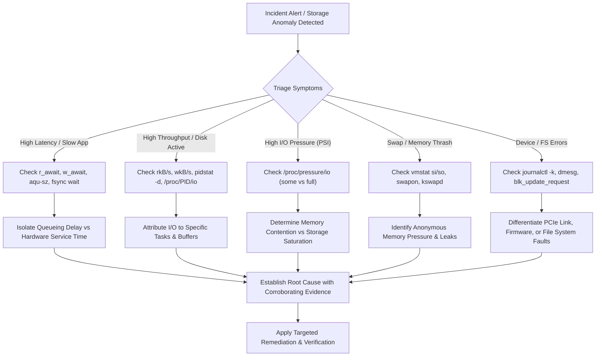

# Linux Storage Troubleshooting & Reliability Engineering Playbook

**Project:** Linux System Monitoring & Reliability Lab  
**Phase:** 1.2.5 — Linux Storage Troubleshooting & Reliability Investigation  
**Author:** Senior Linux Storage Engineer & Site Reliability Engineer  
**Target Host:** Ubuntu 24.04.5 LTS (`rubi`, Linux 7.0.0-38-generic, Samsung MZVL4512HBLU-00BTW NVMe SSD)  

---

## 1. SRE Storage Troubleshooting Framework & Principles

Storage incidents in production systems represent some of the most critical and complex reliability challenges in Site Reliability Engineering. A storage bottleneck or failure can cause cascading service degradation across applications, thread pool exhaustion, latency amplification, or total system unresponsiveness.

### 1.1 The Golden Rules of Storage SRE Investigation
1. **Never Assume Root Cause Without Evidence**: An unverified hypothesis (e.g., "the disk is failing" or "swap is full") must never be presented as root cause. Every diagnosis requires empirical proof derived from kernel telemetry, tracing, or log events.
2. **Distinguish Time-Busy from Saturated**: On multi-queue NVMe devices, 100% `%util` indicates continuous non-idle time, NOT queue or throughput saturation. Concurrency, latency curves, and Pressure Stall Information (PSI) are required to prove saturation.
3. **Decompose Response Time**: Total request latency ($r\_await, w\_await$) consists of **software queueing delay** plus **hardware service time**. Troubleshooting must isolate where time is spent.
4. **Preserve System Stability**: Never execute destructive diagnostic commands (`dd if=... of=/dev/...`, raw block writes, flushing caches with `echo 3 > /proc/sys/vm/drop_caches` on production databases, or uncoordinated remounts).



---

## 2. Comprehensive Diagnostic Procedures for Common Failure Modes

---

### Scenario 1: High Disk Latency (`r_await` or `w_await` Escalation)

#### Symptoms:
- Prometheus / Alertmanager alerts firing on `DiskReadLatencyHigh` ($r\_await > 10\text{ ms}$) or `DiskWriteLatencyHigh` ($w\_await > 20\text{ ms}$).
- Applications report elevated p95/p99 query or transaction response times.
- Threads accumulating in uninterruptible sleep state (`D` state in `ps aux` or `vmstat b > 0`).

#### Diagnostic Commands (Read-Only):
```bash
# 1. Inspect live latency breakdown and average queue size
iostat -xz 1 5

# 2. Check kernel writeback throttling status
cat /sys/block/nvme0n1/queue/wbt_lat_usec

# 3. Check for in-flight requests and device stats
cat /sys/block/nvme0n1/inflight
cat /sys/block/nvme0n1/stat

# 4. Check whether latency is causing system-wide task stalls
cat /proc/pressure/io
```

#### Expected Output Interpretation:
- In `iostat -xz`:
  - If `r_await` is high ($> 5\text{ ms}$) but `aqu-sz` is very low ($< 1.0$), requests are taking a long time in the physical device itself (hardware flash latency, read disturb, or bad blocks).
  - If `r_await` is high and `aqu-sz` is high ($> 50$), latency is dominated by **queueing delay** (requests waiting for previous requests to complete).
  - If `w_await` is high while `r_await` is low, writes may be stalling on synchronous journal commits or NVMe flash garbage collection.

#### Possible Causes:
1. **Device Saturation / Excessive Queueing**: Concurrency exceeds the drive's internal parallelism.
2. **Flash Garbage Collection / TRIM Storm**: SSD internal controller is busy erasing NAND blocks or processing massive TRIM commands.
3. **Synchronous Write Amplification**: Applications calling `fsync()` excessively on small random writes.
4. **Thermal Throttling**: NVMe drive throttling PCIe link speed due to excessive controller temperatures.
5. **Slow Physical Blocks / Reallocation**: Media degradation causing hardware read retries.

#### Evidence Required to Establish Root Cause:
- **Proof of Queueing**: `aqu-sz` is elevated ($> 20$) AND `r_await` increases proportionally with request volume.
- **Proof of Flash Garbage Collection / Thermal Throttling**: High latency occurs without high `aqu-sz`, accompanied by thermal warnings in `journalctl -k` or high internal temperatures in `/sys/class/hwmon/`.
- **Proof of Journal / Fsync Bottleneck**: `f_await` or `w_await` is high, `iostat` shows high `f/s` (flushes per second), and `pidstat -d` attributes writes to database WAL or journal threads.

#### Safe Investigation Steps:
1. Run `iostat -xz 1 5` to identify whether read (`r_await`), write (`w_await`), or flush (`f_await`) latency is elevated.
2. Correlate with `cat /proc/pressure/io` to confirm whether latency is causing active thread starvation.
3. Check `journalctl -k -n 50 --no-pager` for controller thermal events or PCIe link speed drops.
4. Run `pidstat -d 1 5` to pinpoint processes generating the I/O volume.

#### Remediation Considerations:
- If queueing: throttle non-critical batch jobs or introduce cgroup I/O weight limits via systemd (`IOWeight=`).
- If fsync contention: batch transactions (group commit in databases) or adjust `vm.dirty_background_ratio`.
- If thermal: inspect chassis airflow or cooling fan profiles.

---

### Scenario 2: High I/O Throughput (`rkB/s` or `wkB/s` Flooding)

#### Symptoms:
- Disk read throughput (`rkB/s`) or write throughput (`wkB/s`) approaching physical interface limits (e.g., $> 2,000\text{ MB/s}$ on PCIe Gen4 x4).
- High CPU consumption in kernel worker threads (`kworker/u*:*`, `kswapd0`, `jbd2`).
- Rapid disk space consumption or log file growth.

#### Diagnostic Commands (Read-Only):
```bash
# 1. Identify current disk throughput rates and request sizes
iostat -dxz 1 3

# 2. Attribute disk throughput to specific processes
pidstat -d 1 5

# 3. Check for processes with massive logical I/O
awk '{print $1, $2, $4, $5, $6}' /proc/[0-9]*/io 2>/dev/null | sort -k2 -nr | head -n 10
```

#### Expected Output Interpretation:
- In `iostat -dxz`:
  - High `rareq-sz` ($> 128\text{ KiB}$) with high `rkB/s`: sequential full-table scans, large file backups, or container image pulls.
  - Low `wareq-sz` ($< 16\text{ KiB}$) with high `w/s`: high-frequency unbuffered logging or database inserts.
- In `pidstat -d`:
  - `kB_rd/s` or `kB_wr/s` isolates which PID is transmitting the data stream to the block layer.

#### Possible Causes:
1. **Unindexed Database Query**: Sequential scan reading entire multi-gigabyte tables into memory.
2. **Log Runaway**: Application logging in a tight error loop with verbose debug flags enabled.
3. **Backup / Snapshot Activity**: Unscheduled backup or file replication process streaming data.
4. **Kernel Writeback Flush**: Accumulation of dirty pages in RAM followed by a massive burst flush to disk.

#### Evidence Required to Establish Root Cause:
- `pidstat -d` unambiguously identifies the PID responsible for the throughput spike.
- `lsof -p <PID>` or `ls -l /proc/<PID>/fd` identifies the specific open file or database table receiving/reading the data.
- System log review confirms process invocation context (e.g., cron job, user session, or service worker).

#### Safe Investigation Steps:
1. Identify the high-bandwidth process via `pidstat -d 1 5`.
2. Inspect open file descriptors of that process via `ls -la /proc/<PID>/fd` to determine the target files.
3. Check process command-line arguments via `cat /proc/<PID>/cmdline | tr '\0' ' '`.
4. Review process priority via `ps -o pid,user,pri,ni,comm -p <PID>`.

#### Remediation Considerations:
- Apply `ionice -c 3 -p <PID>` to demote rogue batch processes to the idle I/O scheduling class.
- Limit bandwidth using systemd slice configurations: `IOReadBandwidthMax=/dev/nvme0n1 100M`.
- Fix application log rotation or disable excessive debug logging.

---

### Scenario 3: High I/O Pressure (Linux PSI Starvation)

#### Symptoms:
- Alert firing on `SystemIOPressureHigh` (`/proc/pressure/io` `full avg10 > 5.0%`).
- Applications experience unexplained micro-hangs, thread pool starvation, or dropped health checks.
- System feels sluggish despite low CPU utilization (`%idle` high, but `%wa` or `b` processes present).

#### Diagnostic Commands (Read-Only):
```bash
# 1. Read current I/O Pressure Stall Information
cat /proc/pressure/io

# 2. Correlate with Memory Pressure Stall Information
cat /proc/pressure/memory

# 3. Check blocked tasks in uninterruptible sleep (D state)
ps -eo state,pid,user,cmd | grep "^D"

# 4. Inspect system-wide blocked process counter
vmstat 1 3
```

#### Expected Output Interpretation:
- In `/proc/pressure/io`:
  - `some > 0%`, `full == 0%`: Some processes are delayed waiting for I/O, but at least one runnable thread is making CPU progress. Partial degradation.
  - `full > 0%`: Critical condition! **All** non-idle tasks are simultaneously stalled waiting for storage I/O. CPU is sitting idle because every active thread is waiting on disk.
- In `/proc/pressure/memory`:
  - If both `memory` PSI and `io` PSI are elevated, the root cause is **memory reclaim thrashing** (kernel scanning page lists and flushing dirty pages or reading swap to satisfy memory allocations).

#### Possible Causes:
1. **Memory Exhaustion Driving I/O Stalls**: High page cache eviction or swap thrashing forcing tasks to wait on disk reads.
2. **Synchronous File Operations**: Multiple threads blocked on `fsync()` or `msync()` calls.
3. **Severe Storage Saturation**: Physical drive overwhelmed with requests, blocking even kernel flusher threads.

#### Evidence Required to Establish Root Cause:
- `/proc/pressure/io` confirms `full avg10 > 0.00%`.
- Process table (`ps -eo state,wchan:20,pid,comm`) reveals thread execution blocked in `io_schedule`, `wait_on_page_bit`, or `sync_inodes_sb`.
- Memory telemetry determines whether pressure is storage-originated or memory-reclaim-originated.

#### Safe Investigation Steps:
1. Check `cat /proc/pressure/io` and `cat /proc/pressure/memory` simultaneously to isolate memory pressure coupling.
2. Execute `ps -eo state,pid,wchan:24,comm | grep -E "^D"` to find what kernel functions blocked processes are waiting on.
3. Check `vmstat 1 5` to observe whether `si`/`so` (swap) or `bi`/`bo` (file I/O) correlates with the stalls.

#### Remediation Considerations:
- If coupled with memory pressure: resolve memory leaks, reduce database buffer pools, or adjust `vm.min_free_kbytes`.
- If isolated to storage: tune writeback pacing by lowering `vm.dirty_background_ratio` (e.g. from 10% to 5%) to initiate smoother, earlier flushes.

---

### Scenario 4: High Queue Depth (`aqu-sz` Accumulation)

#### Symptoms:
- Alert firing on `DiskQueueDepthHigh` (`aqu-sz > 50`).
- Request service times escalate exponentially due to queue wait times.
- Application transactions time out while awaiting disk acknowledgments.

#### Diagnostic Commands (Read-Only):
```bash
# 1. Check average queue size across intervals
iostat -xz 1 3

# 2. Inspect instantaneous hardware in-flight requests
cat /sys/block/nvme0n1/inflight

# 3. Check blk-mq queue limits
cat /sys/block/nvme0n1/queue/nr_requests
cat /sys/class/nvme/nvme0/sqsize
```

#### Expected Output Interpretation:
- On `nvme0n1`, `nr_requests` is 511 per queue, and the controller provides 12 hardware queues ($6,144$ slots total).
- If `aqu-sz` is $1 - 10$, queue depth is completely normal for parallel NVMe multi-core execution.
- If `aqu-sz` exceeds $100$ and latency climbs proportionally, requests are backing up faster than the physical flash can complete them.
- If `/sys/block/nvme0n1/inflight` shows non-zero counts that remain stuck across several seconds, the NVMe controller may have hung or entered an internal reset cycle.

#### Possible Causes:
1. **Bursty Asynchronous Concurrency**: Highly parallel application workers (e.g., 64 worker threads) issuing concurrent I/O simultaneously.
2. **Controller Firmware Freeze / PCIe Link Drop**: Controller stopped acknowledging completions, causing submissions to queue up.
3. **Slow Hardware Media**: Damaged flash blocks requiring repeated hardware ECC decoding passes.

#### Evidence Required to Establish Root Cause:
- High `aqu-sz` accompanied by growing `r_await` or `w_await`.
- Verification of whether in-flight counters are advancing (normal throughput) or frozen (controller hang).
- Examination of `journalctl -k` for `nvme_timeout`, `aborting command`, or PCIe fatal error logs.

#### Safe Investigation Steps:
1. Observe `iostat -xz 1 5` to check whether throughput is advancing alongside queue depth.
2. Check `cat /sys/block/nvme0n1/inflight` multiple times. If the numbers never change, investigate kernel logs immediately.
3. Run `journalctl -k -n 40 --no-pager | grep -i nvme` to inspect controller health.

#### Remediation Considerations:
- Implement application-level connection pooling and concurrency bounding.
- Adjust `nr_requests` if software queues are starving memory, or configure Writeback Throttling (`wbt`).

---

### Scenario 5: Slow Application Storage Operations (Buffered vs. Synchronous I/O)

#### Symptoms:
- Application logs report slow writes, slow file appends, or transaction timeouts, but `iostat` shows low overall disk throughput and low `%util`.
- Storage appears idle, yet user-facing operations are severely degraded.

#### Diagnostic Commands (Read-Only):
```bash
# 1. Check flush request frequency and flush await times
iostat -xz 1 3

# 2. Check per-process I/O system calls and cancel ratios
pidstat -d 1 3

# 3. Check kernel dirty writeback settings
sysctl vm.dirty_ratio vm.dirty_background_ratio vm.dirty_expire_centisecs
```

#### Expected Output Interpretation:
- In `iostat -xz`:
  - If `w/s` and `wkB/s` are low, but `f/s` (flushes per second) is high and `f_await` is high ($> 5\text{ ms}$), the application is suffering from **synchronous `fsync()` serialization**.
- In `pidstat -d`:
  - If `kB_wr/s` is low, but `iodelay` is high, the application thread is spending its quantum blocked waiting for storage synchronization.

#### Possible Causes:
1. **Excessive `fsync()` Calls**: Application calling `fsync()` after every individual write (e.g., SQLite in default synchronous mode, single-row database commits).
2. **Dirty Page Throttling**: Memory dirty pages reached `vm.dirty_ratio` (20%), causing the kernel to forcibly block `write()` calls and convert buffered writes into synchronous writes.
3. **Lock Contention on Shared Files**: Multiple threads contending on file locks (`fcntl`, `flock`) on the same physical file.

#### Evidence Required to Establish Root Cause:
- Correlation of high `f/s` in `iostat` with the slow application's transaction rate.
- Tracing confirms thread blocked in `vfs_fsync` or `ext4_sync_file`.
- Verification of `/proc/meminfo` `Dirty` value to confirm if `dirty_ratio` throttling is active.

#### Safe Investigation Steps:
1. Check `iostat -xz 1 3` specifically observing `f/s` (flushes/sec) and `f_await`.
2. Inspect `/proc/meminfo` for `Dirty:` and `Writeback:` allocations.
3. Review application storage patterns (e.g. check for `auto-commit` in database drivers or unbuffered append modes).

#### Remediation Considerations:
- Switch application from per-record `fsync()` to batched commits or group commits.
- Use asynchronous durability logging (e.g., WAL with writeback flush intervals).
- Use `fdatasync()` instead of full `fsync()` if metadata access time synchronization is unneeded.

---

### Scenario 6: Swap-Related I/O Contention & Memory Thrashing

#### Symptoms:
- System responsiveness plummets ("thrashing").
- Disk write throughput is high, but application data directories show no write activity.
- CPU usage is dominated by `kswapd0` or direct reclaim routines.

#### Diagnostic Commands (Read-Only):
```bash
# 1. Check swap utilization and active swap devices
cat /proc/swaps
free -h

# 2. Inspect swap-in (si) and swap-out (so) rates
vmstat 1 5

# 3. Check swappiness and cache pressure tunables
sysctl vm.swappiness vm.vfs_cache_pressure

# 4. Identify processes consuming swap space
for f in /proc/[0-9]*/status; do
    awk '/VmSwap/ {if ($2 > 10000) print $2, $3, FILENAME}' "$f" 2>/dev/null
done | sort -nr | head -n 10
```

#### Expected Output Interpretation:
- In `vmstat 1 5`:
  - If `si` and `so` are continuously non-zero ($> 1,000\text{ KB/s}$), the system is actively swapping memory pages to and from disk.
  - If `b` (blocked processes) is elevated and `si` is high, applications are stalling on **major page faults** while trying to read swapped-out memory pages back into RAM.
- In `/proc/swaps`:
  - High `Used` capacity relative to `Size` indicates severe memory overcommit.

#### Possible Causes:
1. **Application Memory Leak**: A process steadily leaking memory until physical RAM is exhausted.
2. **Misconfigured Database Buffer Cache**: Cache sized larger than available physical DRAM.
3. **Aggressive Swappiness**: High `vm.swappiness` causing the kernel to swap anonymous pages rather than reclaim cached file pages.

#### Evidence Required to Establish Root Cause:
- `vmstat` confirms sustained `si` / `so` throughput.
- `/proc/<PID>/status` identifies specific processes with high `VmSwap` consumption.
- `/proc/pressure/memory` confirms high `some` and `full` memory stall pressure.

#### Safe Investigation Steps:
1. Execute `vmstat 1 5` to confirm whether swapping is actively occurring or historical.
2. Query `/proc/swaps` to determine swap utilization.
3. Identify top swap-consuming processes using the `/proc/[0-9]*/status` audit loop.
4. Check whether direct memory reclaim is active via `cat /proc/vmstat | grep -E "pgsteal|pgscan"`.

#### Remediation Considerations:
- Restart or terminate the memory-leaking process.
- Reduce database buffer cache allocations (e.g., `shared_buffers` in PostgreSQL, `innodb_buffer_pool_size` in MySQL).
- Set cgroup memory limits (`MemoryMax=`, `MemoryHigh=`) to contain rogue containers.

---

### Scenario 7: Unexpected Storage Activity (The "Mystery I/O" Investigation)

#### Symptoms:
- Storage drive activity LED is continuously active, or `iostat` shows high write activity during off-peak hours.
- Disk temperature increases without user application activity.
- Filesystem capacity is steadily dropping without apparent explanation.

#### Diagnostic Commands (Read-Only):
```bash
# 1. Attribute I/O to specific processes in real time
pidstat -d 1 5

# 2. Check for active unlinked open files consuming space
lsof +L1 2>/dev/null | head -n 20

# 3. Check systemd timers and scheduled jobs
systemctl list-timers --all --no-pager

# 4. Check for journal / syslog growth
journalctl --disk-usage
```

#### Expected Output Interpretation:
- `pidstat -d` will directly identify the PID, UID, and binary name responsible for the unexpected write or read bandwidth.
- `systemctl list-timers` reveals background maintenance services (e.g., `fstrim.timer`, `apt-daily.timer`, `mandb.timer`, `plocate-updatedb.timer`, snapd auto-refresh).
- `lsof +L1` uncovers deleted files that continue consuming disk space because running daemons retain open file descriptors.

#### Possible Causes:
1. **Background Indexers / Scanners**: `tracker3`, `updatedb`, or antivirus scanners scanning filesystem trees.
2. **Package Manager / Snap Daemon Refresh**: Background unattended upgrades or Snap package mountings.
3. **Core Dumps / Crash Logs**: A crashing daemon generating continuous core dumps or runaway error logs in `/var/log`.
4. **Deleted-but-Open Files**: A truncated/deleted log file continuing to grow in unlinked state.

#### Evidence Required to Establish Root Cause:
- `pidstat -d` identifies the exact executing process.
- Open file handles (`/proc/<PID>/fd`) reveal the target file being modified.
- Timer audit correlates activity start time with systemd scheduled triggers.

#### Safe Investigation Steps:
1. Run `pidstat -d 1 5` to identify the responsible command.
2. Inspect open files for that PID via `ls -la /proc/<PID>/fd`.
3. Check `journalctl -u <service-name> -n 30` to inspect service log activity.
4. Verify if space is held by unlinked files via `lsof +L1`.

#### Remediation Considerations:
- Disable unnecessary background indexers (e.g. `systemctl --user mask tracker-miner-fs-3`).
- Configure log rotation limits (`SystemMaxUse=500M` in `/etc/systemd/journald.conf`).
- Restart daemons holding deleted file handles to release unlinked disk space.

---

### Scenario 8: Storage Device Errors & Hardware Degradation

#### Symptoms:
- Filesystem suddenly remounts read-only (`ro` in `mount`).
- Kernel dmesg logs reporting `I/O error`, `blk_update_request`, or `nvme_timeout`.
- System calls returning `EIO` (Input/output error) or `EROFS` (Read-only file system).

#### Diagnostic Commands (Read-Only):
```bash
# 1. Check kernel ring buffer for storage driver errors
journalctl -k --no-pager | grep -i -E "nvme|ext4-fs error|blk_update_request|i/o error|corrupt" | tail -n 30

# 2. Check mount options to verify if root filesystem is read-only
mount | grep -E " / "

# 3. Check NVMe controller status in sysfs
cat /sys/class/nvme/nvme0/state
cat /sys/class/nvme/nvme0/device/reset_controller 2>/dev/null || true

# 4. Inspect PCIe transport error status (if available)
cat /sys/class/nvme/nvme0/passthru_err_log_enabled
```

#### Expected Output Interpretation:
- In `journalctl -k`:
  - `nvme nvme0: controller is down; will reset`: Hardware PCIe link failure or controller crash.
  - `blk_update_request: I/O error, dev nvme0n1, sector XXXXX`: Physical bad block or uncorrectable ECC error on NAND flash.
  - `EXT4-fs error (device nvme0n1p2): ... Remounting filesystem read-only`: Filesystem metadata inconsistency detected; kernel forced filesystem into read-only mode to prevent catastrophic data loss.
- In `cat /sys/class/nvme/nvme0/state`:
  - Normal status is `live`.
  - Degraded statuses: `resetting`, `connecting`, `deleting`, or `dead`.

#### Possible Causes:
1. **NAND Flash Wear / Bad Blocks**: Flash cells reaching end of endurance; uncorrectable ECC errors.
2. **PCIe Physical Link Instability**: Loose M.2 connector, PCIe bus power management (`ASPM`) state glitch, or overheating.
3. **Controller Firmware Crash**: Bug in NVMe firmware causing controller watchdog reset.
4. **Corrupted Filesystem Metadata**: Unclean shutdown or storage write reordering violating journal barriers.

#### Evidence Required to Establish Root Cause:
- Kernel log timestamps correlating error messages with hardware PCIe or block layer events.
- Device state in sysfs transitioning away from `live`.
- Precise sector numbers reported in `blk_update_request` isolating media failure vs driver reset.

#### Safe Investigation Steps:
1. Immediately check `journalctl -k --no-pager | grep -i -E "nvme|ext4|error|i/o"` to capture diagnostic kernel messages before reboot.
2. Verify mount state using `findmnt /` to confirm whether `ro` mode has been triggered.
3. Check `/sys/class/nvme/nvme0/state` to establish controller responsiveness.
4. Document the exact bad sector LBA or error codes.

#### Remediation Considerations:
- If filesystem remounted read-only: **do not panic or force immediate uncoordinated reboots**; schedule a maintenance window to run offline `fsck` (`e2fsck -fy /dev/nvme0n1p2`).
- If PCIe/controller resets: update SSD firmware or disable aggressive PCIe ASPM power management via kernel parameters (`pcie_aspm=off`).
- If uncorrectable media errors: initiate backup procedures immediately and replace the physical NVMe SSD.

---

## 3. Storage Incident Diagnostic Decision Matrix

| Anomaly / Symptom | Primary Diagnostic Tool | Key Indicator / Metric | Root Cause Distinction Criteria |
|---|---|---|---|
| **High Latency** | `iostat -xz 1 5` | $r\_await, w\_await, aqu\text{-}sz$ | High `aqu-sz` = Queueing delay; Low `aqu-sz` + High `await` = Hardware service delay. |
| **High Bandwidth** | `pidstat -d 1 5` | `kB_rd/s`, `kB_wr/s` | `rareq-sz > 128K` = Sequential scan/backup; `rareq-sz < 16K` = High-rate random I/O. |
| **High PSI Pressure** | `/proc/pressure/io` | `full avg10` | Coupled with `/proc/pressure/memory` = Memory thrashing; Isolated = Storage saturation. |
| **High Queue Depth** | `/sys/block/.../inflight` | `inflight`, `aqu-sz` | Advancing counters = High workload concurrency; Static frozen counters = Controller freeze. |
| **Slow App Operations** | `iostat -xz 1 5` | `f/s`, `f_await` | High `f/s` with low MB/s = `fsync()` serialization; High memory dirty = Throttle stall. |
| **Swap Thrashing** | `vmstat 1 5` | `si`, `so`, `b` | Continuous `si > 0` + `b > 0` = Major page fault stalls on swapped memory pages. |
| **Mystery Storage Activity** | `pidstat -d` + `timers` | PID, command name | Service name in `systemctl list-timers` = Scheduled maintenance task. |
| **Hardware Errors** | `journalctl -k` | `blk_update_request` | Sector error = Media fault; `nvme_timeout` = PCIe link/controller failure. |
