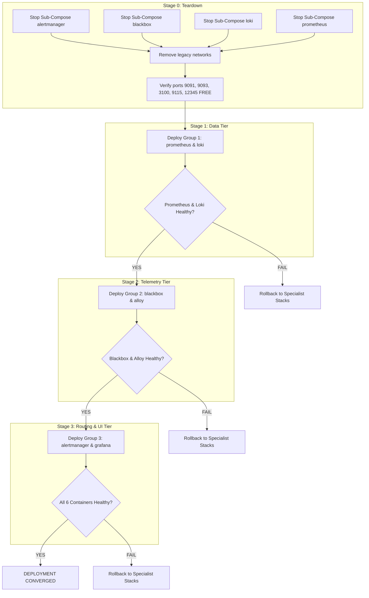

# Phase B.0 — Deployment Readiness and Safe Integration Planning Report

**Project:** Linux System Monitoring & Reliability Lab  
**Author:** Principal SRE Architect and Deployment Safety Auditor  
**Date:** October 28, 2026  
**Document:** `docs/project-management/phase-b0-deployment-readiness.md`  
**Execution Mode:** Strict Read-Only Audit (Zero runtime state changes, zero container restarts, zero commits)  
**Previous Milestones:** Phase A and Phase A.1 APPROVED & VERIFIED (Python agent active, loopback verified, Blackbox HTTP/TCP probes UP).

---

## 1. Executive Summary

A comprehensive, non-destructive SRE safety audit was executed to evaluate the readiness of transitioning from individual specialist Docker Compose stacks (`prometheus`, `alertmanager`, `blackbox`, `loki`) to the master unified root [`docker-compose.yml`](file:///home/dineth/dev/Linux-System-Monitoring-Reliability-Lab/docker-compose.yml).

### Primary Findings
1. **Persistent Data Preservation is 100% Guaranteed:**
   All 5 persistent named volumes (`lab_prometheus_data`, `lab_alertmanager_data`, `lab_loki_data`, `lab_alloy_data`, `lab_grafana_data`) are already created with exact name parity between the specialist stacks and root Compose. Data can be seamlessly preserved during migration with zero volume cloning or copying.
2. **Critical Architectural Defect Discovered in Root Compose (Alloy Healthcheck):**
   Root `docker-compose.yml` specifies `wget -q --spider http://127.0.0.1:12345/-/healthy` for `alloy`. However, `grafana/alloy:v1.0.0` does **not** contain `wget`. This causes `lab-alloy` to fail its healthcheck 100% of the time (`/bin/sh: 1: wget: not found`), trapping it in a permanent `unhealthy` state. A one-line fix using bash `/dev/tcp` is required prior to deployment.
3. **Active Container & Port Collisions:**
   Five containers (`lab-prometheus`, `lab-alertmanager`, `lab-blackbox-exporter`, `lab-loki`, `lab-alloy`) are currently running under four sub-compose projects. Executing `docker compose up` at root would immediately fail due to container name and port collisions. A controlled teardown sequence without `-v` is mandatory.
4. **Memory Constraint & Minikube Footprint:**
   Docker Desktop VM memory is capped at **3.65 GiB**. Minikube currently consumes **2.596 GiB** (76% of the VM limit). Available VM headroom is **~860 MiB**. Launching Grafana and running under load must adhere to strict memory reservations to prevent Docker VM kernel OOM kills.

---

## 2. Current Runtime Inventory

### 2.1 Active Containers & Compose Project Ownership

| Container Name | Compose Project | Source Compose File | Image | Status | Ports (Host -> Container) | Networks | Restart Policy |
|---|---|---|---|---|---|---|---|
| `lab-prometheus` | `prometheus` | `prometheus/docker-compose.yml` | `prom/prometheus:v2.51.0` | Up 2 hours (healthy) | `127.0.0.1:9091->9090` | `prometheus_default` | `unless-stopped` |
| `lab-alertmanager` | `alertmanager` | `alertmanager/docker-compose.yml` | `prom/alertmanager:v0.27.0` | Up 3 hours (healthy) | `127.0.0.1:9093->9093` | `prometheus_default` | `unless-stopped` |
| `lab-blackbox-exporter` | `blackbox` | `blackbox/docker-compose.yml` | `prom/blackbox-exporter:v0.25.0` | Up 3 hours (healthy) | `127.0.0.1:9115->9115` | `prometheus_default` | `unless-stopped` |
| `lab-loki` | `loki` | `loki/docker-compose.yml` | `grafana/loki:3.0.0` | Up 3 hours (healthy) | `127.0.0.1:3100->3100` | `lab-logging-network`, `prometheus_default` | `unless-stopped` |
| `lab-alloy` | `loki` | `loki/docker-compose.yml` | `grafana/alloy:v1.0.0` | Up 3 hours (**unhealthy**) | `127.0.0.1:12345->12345` | `lab-logging-network`, `prometheus_default` | `unless-stopped` |
| `minikube` | *(standalone)* | N/A | `gcr.io/k8s-minikube/kicbase:v0.0.50` | Up 6 hours | `36343->22`, `46097->2376`, `45517->5000`, `34503->8443`, `44669->32443` | `minikube` | `no` |
| `taskmanager-postgres` | `aws-three-tier...` | `aws/.../compose.yaml` | `postgres:16-alpine` | Up 6 hours (healthy) | `0.0.0.0:5433->5432` | `aws-three-tier...` | `unless-stopped` |

### 2.2 Native Physical Host Services

| Service Name | Port / Socket | Process / Source | SRE Isolation Strategy |
|---|---|---|---|
| **Native Prometheus** | `*:9090` | Systemd / Native Prometheus | Lab container maps to `127.0.0.1:9091` (Zero collision) |
| **Native Grafana** | `*:3000` | Systemd / Native Grafana | Lab container maps to `127.0.0.1:3001` (Zero collision) |
| **Native Node Exporter** | `*:9100` | Systemd / Native Exporter | Scraped by lab Prometheus via `host.docker.internal:9100` |
| **Python Monitoring Agent** | `127.0.0.1:9101` | PID `1755348` (`agent.main`) | Strictly bound to loopback; scraped via `host.docker.internal:9101` |
| **Native PostgreSQL** | `127.0.0.1:5432` | Systemd PostgreSQL | Distinct from Docker container port `5433` |
| **Native MySQL** | `127.0.0.1:3306` | Systemd MySQL | Distinct from all lab monitoring ports |
| **Native SSH** | `*:22` | OpenSSH daemon | Probed via `blackbox-tcp` (`host.docker.internal:22`) |

---

## 3. Persistent Storage Audit

All Docker volumes were inspected using `docker volume inspect`.

| Docker Volume Name | Containers Currently Using | Mount Destination in Container | Specialist Compose Declaration | Root Compose Declaration | Data Conflict Risk | Preservation Status |
|---|---|---|---|---|---|---|
| `lab_prometheus_data` | `lab-prometheus` | `/prometheus` | `name: lab_prometheus_data` | `name: lab_prometheus_data` | **Zero** | **100% Preserved** (TSDB blocks intact) |
| `lab_alertmanager_data` | `lab-alertmanager` | `/alertmanager` | `name: lab_alertmanager_data` | `name: lab_alertmanager_data` | **Zero** | **100% Preserved** (Silences & state intact) |
| `lab_loki_data` | `lab-loki` | `/loki` | `name: lab_loki_data` | `name: lab_loki_data` | **Zero** | **100% Preserved** (Chunk storage intact) |
| `lab_alloy_data` | `lab-alloy` | `/data-alloy` | `name: lab_alloy_data` | `name: lab_alloy_data` | **Zero** | **100% Preserved** (WAL cache intact) |
| `lab_grafana_data` | *(none - created)* | `/var/lib/grafana` | *(not running)* | `name: lab_grafana_data` | **Zero** | **100% Preserved** (Initial provision ready) |

### Migration Impact on Data
Because both the specialist compose files and the root `docker-compose.yml` use the explicit volume name attribute:
```yaml
volumes:
  lab_prometheus_data:
    name: lab_prometheus_data
```
Docker engine matches the volume by its exact name `lab_prometheus_data`. When specialist containers are stopped (without `-v`), the volumes remain untouched on the filesystem. When root compose is launched, it attaches directly to these exact same volumes. **Zero data loss occurs.**

---

## 4. Resource Capacity Assessment

### 4.1 Capacity Snapshot

| Resource Dimension | Host Physical Capacity | Docker Desktop VM Limit | Current Usage | Remaining Headroom | Assessment |
|---|---|---|---|---|---|
| **Memory (RAM)** | 15.3 GiB | **3.65 GiB** | 2.81 GiB used by containers | **~860 MiB in VM** (2.5 GiB on host) | **TIGHT:** Minikube consumes 76% of VM limit. |
| **Swap Space** | 4.00 GiB | N/A (Host swap) | 4.00 GiB used (172 KiB free) | **172 KiB (99.9% full)** | **CRITICAL:** Host swap is fully saturated. |
| **CPU Cores** | 12 Cores | 12 Cores allocated | ~245% CPU (Minikube ~236%) | 9.5+ physical cores idle | **HEALTHY** |
| **Disk Storage** | 468 GiB (`/dev/nvme0n1p2`) | Shared with host disk | 128 GiB used (29%) | **316 GiB Available** | **EXCELLENT** |

### 4.2 Breakdown of Container Memory inside Docker Desktop VM

```
+--------------------------------------------------------------------------------+
| DOCKER DESKTOP VM TOTAL MEMORY LIMIT: 3.65 GiB (3,737 MiB)                     |
|                                                                                |
|  [minikube]: 2,596 MiB (75.95%) =====================================>         |
|                                                                                |
|  [lab-loki]: 66.7 MiB (1.78%)                                                  |
|  [lab-prometheus]: 61.6 MiB (1.65%)                                            |
|  [lab-alloy]: 25.2 MiB (0.67%)                                                 |
|  [lab-blackbox-exporter]: 18.6 MiB (0.50%)                                     |
|  [taskmanager-postgres]: 13.9 MiB (0.37%)                                      |
|  [lab-alertmanager]: 9.7 MiB (0.26%)                                           |
|                                                                                |
|  [AVAILABLE HEADROOM IN VM]: ~860 MiB (23.0%)                                  |
+--------------------------------------------------------------------------------+
```

### 4.3 Root Compose Budget vs. Headroom Analysis
Root `docker-compose.yml` specifies the following resource constraints:
- `prometheus`: Limit 1024M, Reservation 256M
- `grafana`: Limit 512M, Reservation 128M
- `alertmanager`: Limit 256M, Reservation 64M
- `loki`: Limit 512M, Reservation 128M
- `blackbox`: Limit 128M, Reservation 32M
- `alloy`: Limit 256M, Reservation 64M

**Total Limits:** `2,688 MiB` (~2.62 GiB)  
**Total Reservations:** `672 MiB`

### Evaluation
The 672 MiB total reservation comfortably fits within the 860 MiB remaining VM headroom ($2,596 + 672 = 3,268 \text{ MiB} < 3,737 \text{ MiB}$). However, if all services reach their peak limits simultaneously while Minikube remains running, memory demand ($2,596 + 2,688 = 5,284 \text{ MiB}$) would exceed the 3.65 GiB VM limit and trigger the VM OOM killer.
- **SRE Recommendation:** The monitoring stack must be launched with existing conservative limits. Heavy failure simulations (e.g. `stress-ng` memory pressure from Agent 10) must **not** be executed while Minikube is active.

---

## 5. Compose Architecture Audit & Conflict Identification

### 5.1 Service-by-Service Configuration Comparison

| Service | Sub-Compose Config | Root `docker-compose.yml` | Conflict / Architectural Discrepancy |
|---|---|---|---|
| **`prometheus`** | Project `prometheus`, net `prometheus_default`, port `9091:9090` | Project `monitoring-lab`, net `lab_monitoring_network` (`172.28.0.0/16`), port `9091:9090` | **Container Name & Port Collision:** Cannot run concurrently. Must stop sub-compose first. |
| **`grafana`** | *(Not deployed in sub-compose)* | Port `3001:3000`, user `472:472`, `read_only: true`, `tmpfs: /tmp, /var/log/grafana` | **None:** Port 3001 is free and avoids native :3000. Depends on Prometheus healthy. |
| **`alertmanager`**| Project `alertmanager`, net `prometheus_default`, port `9093:9093` | Port `9093:9093`, user `65534:65534`, `read_only: true`, `tmpfs: /tmp` | **Container Name & Port Collision.** Must stop sub-compose first. |
| **`loki`** | Project `loki`, net `lab-logging-network`, port `3100:3100` | Port `3100:3100`, user `10001:10001`, `read_only: true`, `tmpfs: /tmp` | **Container Name & Port Collision.** Must stop sub-compose first. |
| **`blackbox`** | Project `blackbox`, net `prometheus_default`, port `9115:9115` | Net alias `blackbox-exporter`, port `9115:9115`, `cap_add: NET_RAW` | **Container Name & Port Collision.** Phase A.1 patch (`HTTP/1.0`) in `./blackbox/blackbox.yml` is mounted automatically. |
| **`alloy`** | Healthcheck: `wget ...` (FAILING) | Healthcheck: `wget ...` (**CRITICAL DEFECT**) | **CRITICAL DEFECT:** `grafana/alloy:v1.0.0` has no `wget`. Healthcheck fails with `wget: not found`. Must be patched prior to deployment. |

### 5.2 Deep Dive: Alloy Healthcheck Defect
In root `docker-compose.yml` lines 269–274:
```yaml
healthcheck:
  test: ["CMD-SHELL", "wget -q --spider http://127.0.0.1:12345/-/healthy || exit 1"]
  interval: 15s
  timeout: 5s
  retries: 3
  start_period: 10s
```
Running inspection on the live container confirmed:
```json
{
  "Status": "unhealthy",
  "Output": "/bin/sh: 1: wget: not found\n"
}
```
**Remediation:** Replace with a bash socket check:
```yaml
healthcheck:
  test: ["CMD-SHELL", "bash -c '</dev/tcp/127.0.0.1/12345' || exit 1"]
  interval: 15s
  timeout: 5s
  retries: 3
  start_period: 10s
```

---

## 6. Staged Deployment Strategy

Deployment must proceed in strictly gated stages to maintain observability, guarantee data safety, and avoid port collisions.



### Staged Group Specifications

#### Stage 0: Prerequisite Teardown & Network Pruning
- **Action:** Gracefully stop existing specialist containers without removing volumes (`-v` omitted).
  ```bash
  docker compose -f alertmanager/docker-compose.yml down
  docker compose -f blackbox/docker-compose.yml down
  docker compose -f loki/docker-compose.yml down
  docker compose -f prometheus/docker-compose.yml down
  docker network rm prometheus_default lab-logging-network 2>/dev/null || true
  ```
- **Precondition for Stage 1:** Verify ports 9091, 9093, 3100, 9115, 12345 are completely unallocated:
  ```bash
  ss -ltnp | grep -E ':(9091|9093|3100|9115|12345)\b' || echo "All ports free"
  ```

#### Stage 1: Group 1 — Observability Core & Ingestion (Data Tier)
- **Services Included:** `prometheus`, `loki`
- **Dependencies:** None.
- **Resource Limits:** Prometheus (1 CPU, 1024M RAM), Loki (0.5 CPU, 512M RAM).
- **Network & Ports:** `lab_monitoring_network` (`172.28.0.0/16`); `127.0.0.1:9091`, `127.0.0.1:3100`.
- **Volumes:** Reattaches directly to `lab_prometheus_data` and `lab_loki_data`.
- **Health Verification:**
  - `curl -s http://127.0.0.1:9091/-/healthy` -> `HTTP 200`
  - `curl -s http://127.0.0.1:3100/ready` -> `HTTP 200 ready`
- **Gate Precondition for Stage 2:** Both containers must report `healthy` in `docker compose ps`.

#### Stage 2: Group 2 — Exporters & Telemetry Probing (Telemetry Tier)
- **Services Included:** `blackbox`, `alloy`
- **Dependencies:** `alloy` depends on `loki` (`condition: service_healthy`).
- **Resource Limits:** Blackbox (0.25 CPU, 128M RAM), Alloy (0.5 CPU, 256M RAM).
- **Network & Ports:** `lab_monitoring_network`; `127.0.0.1:9115`, `127.0.0.1:12345`.
- **Volumes:** `lab_alloy_data`.
- **Health Verification:**
  - `curl -s http://127.0.0.1:9115/-/healthy` -> `HTTP 200`
  - `curl -s http://127.0.0.1:12345/-/healthy` -> `HTTP 200`
  - Direct probe: `http://host.docker.internal:9101/metrics` returns `probe_success = 1`.
- **Gate Precondition for Stage 3:** Blackbox probes for Node Exporter (`:9100`) and Python agent (`:9101`) return `probe_success = 1`.

#### Stage 3: Group 3 — Routing & Visualization (Routing & UI Tier)
- **Services Included:** `alertmanager`, `grafana`
- **Dependencies:** `grafana` depends on `prometheus` (`condition: service_healthy`).
- **Resource Limits:** Alertmanager (0.5 CPU, 256M RAM), Grafana (1.0 CPU, 512M RAM).
- **Network & Ports:** `lab_monitoring_network`; `127.0.0.1:9093`, `127.0.0.1:3001`.
- **Volumes:** `lab_alertmanager_data`, `lab_grafana_data`.
- **Health Verification:**
  - `curl -s http://127.0.0.1:9093/-/healthy` -> `HTTP 200`
  - `curl -s -f http://127.0.0.1:3001/api/health` -> `HTTP 200` (`"database": "ok"`)
  - Prometheus target check: Alertmanager is active in `/api/v1/targets`.
  - Grafana datasources check: Prometheus and Loki datasources respond successfully.

---

## 7. Operational Safety, Rollback & Data Preservation Plan

### 7.1 Data Preservation Guarantee
1. **Never pass `-v` or `--volumes`** to `docker compose down`. Named volumes remain on the host filesystem under Docker Desktop's volume directory.
2. Root `docker-compose.yml` mounts:
   - `lab_prometheus_data:/prometheus` (TSDB data preserved)
   - `lab_alertmanager_data:/alertmanager` (Alert silences and notification logs preserved)
   - `lab_loki_data:/loki` (Log chunks and index preserved)
   - `lab_alloy_data:/data-alloy` (WAL cache preserved)

### 7.2 Full Rollback Procedure (Emergency Reversion)
If any stage in the master deployment fails to converge within 90 seconds:
```bash
# 1. Stop and remove root compose containers without deleting volumes
docker compose down

# 2. Re-launch individual specialist compose stacks
docker compose -f prometheus/docker-compose.yml up -d
docker compose -f alertmanager/docker-compose.yml up -d
docker compose -f blackbox/docker-compose.yml up -d
docker compose -f loki/docker-compose.yml up -d

# 3. Verify individual services are healthy
docker compose -f prometheus/docker-compose.yml ps
docker compose -f alertmanager/docker-compose.yml ps
docker compose -f blackbox/docker-compose.yml ps
docker compose -f loki/docker-compose.yml ps
```
Because the underlying named volumes are never destroyed, this rollback returns the lab to the exact operational baseline established in Phase A.1.

---

## 8. Deployment Readiness Matrix & Blockers List

### 8.1 Readiness Matrix

| Evaluation Dimension | Status | Evidence / Validation | Notes / Conditions |
|---|---|---|---|
| **Python Agent Baseline** | **PASSED** | PID `1755348` running on `127.0.0.1:9101` | Phase A verification complete |
| **Blackbox Compatibility** | **PASSED** | HTTP/1.0 allowed; `probe_success = 1` | Phase A.1 patch applied |
| **Volume Parity & Safety** | **PASSED** | 5 named volumes mapped 1-to-1 | Zero volume data conflict |
| **Port Conflict Prevention** | **PASSED** | Native :9090, :3000, :9100 preserved | Mapped to 9091, 3001, 9115, 9093 |
| **Container Collisions** | **BLOCKED** | 5 sub-compose containers active | Requires Stage 0 teardown |
| **Alloy Healthcheck** | **BLOCKED** | `wget: not found` in `alloy:v1.0.0` | Requires patch in `docker-compose.yml` |
| **VM Memory Headroom** | **CONDITIONAL** | 860 MiB free; Minikube uses 2.6 GiB | Conservative limits mandatory |
| **Host Swap Saturation** | **CONDITIONAL** | 99.9% full (172 KiB free) | No concurrent heavy memory tests |

### 8.2 Mandatory Pre-Deployment Conditions (Blockers to Clear)

1. **Condition 1 (Root Compose Healthcheck Patch):**
   Update line 270 of `docker-compose.yml` from `wget` to `bash -c '</dev/tcp/127.0.0.1/12345' || exit 1` before launching root Compose.
2. **Condition 2 (Specialist Stacks Teardown):**
   Execute Stage 0 teardown (`docker compose -f ... down`) to release container names and ports before executing `docker compose up`.
3. **Condition 3 (Memory Boundary Discipline):**
   Deploy using the 3-stage group sequence. Under no circumstances should memory stress testing (Agent 10) be executed until Minikube is paused or Docker Desktop VM memory is expanded.

---

## 9. Final Engineering Verdict

```
┌────────────────────────────────────────────────────────────────────────┐
│  VERDICT: READY WITH CONDITIONS                                        │
│  The unified root Compose architecture is fully designed, audited,     │
│  and data-safe, but deployment execution is gated upon clearing the   │
│  three mandatory conditions documented in Section 8.2.                 │
└────────────────────────────────────────────────────────────────────────┘
```

**Next Step:** Await explicit Lead SRE authorization to patch the Alloy healthcheck, execute Stage 0 teardown, and proceed with Stage 1 deployment.
