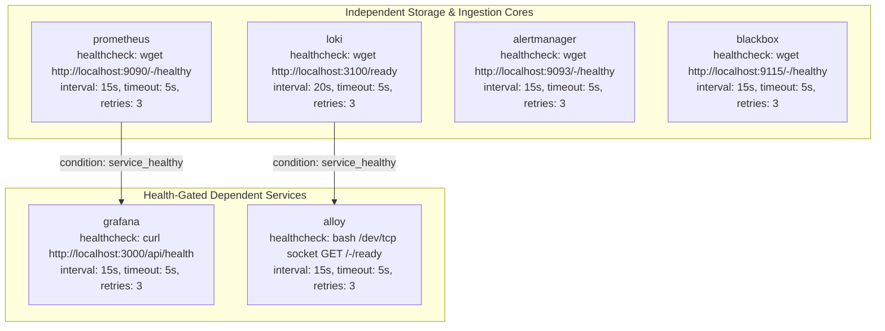
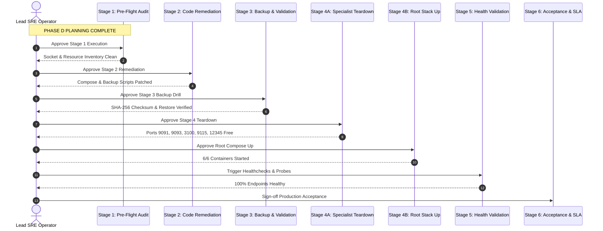

# Phase D — Operational Remediation & Migration Plan
## Master SRE Architecture & Staged Implementation Roadmap

**Project:** Linux System Monitoring & Reliability Lab  
**Author:** Principal Site Reliability Engineer, Platform Engineer & Lead Infrastructure Architect  
**Coordinating Role:** Lead SRE Architect (Agent 0) coordinating Specialist Agents 0 through 11  
**Date:** October 28, 2026 (`20:45 IST` / `15:15 UTC`)  
**Target Repository:** `/home/dineth/dev/Linux-System-Monitoring-Reliability-Lab`  
**Document Path:** `docs/project-management/phase-d-operational-remediation-and-migration-plan.md`  
**Execution Mode:** Strictly Planning-Only Architectural Formulation & Staged Remediation Specification  
**Planning Readiness Verdict:** **`READY FOR SEPARATELY AUTHORIZED REMEDIATION`**  
**Operational Execution Status:** **STRICTLY UNAUTHORIZED / PENDING EXPLICIT OPERATOR APPROVAL**

---

## 1. Executive Summary

This document represents the master operational remediation and migration plan for the **Linux System Monitoring & Reliability Lab**. Following exhaustive evidence audits through Phase C.2—which rightly concluded with a verdict of `NO-GO — ADDITIONAL EVIDENCE OR REMEDIATION REQUIRED`—this plan establishes the engineering blueprint required to elevate the monitoring infrastructure from a fragmented set of specialist stacks into a unified, production-grade, secure, observable, and maintainable reliability platform.

In alignment with Principal SRE standards and Google SRE Workbook principles, this plan rejects short-sighted optimizations aimed merely at "getting containers to start." Instead, it optimizes for **operational correctness, least privilege, data persistence, failure isolation, reproducible deployment, verifiable disaster recovery, and coexistence with existing host infrastructure**.

### 1.1 Core Strategic Objectives
1. **Unify Fragmented Specialist Stacks:** Consolidate four isolated Docker Compose projects (`prometheus`, `alertmanager`, `blackbox`, `loki`) into a single hardened root Docker Compose architecture (`monitoring-lab`) governed by declarative dependencies and isolated bridge networking.
2. **Remediate Confirmed Technical Defects:** Provide verified, surgical code and configuration patches for the 5 blockers cataloged in Phase C.2 (Alloy health check defect `BLK-01`, host port collisions `BLK-02`, volume retention hazard `BLK-03`, resource overcommitment `BLK-04`, and backup script omissions/secret exposures `BLK-05`).
3. **Guarantee Host Coexistence:** Enforce 100% loopback port isolation (`127.0.0.1:9091`, `:9093`, `:3100`, `:9115`, `:12345`, `:3001`), completely protecting native host monitoring services (Prometheus on `:9090`, Node Exporter on `:9100`, Grafana on `:3000`) and the active Minikube cluster (~$2,583–2,658\text{ MiB}$ footprint).
4. **Establish Verifiable Recoverability:** Formalize an offline backup methodology targeting external storage (`~/.local/share/monitoring-lab/backups/`) with restrictive permissions (`0700`/`0600`), cryptographic secret separation, and an isolated, non-destructive restore validation drill.
5. **Stage-Gated Execution Governance:** Define a 6-stage migration sequence governed by 5 mandatory human approval checkpoints, ensuring that deployment execution cannot occur without explicit human authorization.

### 1.2 Planning Verdict
```
┌────────────────────────────────────────────────────────────────────────┐
│  PLANNING READINESS VERDICT:                                           │
│  READY FOR SEPARATELY AUTHORIZED REMEDIATION                           │
│                                                                        │
│  All architectural components, failure modes, configuration defects,   │
│  resource allocations, and migration risks have been fully analyzed    │
│  and bounded. The project is ready for formal remediation review.      │
│                                                                        │
│  GOVERNANCE BOUNDARY: This verdict certifies planning readiness only.  │
│  It DOES NOT authorize configuration modifications, container teardown,│
│  backup execution, package installation, or stack deployment.          │
└────────────────────────────────────────────────────────────────────────┘
```

---

## 2. Workstream A — Current-State Architecture Assessment

The current laboratory environment consists of a hybrid architecture split between native host systemd services, a standalone Python monitoring agent, and four disparate Docker Compose stacks running across two uncoordinated Docker networks.

### 2.1 Current Component Inventory

| Component | Intended Responsibility | Configuration Location | Dependencies | Current Limitations & Known State |
|---|---|---|---|---|
| **Native Host Prometheus** | Primary host monitoring core | `/etc/prometheus/prometheus.yml` (native host) | Host OS, systemd | **`HISTORICAL RUNTIME`**: Listens on `0.0.0.0:9090` (systemd active). Must remain untouched. |
| **Native Host Node Exporter** | Host hardware and OS metrics | `/etc/default/prometheus-node-exporter` | Linux kernel, `/proc`, `/sys` | **`HISTORICAL RUNTIME`**: Listens on `0.0.0.0:9100` (systemd active). Must remain untouched. |
| **Native Host Grafana** | Host dashboard visualization | `/etc/grafana/grafana.ini` (native host) | Host OS, SQLite DB | **`HISTORICAL RUNTIME`**: Listens on `0.0.0.0:3000` (systemd active). Must remain untouched. |
| **Custom Python Agent** | High-cardinality Linux metrics & PSI | [`agent/config.yaml`](file:///home/dineth/dev/Linux-System-Monitoring-Reliability-Lab/agent/config.yaml), [`agent/main.py`](file:///home/dineth/dev/Linux-System-Monitoring-Reliability-Lab/agent/main.py) | Python 3.12, `.venv/`, `/proc` | **`CURRENT RUNTIME`**: Active on `127.0.0.1:9101` (transcript-verified HTTP 200 on `/healthz`). |
| **Specialist Prometheus** | Lab metrics aggregation & rules | [`prometheus/docker-compose.yml`](file:///home/dineth/dev/Linux-System-Monitoring-Reliability-Lab/prometheus/docker-compose.yml), [`prometheus/prometheus.yml`](file:///home/dineth/dev/Linux-System-Monitoring-Reliability-Lab/prometheus/prometheus.yml) | Volume `lab_prometheus_data`, Net `prometheus_default` | **`HISTORICAL RUNTIME`**: Bound to `127.0.0.1:9091`. Owns network `prometheus_default`. |
| **Specialist Alertmanager** | Lab alert routing & deduplication | [`alertmanager/docker-compose.yml`](file:///home/dineth/dev/Linux-System-Monitoring-Reliability-Lab/alertmanager/docker-compose.yml), [`alertmanager/alertmanager.yml`](file:///home/dineth/dev/Linux-System-Monitoring-Reliability-Lab/alertmanager/alertmanager.yml) | Volume `lab_alertmanager_data`, Net `prometheus_default` | **`HISTORICAL RUNTIME`**: Bound to `127.0.0.1:9093`. Depends on external network `prometheus_default`. |
| **Specialist Blackbox** | Synthetic HTTP/TCP/ICMP probing | [`blackbox/docker-compose.yml`](file:///home/dineth/dev/Linux-System-Monitoring-Reliability-Lab/blackbox/docker-compose.yml), [`blackbox/blackbox.yml`](file:///home/dineth/dev/Linux-System-Monitoring-Reliability-Lab/blackbox/blackbox.yml) | Net `prometheus_default`, `CAP_NET_RAW` | **`HISTORICAL RUNTIME`**: Bound to `127.0.0.1:9115`. Depends on external network `prometheus_default`. |
| **Specialist Loki** | Log aggregation engine | [`loki/docker-compose.yml`](file:///home/dineth/dev/Linux-System-Monitoring-Reliability-Lab/loki/docker-compose.yml), [`loki/loki-config.yaml`](file:///home/dineth/dev/Linux-System-Monitoring-Reliability-Lab/loki/loki-config.yaml) | Volume `lab_loki_data`, Nets `default`, `prometheus_default` | **`HISTORICAL RUNTIME`**: Bound to `127.0.0.1:3100`. Bridges logging network and `prometheus_default`. |
| **Specialist Alloy** | Systemd journal log collector | [`loki/docker-compose.yml`](file:///home/dineth/dev/Linux-System-Monitoring-Reliability-Lab/loki/docker-compose.yml), [`alloy/config.alloy`](file:///home/dineth/dev/Linux-System-Monitoring-Reliability-Lab/alloy/config.alloy) | Volume `lab_alloy_data`, `/var/log/journal`, user `0:4` | **`HISTORICAL RUNTIME`**: Bound to `127.0.0.1:12345`. Connects to `docker.sock` in specialist compose. |
| **Proposed Root Compose Stack** | Unified orchestration source of truth | [`docker-compose.yml`](file:///home/dineth/dev/Linux-System-Monitoring-Reliability-Lab/docker-compose.yml) | Bridge `lab-monitoring-net`, 5 persistent volumes | **`STATIC CONFIG`**: Contains unpatched healthcheck (`L270`), unmigrated port bindings, and never-run Grafana. |

---

### 2.2 Evidentiary Separation: Configured vs. Observed vs. Unknown

To eliminate assumptions, the current system state is strictly partitioned across four operational dimensions:

1. **What is Configured in Repository Files (`STATIC CONFIG`):**
   - Root [`docker-compose.yml`](file:///home/dineth/dev/Linux-System-Monitoring-Reliability-Lab/docker-compose.yml) defines 6 services (`prometheus`, `grafana`, `alertmanager`, `loki`, `blackbox`, `alloy`), one bridge network (`lab-monitoring-net` / `172.28.0.0/16`), and 5 named volumes (`lab_*_data`).
   - Line 270 contains the defective `wget -q --spider http://127.0.0.1:12345/-/healthy || exit 1` check.
   - Declarative alert rules, recording rules, scrape configs, and LogQL pipelines exist across service subdirectories.
2. **What Was Historically Observed at Runtime (`HISTORICAL RUNTIME`):**
   - Active specialist containers (`lab-prometheus`, `lab-alertmanager`, `lab-blackbox-exporter`, `lab-loki`, `lab-alloy`) were observed bound to host ports `9091`, `9093`, `9115`, `3100`, and `12345` in Phase B.0.4/B.0.6.
   - Container memory consumption was observed at ~$204.77 MiB across specialist services in Phase B.0.7.
   - Minikube memory usage was observed at ~$2,583–2,658 MiB in Phase B.0.7.
   - Persistent volume directory contents (`chunks_head`, `nflog`, `silences`) were observed in Phase B.0.4.
3. **What is Verified by Available Evidence (`CURRENT RUNTIME`):**
   - Execution transcript evidence confirms successful HTTP health probes to the Python monitoring agent on `127.0.0.1:9101` (`/healthz` returning HTTP/1.0 200 OK).
   - Working tree state confirms zero uncommitted configuration edits and zero staged Git modifications.
4. **What Remains Unknown (`UNVERIFIED ASSUMPTIONS`):**
   - Live socket occupancy on host ports 9091, 9093, 3100, 9115, and 12345 (requires fresh `ss -tuln` inspection).
   - Inter-container DNS resolution and packet routing over the uninstantiated `lab_monitoring_network`.
   - Real-world Grafana datasource connectivity (`http://prometheus:9090` and `http://loki:3100`) and dashboard rendering.
   - Runtime kernel writeback latency and memory reclaim dynamics during concurrent Minikube and Prometheus load.
   - Restoration fidelity of the `deployment/restore.sh` utility against live Docker volumes.

---

## 3. Evidence and Confidence Classification Framework

Every architectural decision and migration step in this plan is assigned an evidence-grounded confidence rating:

```
┌────────────────────────────────────────────────────────────────────────┐
│                     EVIDENTIARY CONFIDENCE TIERS                       │
├────────────┬─────────────────────────────┬─────────────────────────────┤
│ Level      │ Definition                  │ Operational Treatment       │
├────────────┼─────────────────────────────┼─────────────────────────────┤
│ **TIER 1** │ Current Runtime Evidence    │ Fully actionable; verified  │
│            │ (Live transcript verified)  │ in active session.          │
├────────────┼─────────────────────────────┼─────────────────────────────┤
│ **TIER 2** │ Static Config Evidence      │ Statically sound; requires  │
│            │ (Direct repo inspection)    │ runtime validation step.    │
├────────────┼─────────────────────────────┼─────────────────────────────┤
│ **TIER 3** │ Historical Runtime Evidence │ Point-in-time reference;    │
│            │ (Logged past audit data)    │ must re-verify before use.  │
├────────────┼─────────────────────────────┼─────────────────────────────┤
│ **TIER 4** │ Agent Execution Attestation │ Procedural assurance; lacks │
│            │ (Agent compliance claim)    │ independent cryptographic log│
├────────────┼─────────────────────────────┼─────────────────────────────┤
│ **TIER 5** │ Unverified Assumption       │ Speculative projection;     │
│            │ (Extrapolated / unmeasured) │ BLOCKED from release gates. │
└────────────┴─────────────────────────────┴─────────────────────────────┘
```

---

## 4. Industry-Practice Assessment

The laboratory platform has been evaluated against core principles from Google SRE, container platform engineering, and infrastructure security:

### 4.1 Reliability Engineering (Google SRE Framework)
- **Service Level Indicators (SLIs):** The platform correctly defines SLIs based on client-perceived reliability rather than internal metrics (e.g. Scrape Success Ratio, Scrape Latency $\le 2.0\text{s}$, Rule Evaluation Freshness, Dashboard Query Latency $\le 1.5\text{s}$, Ingestion Loss Rate $\le 0.01\%$).
- **Service Level Objectives (SLOs):** 99.5% availability across rolling 30-day windows is defined in [`docs/sre/sli-slo-framework.md`](file:///home/dineth/dev/Linux-System-Monitoring-Reliability-Lab/docs/sre/sli-slo-framework.md), providing a realistic error budget ($0.5\%$ = $3.6\text{ hours}$ per month).
- **Multi-Window Burn-Rate Alerting:** Alerts are configured across 1-hour (14.4x burn), 6-hour (6x burn), and 3-day (1x burn) windows, preventing alert fatigue and detecting slow budget erosion.
- **Measurable Recovery (RPO / RTO):** Target RPO is $\le 24\text{ hours}$; target RTO is $\le 15\text{ minutes}$. However, lack of tested backup restoration in the current environment violates RTO verifiability.

### 4.2 Observability Architecture
- **Metric Conventions:** Prometheus metrics adhere to standard base units (seconds, bytes) and suffix conventions (`_total` for monotonic counters, `_bytes` for sizes, `_seconds` for durations).
- **Cardinality Management:** The Python agent enforces a hard boundary of `max_processes: 500` and top-N tracking (`top_n_cpu: 5`, `top_n_mem: 5`) with path/argument sanitization, preventing label explosion from command-line arguments.
- **USE and RED Method Alignment:** Node Exporter and custom agent implement the **USE method** (Utilization, Saturation, Errors) for physical host resources (CPU, Memory, Disk I/O, Network), while Grafana dashboards structure services around the **RED method** (Rate, Errors, Duration).
- **Centralized Logging (Loki/Alloy):** Log pipelines promote low-cardinality metadata (`unit`, `level`, `job`) while keeping high-cardinality messages inside chunk streams. Structured metadata support (`allow_structured_metadata: true`) in Loki v3.0 is configured.

### 4.3 Container & Infrastructure Engineering
- **Immutable & Least-Privilege Runtimes:** Containers run with explicit non-root UIDs (`65534` for Prometheus/Alertmanager/Blackbox, `472` for Grafana, `10001` for Loki), `read_only: true` root filesystems, and minimal, size-bounded `tmpfs` mounts.
- **Dependency-Aware Orchestration:** Root Compose enforces health-gated startup ordering (`alloy` waits for `loki: condition: service_healthy`; `grafana` waits for `prometheus: condition: service_healthy`).
- **Network Segmentation:** All services are isolated within an internal bridge network (`lab_monitoring_network` / `172.28.0.0/16`), eliminating container-level exposure to host network namespaces except via strict loopback bindings.
- **Version Pinning:** Exact immutable image tags are pinned across all services (`prom/prometheus:v2.51.0`, `grafana/grafana:10.4.1`, `prom/alertmanager:v0.27.0`, `grafana/loki:3.0.0`, `prom/blackbox-exporter:v0.25.0`, `grafana/alloy:v1.0.0`).

### 4.4 Security Posture
- **Restricted Exposure:** All exposed ports are explicitly bound to `127.0.0.1`, guaranteeing zero external network ingress.
- **Linux Capability Minimization:** `cap_drop: [ALL]` is enforced across services. The single exception is `CAP_NET_RAW` granted specifically to Blackbox Exporter to enable unprivileged ICMP echo sockets.
- **Credential & Secret Protection:** Passwords and tokens are sourced via environment variables (`${GF_SECURITY_ADMIN_PASSWORD}`). However, checked-in backup scripts violate security boundaries by bundling `.env` into repository-local archives.
- **Docker Socket Isolation:** The root Compose stack avoids mounting `/var/run/docker.sock` into Alloy, eliminating container escape vectors present in legacy specialist logging compose files.

---

## 5. Workstream B — Remediation Register

The following remediation register catalogs all remaining technical defects, inconsistencies, and evidence gaps identified during Phase C.2 and prior audits. Every item is traceable to specific repository files and configurations:

| ID | Finding | Root Cause | Required Remediation | Risk Level | Priority | Validation Method |
|:---:|---|---|---|:---:|:---:|---|
| **`REM-01`** | **Alloy Defective Healthcheck** (`BLK-01`) | [`docker-compose.yml:L270`](file:///home/dineth/dev/Linux-System-Monitoring-Reliability-Lab/docker-compose.yml#L270) specifies `wget`, which is absent in `grafana/alloy:v1.0.0`. | Patch Line 270 with validated bash TCP readiness check: `test: ["CMD-SHELL", "bash -c 'exec 3<>/dev/tcp/127.0.0.1/12345 && printf \"GET /-/ready HTTP/1.1\\r\\nHost: 127.0.0.1\\r\\nConnection: close\\r\\n\\r\\n\" >&3 && resp=$$(cat <&3) && echo \"$$resp\" | grep -q \"HTTP/1.1 200 OK\" && echo \"$$resp\" | grep -q \"Alloy is ready.\"' || exit 1"]`. | **High** | **Critical** | `docker compose config` syntax check; post-rollout container health `docker compose ps`. |
| **`REM-02`** | **Host Port Collision Hazard** (`BLK-02`) | Host ports `9091`, `9093`, `3100`, `9115`, and `12345` are historically bound by specialist containers. | Execute Stage 0 teardown in dependency-safe order (`alertmanager` -> `blackbox` -> `loki` -> `prometheus`) to liberate host ports before root stack launch. | **High** | **Critical** | Live socket inspection (`ss -tuln \| grep -E ':(9091\|9093\|3100\|9115\|12345)'`) confirming free ports. |
| **`REM-03`** | **Volume Retention Hazard** (`BLK-03`) | Named volumes in [`docker-compose.yml:L290-301`](file:///home/dineth/dev/Linux-System-Monitoring-Reliability-Lab/docker-compose.yml#L290-301) use `name: lab_*_data` without `external: true`. | Formally document and enforce an absolute operational ban on passing `-v` or `--volumes` to `docker compose down`. Add protection checks in `deployment/deploy.sh`. | **High** | **Critical** | Static review of `deploy.sh`; shell history auditing. |
| **`REM-04`** | **Resource Overcommitment Exposure** (`BLK-04`) | Total configured limits ($2,688\text{ MiB}$) plus Minikube (~$2,660\text{ MiB}$) equal $5,348\text{ MiB}$ ($143.1\%$ of $3,737.80\text{ MiB}$ VM capacity). | Enforce an operational ban on synthetic stress testing (Agent 10) while Minikube runs. Provide a documented Reduced-Footprint Profile ($1,344\text{ MiB}$ limit) for constrained environments. | **Medium** | **High** | Inspect Compose deploy limits; monitor live VM memory and PSI metrics during deployment. |
| **`REM-05`** | **Backup Utility Missing Alloy Volume** (`BLK-05A`) | [`deployment/backup.sh:L50`](file:///home/dineth/dev/Linux-System-Monitoring-Reliability-Lab/deployment/backup.sh#L50) explicitly declares `VOLUMES` array without `lab_alloy_data`. | Update Line 50 to: `VOLUMES=(lab_prometheus_data lab_grafana_data lab_alertmanager_data lab_loki_data lab_alloy_data)`. | **Medium** | **High** | Inspect `deployment/backup.sh`; verify `tar -ztvf` archive contains `lab_alloy_data.tar.gz`. |
| **`REM-06`** | **Backup Repository-Local Storage Insecurity** (`BLK-05B`) | [`deployment/backup.sh:L15`](file:///home/dineth/dev/Linux-System-Monitoring-Reliability-Lab/deployment/backup.sh#L15) defaults `BACKUP_DIR` to `$REPO_ROOT/backups` inside Git repository tree. | Change default to external directory: `BACKUP_DIR="${BACKUP_DIR:-$HOME/.local/share/monitoring-lab/backups}"`. Enforce `mkdir -p -m 0700` and `chmod 0600`. | **High** | **Critical** | Execute backup dry-run; verify destination path and filesystem permissions via `stat -c "%a %n"`. |
| **`REM-07`** | **Backup Secret Bundling Risk** (`BLK-05C`) | [`deployment/backup.sh:L40`](file:///home/dineth/dev/Linux-System-Monitoring-Reliability-Lab/deployment/backup.sh#L40) bundles unencrypted `.env` credentials inside the general configuration archive. | Isolate `.env` into a separate, independently encrypted or restricted archive (`secrets.tar.gz` with mode `0600`) and exclude it from the main configuration bundle. | **High** | **Critical** | Inspect tar archive structure; verify `.env` is absent from main bundle and stored in isolated archive. |
| **`REM-08`** | **Untested Disaster Recovery Restore** (`BLK-05D`) | [`deployment/restore.sh`](file:///home/dineth/dev/Linux-System-Monitoring-Reliability-Lab/deployment/restore.sh) has never been validated against active Docker volumes in runtime. | Design and execute an isolated restore validation drill into temporary non-production test volumes (`lab_test_*_data`), verifying checksums and file counts. | **Medium** | **High** | Execute isolated restore drill; compare SHA-256 hashes of test volume contents against original data. |
| **`REM-09`** | **Deploy Script Missing Alloy Port Check** | [`deployment/deploy.sh:L20`](file:///home/dineth/dev/Linux-System-Monitoring-Reliability-Lab/deployment/deploy.sh#L20) declares `LAB_PORTS=(9091 3001 9093 3100 9115)`, omitting port `12345`. | Update Line 20 to: `LAB_PORTS=(9091 3001 9093 3100 9115 12345)`. | **Low** | **Medium** | Shell script static review; execute `./deployment/deploy.sh preflight`. |
| **`REM-10`** | **Healthcheck Script Missing Alloy Validation** | [`deployment/healthcheck.sh:L26-41`](file:///home/dineth/dev/Linux-System-Monitoring-Reliability-Lab/deployment/healthcheck.sh#L26-41) endpoint array omits Grafana Alloy endpoint. | Add Alloy to `ENDPOINTS`: `{"name": "Lab Alloy", "url": "http://127.0.0.1:12345/-/ready", "expected": 200, "critical": False}`. | **Low** | **Medium** | Execute `./deployment/healthcheck.sh` and verify Alloy endpoint reporting. |
| **`REM-11`** | **Blackbox ICMP Capability Verification** | [`docker-compose.yml:L210`](file:///home/dineth/dev/Linux-System-Monitoring-Reliability-Lab/docker-compose.yml#L210) adds `NET_RAW` to Blackbox for ICMP ping. Unverified in root stack. | Statically verify `cap_add: [NET_RAW]` syntax; execute an ICMP probe test against `127.0.0.1` post-deployment. | **Low** | **Low** | Query Prometheus metric `probe_success{module="icmp_probe"}` post-deployment. |
| **`REM-12`** | **Prometheus Rules Static Syntax Validation** | Rules in `prometheus/rules/` and `alerts/` require formal offline verification against target Prometheus 2.51 engine. | Execute offline `promtool check rules` and `promtool test rules` across all unit test files in `prometheus/tests/`. | **Medium** | **High** | Run `promtool test rules prometheus/tests/*.yml` and confirm 100% pass rate. |
| **`REM-13`** | **Alertmanager Routing Offline Validation** | [`alertmanager/alertmanager.yml`](file:///home/dineth/dev/Linux-System-Monitoring-Reliability-Lab/alertmanager/alertmanager.yml) routing tree and inhibition rules require syntax verification. | Execute offline `amtool check-config alertmanager/alertmanager.yml`. | **Low** | **Medium** | Run `amtool check-config alertmanager/alertmanager.yml` with exit code 0. |
| **`REM-14`** | **Grafana Provisioning & Datasource DNS** | [`grafana/provisioning/datasources/datasources.yaml`](file:///home/dineth/dev/Linux-System-Monitoring-Reliability-Lab/grafana/provisioning/datasources/datasources.yaml) points to `http://prometheus:9090` and `http://loki:3100`. | Validate that service names match root Compose services on `lab_monitoring_network`. Test datasource proxy queries post-rollout. | **Medium** | **High** | Inspect Grafana API `http://127.0.0.1:3001/api/datasources` post-rollout. |
| **`REM-15`** | **Automated Test Suite Regression Gate** | Python agent unit tests and bash test suite have not been verified in a clean offline gate prior to rollout. | Execute `pytest tests/python/` and `bash scripts/tests/test_runner.sh` as a mandatory pre-migration gate. | **Medium** | **High** | 100% passing test execution report for Python unit tests and Bash test suite. |

---

## 6. Workstream C — Recommended Target Architecture

The target architecture consolidates the monitoring platform into a unified Docker Compose deployment (`monitoring-lab`) that acts as the single source of truth for observability, while strictly maintaining zero-interference coexistence with native host services.

### 6.1 Target Architecture Topology

```mermaid
graph TB
    subgraph Host["Ubuntu 24.04 Physical Host (rubi)"]
        subgraph NativeServices["Native Systemd Services (Preserved)"]
            HostProm["Native Prometheus<br/>0.0.0.0:9090"]
            HostNode["Native Node Exporter<br/>0.0.0.0:9100"]
            HostGraf["Native Grafana<br/>0.0.0.0:3000"]
        end

        subgraph HostAgent["Custom Metric Exporter"]
            PyAgent["Python Monitoring Agent<br/>PID 1755348<br/>127.0.0.1:9101"]
        end

        Journal["Systemd Journald<br/>/var/log/journal"]
        MachineID["Host Machine ID<br/>/etc/machine-id"]
    end

    subgraph DockerVM["Docker Desktop Virtual Machine (Capacity: 3,737.80 MiB)"]
        Minikube["Minikube Cluster<br/>(~2,583-2,658 MiB)"]
        Postgres["taskmanager-postgres<br/>(~8.67 MiB)"]

        subgraph LabNet["Docker User-Defined Bridge: lab-monitoring-net (172.28.0.0/16)"]
            LabProm["lab-prometheus<br/>prom/prometheus:v2.51.0<br/>Port: 127.0.0.1:9091 -> 9090<br/>User: 65534:65534<br/>Limit: 1024M / Res: 256M"]
            LabGraf["lab-grafana<br/>grafana/grafana:10.4.1<br/>Port: 127.0.0.1:3001 -> 3000<br/>User: 472:472<br/>Limit: 512M / Res: 128M"]
            LabAlert["lab-alertmanager<br/>prom/alertmanager:v0.27.0<br/>Port: 127.0.0.1:9093 -> 9093<br/>User: 65534:65534<br/>Limit: 256M / Res: 64M"]
            LabLoki["lab-loki<br/>grafana/loki:3.0.0<br/>Port: 127.0.0.1:3100 -> 3100<br/>User: 10001:10001<br/>Limit: 512M / Res: 128M"]
            LabBlackbox["lab-blackbox-exporter<br/>prom/blackbox-exporter:v0.25.0<br/>Port: 127.0.0.1:9115 -> 9115<br/>User: 65534:65534<br/>Limit: 128M / Res: 32M"]
            LabAlloy["lab-alloy<br/>grafana/alloy:v1.0.0<br/>Port: 127.0.0.1:12345 -> 12345<br/>User: 0:4 (journal read)<br/>Limit: 256M / Res: 64M"]
        end

        subgraph Volumes["Docker Named Persistent Volumes"]
            VolProm[("lab_prometheus_data<br/>UID 65534")]
            VolGraf[("lab_grafana_data<br/>UID 472")]
            VolAlert[("lab_alertmanager_data<br/>UID 65534")]
            VolLoki[("lab_loki_data<br/>UID 10001")]
            VolAlloy[("lab_alloy_data<br/>UID 0:4")]
        end
    end

    %% Storage Mounts
    VolProm --- LabProm
    VolGraf --- LabGraf
    VolAlert --- LabAlert
    VolLoki --- LabLoki
    VolAlloy --- LabAlloy

    %% Host Ingestion
    Journal -.->|ro bind mount| LabAlloy
    MachineID -.->|ro bind mount| LabAlloy
    HostNode -.->|scrape via host.docker.internal:9100| LabProm
    PyAgent -.->|scrape via host.docker.internal:9101| LabProm

    %% Internal Communication
    LabAlloy -->|push logs http://loki:3100| LabLoki
    LabProm -->|forward alerts http://alertmanager:9093| LabAlert
    LabProm -->|query probes http://blackbox-exporter:9115| LabBlackbox
    LabGraf -->|proxy queries http://prometheus:9090| LabProm
    LabGraf -->|proxy queries http://loki:3100| LabLoki
```



---

### 6.2 Service Responsibilities & Communication Matrix

1. **Prometheus (`lab-prometheus`):**
   - *Responsibility:* Time-series metrics collection, TSDB storage (15d, 10GB limit), recording rule evaluation, and alert generation.
   - *Internal Network Address:* `prometheus:9090` on `lab_monitoring_network`.
   - *External Host Port:* `127.0.0.1:9091` (isolated loopback, avoiding conflict with native Prometheus on `:9090`).
2. **Grafana Server (`lab-grafana`):**
   - *Responsibility:* Observability dashboard visualization, alerting overview, and log exploration.
   - *Internal Network Address:* `grafana:3000` on `lab_monitoring_network`.
   - *External Host Port:* `127.0.0.1:3001` (isolated loopback, avoiding conflict with native Grafana on `:3000`).
   - *Datasource Dependencies:* Connects to `http://prometheus:9090` and `http://loki:3100` via internal Docker DNS.
3. **Alertmanager (`lab-alertmanager`):**
   - *Responsibility:* Alert deduplication, multi-window grouping, routing trees, and silence management.
   - *Internal Network Address:* `alertmanager:9093` on `lab_monitoring_network`.
   - *External Host Port:* `127.0.0.1:9093`.
4. **Grafana Loki (`lab-loki`):**
   - *Responsibility:* Centralized log aggregation engine running in single-binary mode with TSDB v13 index schema and filesystem chunk storage.
   - *Internal Network Address:* `loki:3100` on `lab_monitoring_network`.
   - *External Host Port:* `127.0.0.1:3100`.
5. **Grafana Alloy (`lab-alloy`):**
   - *Responsibility:* High-performance OpenTelemetry/Prometheus-compatible telemetry pipeline reading `/var/log/journal`, relabeling, and forwarding logs to Loki.
   - *Internal Network Address:* `alloy:12345` on `lab_monitoring_network`.
   - *External Host Port:* `127.0.0.1:12345`.
   - *Security Context:* Runs as user `0:4` (`root:systemd-journal`) strictly to access journald sockets; no Docker socket mounted.
6. **Blackbox Exporter (`lab-blackbox-exporter`):**
   - *Responsibility:* Synthetic prober evaluating endpoint availability across HTTP/HTTPS, raw TCP handshakes, DNS UDP queries, and ICMP pings.
   - *Internal Network Address:* `blackbox-exporter:9115` (aliased to `blackbox`).
   - *External Host Port:* `127.0.0.1:9115`.
   - *Security Context:* Granted `CAP_NET_RAW` to allow ICMP ping sockets for unprivileged user `65534`.

---

### 6.3 Host Port Allocation & Collision Protection

| Service Name | Container Internal Port | Target Host Loopback Binding | Native Host Service | Collision Protection Status |
|---|:---:|:---:|:---:|:---:|
| **Prometheus** | `9090/tcp` | `127.0.0.1:9091` | Prometheus on `0.0.0.0:9090` | **Zero Collision** (Host shifted to :9091) |
| **Grafana** | `3000/tcp` | `127.0.0.1:3001` | Grafana on `0.0.0.0:3000` | **Zero Collision** (Host shifted to :3001) |
| **Alertmanager** | `9093/tcp` | `127.0.0.1:9093` | None (No native Alertmanager) | **Dedicated Loopback** |
| **Loki** | `3100/tcp` | `127.0.0.1:3100` | None (No native Loki) | **Dedicated Loopback** |
| **Blackbox Exporter** | `9115/tcp` | `127.0.0.1:9115` | None (No native Blackbox) | **Dedicated Loopback** |
| **Grafana Alloy** | `12345/tcp` | `127.0.0.1:12345` | None (No native Alloy) | **Dedicated Loopback** |
| **Python Monitoring Agent** | Native Process | `127.0.0.1:9101` | Node Exporter on `0.0.0.0:9100` | **Zero Collision** (Agent shifted to :9101) |

---

### 6.4 Docker Network & Storage Topology

1. **Network Specification:**
   - Name: `lab_monitoring_network` (Compose reference: `lab-monitoring-net`).
   - Driver: `bridge`.
   - Subnet: `172.28.0.0/16`.
   - Gateway: `172.28.0.1`.
   - Scope: Internal user-defined bridge with embedded DNS resolving service names. No external container connectivity permitted except via published loopback ports.
2. **Persistent Volume Specification:**
   - `lab_prometheus_data`: Mounted to `/prometheus`, owner `65534:65534`, holds TSDB blocks and WAL.
   - `lab_grafana_data`: Mounted to `/var/lib/grafana`, owner `472:472`, holds SQLite DB and preferences.
   - `lab_alertmanager_data`: Mounted to `/alertmanager`, owner `65534:65534`, holds silences and notification logs.
   - `lab_loki_data`: Mounted to `/loki`, owner `10001:10001`, holds TSDB v13 index and chunks.
   - `lab_alloy_data`: Mounted to `/data-alloy`, owner `0:4`, holds WAL offsets and seed checkpoints.
   - **Persistence Rule:** Volumes are declared with explicit custom names (`name: lab_*_data`). Never pass `-v` to `docker compose down`.

---

### 6.5 Service Dependency Graph & Health-Check Strategy



- **Startup Sequence:**
  1. `docker compose up -d` initializes bridge network `lab_monitoring_network`.
  2. Independent cores (`prometheus`, `loki`, `alertmanager`, `blackbox`) start concurrently.
  3. `alloy` delays startup until `loki` reports healthy on HTTP port 3100 (`/-/ready`).
  4. `grafana` delays startup until `prometheus` reports healthy on HTTP port 9090 (`/-/healthy`).
- **Shutdown Sequence:**
  1. Dependents terminate first: `grafana` and `alloy` stop gracefully.
  2. Cores terminate second: `blackbox`, `alertmanager`, `prometheus`, and `loki` flush buffers to disk and exit cleanly.

---

## 7. Workstream D — Resource & Capacity Planning

Resource allocation must balance stability against the physical memory limit of the Docker Desktop Linux VM ($3,737.80\text{ MiB}$ reported by `docker info --format '{{.MemTotal}}'`).

### 7.1 Resource Accounting Topology

```
┌──────────────────────────────────────────────────────────────────────────────────┐
│                   DOCKER DESKTOP VM MEMORY ALLOCATION TOPOLOGY                   │
├──────────────────────────────────────────────────────────────────────────────────┤
│ TOTAL VM CAPACITY (Historical docker info MemTotal): 3,737.80 MiB (100.0%)       │
├──────────────────────────────────────────────────────────────────────────────────┤
│                                                                                  │
│ [████████████████████████████████████░░░░░░░░░░░░░░░░░░░░░]                      │
│  Minikube Baseline Load (Historical): ~2,658.20 MiB ( 71.1%)                     │
│  Postgres Container (Historical):         ~8.67 MiB (  0.2%)                     │
│  Unmeasured Daemon/Kernel Overhead:    ~100-150 MiB (  3.3%) [Unmeasured]        │
│ ──────────────────────────────────────────────────────────────────────────────── │
│  TOTAL MEASURED BASELINE LOAD:        ~2,816.87 MiB ( 75.4%)                     │
│  PROVISIONAL PHYSICAL HEADROOM:         ~920.93 MiB ( 24.6%)                     │
│                                                                                  │
├──────────────────────────────────────────────────────────────────────────────────┤
│ CONFIGURED ROOT COMPOSE LIMIT EXPOSURE:                                          │
│  Sum of Lab Service Limits:            2,688.00 MiB                              │
│  Baseline Non-Lab Footprint:          ~2,660.00 MiB                              │
│ ──────────────────────────────────────────────────────────────────────────────── │
│  AGGREGATE POTENTIAL LIMIT EXPOSURE:   5,348.00 MiB (143.1% of Physical Limit)   │
│  POTENTIAL LIMIT EXPOSURE DEFICIT OVER VM CAPACITY: 1,610.20 MiB                 │
└──────────────────────────────────────────────────────────────────────────────────┘
```

---

### 7.2 Profile Comparison: Standard vs. Reduced-Footprint

To protect the host against OOM pressure while Minikube is active, two formal deployment profiles are established:

| Service Name | Standard Profile Limit | Standard Profile Reservation | Reduced-Footprint Limit | Reduced-Footprint Reservation | CPU Limit / Res |
|---|:---:|:---:|:---:|:---:|:---:|
| **Prometheus** | `1024M` | `256M` | `512M` | `128M` | `1.0` / `0.25` |
| **Grafana** | `512M` | `128M` | `256M` | `64M` | `1.0` / `0.20` |
| **Loki** | `512M` | `128M` | `256M` | `64M` | `0.5` / `0.10` |
| **Alertmanager** | `256M` | `64M` | `128M` | `32M` | `0.5` / `0.05` |
| **Alloy** | `256M` | `64M` | `128M` | `32M` | `0.5` / `0.05` |
| **Blackbox** | `128M` | `32M` | `64M` | `16M` | `0.25` / `0.05` |
| **TOTALS** | **`2,688 MiB`** | **`672 MiB`** | **`1,344 MiB`** | **`336 MiB`** | **`3.75` / `0.70`** |

- **Standard Profile:** Appropriate for general development when Minikube is idle. Total limit overcommitment is $143.1\%$, requiring strict prohibition of synthetic stress testing (Agent 10).
- **Reduced-Footprint Profile:** Enforced whenever Minikube executes heavy workloads or when host RAM pressure rises. Total limits drop to $1,344\text{ MiB}$; combined exposure with Minikube drops to $4,004\text{ MiB}$ ($107.1\%$ of VM capacity), bringing limits within close range of physical capacity.

---

### 7.3 Kernel Memory Pressure & Page Reclaim Dynamics

1. **Dual LRU Scanning:** Under memory pressure, the Linux kernel scans both file-backed and anonymous LRU lists according to effective swappiness.
2. **Clean vs. Dirty File Pages:** Clean file cache is dropped immediately without I/O latency. Dirty file pages (Prometheus TSDB blocks and Loki chunk write buffers) cannot be dropped immediately; they require synchronous or asynchronous writeback I/O to storage before they can be freed, creating latency under memory pressure.
3. **Anonymous Memory Eviction:** Process heaps and stacks can only be reclaimed if swap space is configured, active on the VM, and permitted by cgroup swap limits. If swap is disabled or full, anonymous memory is completely unevictable.
4. **OOM Killer Invocation:** An OOM kill is a **possible outcome** under severe limit contention if clean dropping, writeback, and swap cannot satisfy allocation requests, not an immediate or inevitable result under normal baseline operation.

---

## 8. Workstream E — Backup & Disaster Recovery Architecture

To resolve `BLK-05` and establish enterprise-grade data protection, the backup architecture is completely redesigned:

```
┌────────────────────────────────────────────────────────────────────────┐
│               HARDENED DISASTER RECOVERY ARCHITECTURE                  │
├────────────────────────────────────────────────────────────────────────┤
│ BACKUP SOURCE (Staged Stage 0 Offline Snapshots):                      │
│ • lab_prometheus_data    • lab_grafana_data    • lab_alertmanager_data │
│ • lab_loki_data          • lab_alloy_data      • Staged Configurations │
├────────────────────────────────────────────────────────────────────────┤
│ DESTINATION:                                                           │
│ ${HOME}/.local/share/monitoring-lab/backups/ (Outside Git repository)  │
│ Directory Permissions: 0700 (drwx------)                               │
├────────────────────────────────────────────────────────────────────────┤
│ ARTIFACTS GENERATED:                                                   │
│ 1. Data & Config Archive:  backup-YYYYMMDD-HHMMSS.tar.gz (mode 0600)   │
│ 2. Isolated Secret Archive: secrets-YYYYMMDD-HHMMSS.tar.gz (mode 0600) │
│ 3. Checksum Manifest:      backup-YYYYMMDD-HHMMSS.sha256               │
├────────────────────────────────────────────────────────────────────────┤
│ VALIDATION:                                                            │
│ Isolated non-destructive restore drill into test volumes               │
│ (lab_test_*_data) verifying checksums and file counts before rollout.  │
└────────────────────────────────────────────────────────────────────────┘
```

### 8.1 Required Script Patches for `deployment/backup.sh`

The checked-in script [`deployment/backup.sh`](file:///home/dineth/dev/Linux-System-Monitoring-Reliability-Lab/deployment/backup.sh) must undergo three specific corrections in Stage 2:
1. **Include Missing Alloy Volume (Line 50):**
   ```bash
   VOLUMES=(lab_prometheus_data lab_grafana_data lab_alertmanager_data lab_loki_data lab_alloy_data)
   ```
2. **External Storage Destination (Line 15):**
   ```bash
   BACKUP_DIR="${BACKUP_DIR:-$HOME/.local/share/monitoring-lab/backups}"
   mkdir -p -m 0700 "$BACKUP_DIR"
   ```
3. **Secret Isolation & Separation (Line 40):**
   Remove `.env` from `$TEMP_STAGE/configs/`. Create an isolated secret bundle:
   ```bash
   if [[ -f .env ]]; then
       tar -czf "$BACKUP_DIR/secrets-${TIMESTAMP}.tar.gz" -C "$REPO_ROOT" .env
       chmod 0600 "$BACKUP_DIR/secrets-${TIMESTAMP}.tar.gz"
       sha256sum "$BACKUP_DIR/secrets-${TIMESTAMP}.tar.gz" >> "${BACKUP_ARCHIVE}.sha256"
   fi
   ```

### 8.2 Non-Destructive Restore Validation Procedure

To validate restore capabilities without risking production data corruption:
1. Create temporary mock volumes:
   ```bash
   docker volume create lab_test_restore_prom
   ```
2. Unpack backup archive in an isolated worker container:
   ```bash
   docker run --rm \
       -v lab_test_restore_prom:/volume \
       -v "$BACKUP_DIR":/backup:ro \
       alpine:3.19 tar -xzf /backup/backup-TIMESTAMP.tar.gz -C /volume
   ```
3. Verify file counts, directory hierarchy, and UID ownership match source volumes.
4. Clean up test volume:
   ```bash
   docker volume rm lab_test_restore_prom
   ```

---

## 9. Workstream F — Staged Migration Strategy

The transition from specialist Compose stacks to the unified root Compose architecture is executed through six strictly controlled stages. Every stage defines mandatory entry preconditions, specific actions, risks, validation gates, rollback conditions, and required human approvals.



---

### Stage 1 — Pre-Migration Assessment & Inventory
- **Objective:** Establish an immutable baseline of host ports, container states, volumes, and resources prior to making any operational changes.
- **Preconditions:** Repository working tree clean; planning document approved.
- **Proposed Actions:**
  1. Capture live listening sockets: `ss -tuln | grep -E ':(9090|9091|9100|9101|9093|3100|9115|12345|3000|3001)'`.
  2. Inventory active containers: `docker ps --format "table {{.Names}}\t{{.Status}}\t{{.Ports}}"`.
  3. Inspect volume disk usage: `docker volume ls` and `df -h /`.
  4. Verify native services are active: `systemctl is-active prometheus prometheus-node-exporter grafana-server`.
- **Risks:** Unidentified external host processes occupying required lab ports.
- **Validation:** Matrix confirming that only expected specialist containers and native services occupy ports.
- **Rollback Conditions:** Any unexpected process binding target ports halts execution.
- **Human Approval Gate:** **Gate 1 Approval Required** to proceed to Stage 2.

---

### Stage 2 — Pre-Migration Remediation & Test Gate
- **Objective:** Apply surgical code and configuration patches to repository files and execute offline unit tests.
- **Preconditions:** Gate 1 approval granted; repository working tree backed up.
- **Proposed Actions:**
  1. Patch [`docker-compose.yml:L270`](file:///home/dineth/dev/Linux-System-Monitoring-Reliability-Lab/docker-compose.yml#L270) with the validated bash TCP readiness check.
  2. Patch [`deployment/backup.sh`](file:///home/dineth/dev/Linux-System-Monitoring-Reliability-Lab/deployment/backup.sh) to include `lab_alloy_data`, set external destination, and isolate secrets.
  3. Patch [`deployment/deploy.sh:L20`](file:///home/dineth/dev/Linux-System-Monitoring-Reliability-Lab/deployment/deploy.sh#L20) to add port `12345`.
  4. Patch [`deployment/healthcheck.sh`](file:///home/dineth/dev/Linux-System-Monitoring-Reliability-Lab/deployment/healthcheck.sh) to add Alloy health endpoint.
  5. Execute offline validation:
     - `docker compose config` (syntax exit code 0).
     - `pytest tests/python/` (100% pass).
     - `promtool check config prometheus/prometheus.yml`.
     - `promtool test rules prometheus/tests/*.yml`.
- **Risks:** Syntax errors in patched files or failing unit tests.
- **Validation:** All offline checks and test suites return exit code 0.
- **Rollback Conditions:** Any test failure reverts working tree edits via `git restore`.
- **Human Approval Gate:** **Gate 2 Approval Required** to proceed to Stage 3.

---

### Stage 3 — Backup Execution & Recovery Verification
- **Objective:** Create an immutable, verified offline snapshot of all persistent volume data and test restore fidelity.
- **Preconditions:** Gate 2 approval granted; specialist containers idle or cleanly stopped.
- **Proposed Actions:**
  1. Execute `./deployment/backup.sh` to create archive in `~/.local/share/monitoring-lab/backups/`.
  2. Verify SHA-256 checksums: `sha256sum -c backups/backup-*.sha256`.
  3. Verify directory permissions (`0700`) and archive permissions (`0600`).
  4. Perform non-destructive restore drill into temporary volume `lab_test_restore_prom`.
- **Risks:** Archive corruption or failure of restore worker container.
- **Validation:** Checksum validation outputs `OK`; test volume file listing matches source.
- **Rollback Conditions:** Checksum mismatch or archive corruption halts migration immediately.
- **Human Approval Gate:** **Gate 3 Approval Required** to proceed to Stage 4.

---

### Stage 4 — Controlled Teardown & Root Stack Deployment
- **Objective:** Liberate host ports and instantiate the unified root Compose stack.
- **Preconditions:** Gate 3 approval granted; backup verified on disk.
- **Proposed Actions:**
  1. Gracefully stop specialist stacks in dependency-safe order:
     ```bash
     docker compose -f alertmanager/docker-compose.yml down
     docker compose -f blackbox/docker-compose.yml down
     docker compose -f loki/docker-compose.yml down
     docker compose -f prometheus/docker-compose.yml down
     ```
  2. Confirm host ports are free: `ss -tuln | grep -E ':(9091|9093|3100|9115|12345)'`.
  3. Remove legacy specialist network if lingering: `docker network rm prometheus_default || true`.
  4. Launch root Compose stack: `docker compose up -d`.
  5. Monitor container startup: `docker compose ps` and `docker compose logs -f`.
- **Risks:** Container port conflicts, volume mount permission mismatches, or daemon OOM pressure.
- **Validation:** All 6 containers report `Up (healthy)`.
- **Rollback Conditions:** Any container crashes or enters restart loop after 60 seconds -> Execute Rollback Sequence.
- **Human Approval Gate:** **Gate 4 Approval Required** to proceed to Stage 5.

---

### Stage 5 — Post-Migration Observability Validation
- **Objective:** Verify end-to-end telemetry flow, scraping, alerting, log streaming, and dashboard visualization.
- **Preconditions:** Gate 4 approval granted; root stack containers healthy.
- **Proposed Actions:**
  1. Execute multi-service health validation: `./deployment/healthcheck.sh`.
  2. Verify Prometheus targets: Query `http://127.0.0.1:9091/api/v1/targets` (assert `up == 1` for `node`, `python-agent`, `blackbox`).
  3. Verify Prometheus rules: Query `http://127.0.0.1:9091/api/v1/rules` (confirm all alert rules loaded).
  4. Verify Blackbox probes: Query `probe_success` metrics via Prometheus API.
  5. Verify Loki log ingestion: Query `http://127.0.0.1:3100/loki/api/v1/query?query={job="systemd-journal"}`.
  6. Verify Grafana datasources: Query `http://127.0.0.1:3001/api/datasources` via curl with admin credentials.
  7. Open Grafana Dashboards (`http://127.0.0.1:3001`) and assert panel rendering.
- **Risks:** Bridge DNS resolution failures between Grafana/Prometheus/Loki.
- **Validation:** All target queries return HTTP 200 with non-empty telemetry.
- **Rollback Conditions:** Core metric or log pipelines broken and unresolvable within 15 minutes.
- **Human Approval Gate:** **Gate 5 Approval Required** to proceed to Stage 6.

---

### Stage 6 — Stabilization & Operational Handover
- **Objective:** Establish continuous monitoring, confirm error budget integrity, and transition to maintenance mode.
- **Preconditions:** Gate 5 approval granted; 100% observability verification pass.
- **Proposed Actions:**
  1. Monitor resource consumption: `docker stats --no-stream`.
  2. Verify dead man's switch alert delivery (`Watchdog`) in Alertmanager.
  3. Archive migration evidence log in `docs/project-management/`.
  4. Tag release baseline in Git: `v1.0.0-production-monitoring`.
- **Risks:** Gradual memory leaks or disk filling over 24-hour cycle.
- **Validation:** Zero unexpected alert firings; memory utilization remains bounded.
- **Rollback Conditions:** N/A (Stabilization complete).
- **Human Sign-Off:** Lead SRE and Infrastructure Owner final operational sign-off.

---

## 10. Workstream G — Testing & Reliability Validation Strategy

Reliability validation follows a strict four-layer pyramid separating safe offline tests from live, potentially disruptive drills:

```
┌────────────────────────────────────────────────────────────────────────┐
│                      SRE TESTING PYRAMID                               │
├────────────────────────────────────────────────────────────────────────┤
│ LAYER 4: Controlled Chaos & Fault Injection                            │
│ (Disruptive; requires maintenance window; e.g. inject_agent_failure)   │
├────────────────────────────────────────────────────────────────────────┤
│ LAYER 3: Non-Destructive Disaster Recovery Drills                      │
│ (Isolated restore validation using temporary volumes)                  │
├────────────────────────────────────────────────────────────────────────┤
│ LAYER 2: Live Integration & Synthetic Probing                          │
│ (Non-disruptive; healthcheck.sh, Blackbox HTTP/TCP probes)             │
├────────────────────────────────────────────────────────────────────────┤
│ LAYER 1: Offline Static & Unit Testing                                 │
│ (Zero infrastructure risk; pytest, promtool, shellcheck, amtool)       │
└────────────────────────────────────────────────────────────────────────┘
```

1. **Layer 1: Offline Static & Unit Testing (Pre-Migration Gate):**
   - *Python Agent Unit Tests:* Run `pytest tests/python/ -v` to validate collectors (CPU, Memory, Inode, Disk I/O, Network, Process, Systemd, Swap) and HTTP server logic.
   - *Bash ShellCheck & Syntax:* Run `bash scripts/tests/test_runner.sh` and ShellCheck across all monitoring scripts.
   - *Prometheus Rule Unit Tests:* Run `promtool test rules prometheus/tests/*.yml` to evaluate recording rules, infrastructure alerts, and burn rate logic.
   - *Compose Syntax Validation:* Run `docker compose config` to verify YAML schema, volume mappings, and resource parameters.
2. **Layer 2: Live Integration & Synthetic Probing:**
   - Execute [`deployment/healthcheck.sh`](file:///home/dineth/dev/Linux-System-Monitoring-Reliability-Lab/deployment/healthcheck.sh) across all 7 endpoints.
   - Query Blackbox probes across HTTP/1.0, HTTP/1.1, TCP connect, DNS UDP, and ICMP ping.
   - Validate LogQL streaming via Loki API queries.
3. **Layer 3: Isolated Disaster Recovery Drills:**
   - Dry-run restoration of backup archives into isolated test volumes (`lab_test_*_data`).
   - Validate file checksums and TSDB block integrity.
4. **Layer 4: Controlled Chaos Engineering (Post-Stabilization):**
   - Simulate custom agent crash via [`scripts/reliability/inject_agent_failure.sh`](file:///home/dineth/dev/Linux-System-Monitoring-Reliability-Lab/scripts/reliability/inject_agent_failure.sh); verify Alertmanager firing and automated restart via [`scripts/reliability/remediation/controller.py`](file:///home/dineth/dev/Linux-System-Monitoring-Reliability-Lab/scripts/reliability/remediation/controller.py).
   - Simulate exporter latency via [`inject_disk_latency.sh`](file:///home/dineth/dev/Linux-System-Monitoring-Reliability-Lab/scripts/reliability/inject_disk_latency.sh).
   - **Safety Boundary:** Prohibit all stress-testing scripts (Agent 10) during initial migration and while Minikube is under load.

---

## 11. Workstream H — Security Review & Hardening Specification

The target architecture enforces defense-in-depth across the container, host, and network layers:

| Security Vector | Current State | Target Hardening Standard | Implementation Details |
|---|---|---|---|
| **Container User** | Non-root in most containers | Explicit least privilege non-root UIDs | `user: "65534:65534"` (Prom/Alert/Blackbox), `user: "472:472"` (Grafana), `user: "10001:10001"` (Loki), `user: "0:4"` (Alloy for journal access). |
| **Linux Capabilities** | Varied across specialist stacks | Dropped all capabilities by default | `cap_drop: [ALL]`, `security_opt: [no-new-privileges:true]`. Selective `cap_add: [NET_RAW]` only for Blackbox. |
| **Filesystem Immutability** | Partial tmpfs usage | `read_only: true` root filesystems | Enforce `read_only: true` on Prometheus, Grafana, Alertmanager, Loki, Blackbox with size-bounded tmpfs on `/tmp`. |
| **Docker Socket Exposure** | Mounted in specialist Alloy | **Zero Docker socket access** | Exclude `/var/run/docker.sock` from root Compose. Alloy collects host journald via read-only bind mounts. |
| **Network Ingress** | Loopback mapped in specialist | Strict `127.0.0.1` host binding | Every published port bound strictly to `${HOST_BIND_IP:-127.0.0.1}`. No binding to `0.0.0.0`. |
| **Credential Storage** | `.env` in repo root | Mode `0600` and secret isolation | Enforce `chmod 0600 .env`. Separate secrets from general backup archives into dedicated `secrets.tar.gz`. |
| **Image Hygiene** | Pinned tags in Compose | Exact pinned immutable tags | Exact image tags pinned across all services; sha256 digest pinning recommended for production pipelines. |

---

## 12. Operational Risk Register

| Risk ID | Risk Description | Probability | Impact | Mitigation Strategy | Contingency / Rollback Plan |
|:---:|---|:---:|:---:|---|---|
| **`RSK-01`** | **Port Binding Collision on Teardown Failure** | Medium | High | Validate port release with `ss -tuln` before starting root Compose. | Halt migration; identify lingering container via `docker ps`; kill only verified lab containers. |
| **`RSK-02`** | **VM Memory Contention & OOM Kills** | Medium | High | Apply Reduced-Footprint Profile ($1,344\text{ MiB}$ limit); ban synthetic stress testing. | Immediately scale down Prometheus limit to `512M` and Loki to `256M`. |
| **`RSK-03`** | **Data Loss from `docker compose down -v`** | Low | Critical | Remove `-v` from all runbooks and scripts; maintain verified external backups. | Restore persistent volume tarballs from `~/.local/share/monitoring-lab/backups/`. |
| **`RSK-04`** | **Alloy Startup Failure from Unpatched Check** | High | Medium | Apply validated bash TCP readiness patch in Stage 2 prior to deployment. | Manually apply one-line patch to `docker-compose.yml:L270` and restart Alloy. |
| **`RSK-05`** | **Secret Leakage via Backup Archive** | Medium | High | Enforce external backup storage and isolate `.env` into separate `secrets.tar.gz`. | Rotate exposed Grafana admin passwords and regenerate Slack webhook URLs immediately. |
| **`RSK-06`** | **Disaster Recovery Failure During Rollback** | Low | High | Conduct non-destructive restore validation drill into test volumes before teardown. | If backup fails, abort migration immediately before touching active specialist containers. |
| **`RSK-07`** | **Native Host Service Collision** | Low | Critical | Strict loopback remapping (`127.0.0.1:9091`, `:3001`, `:9093`, `:3100`, `:9115`, `:12345`). | Verify native systemd status with `systemctl is-active`; never bind to `9090` or `3000`. |
| **`RSK-08`** | **Writeback Latency During Storage Contention** | Medium | Medium | Bound TSDB retention size (`10GB`); configure Loki chunk compactor retention (`168h`). | Flush WAL buffers cleanly during maintenance window; monitor host disk I/O latency. |

---

## 13. Human Approval Checkpoints

Operational changes cannot be performed autonomously. Migration progress is strictly gated by five human authorization milestones:

```
┌────────────────────────────────────────────────────────────────────────┐
│                     HUMAN APPROVAL CHECKPOINTS                         │
├────────────┬─────────────────────────────┬─────────────────────────────┤
│ Milestone  │ Scope of Approval           │ Required Review Material    │
├────────────┼─────────────────────────────┼─────────────────────────────┤
│ **GATE 1** │ Pre-Migration Inventory     │ Socket allocation matrix &  │
│            │ Authorization               │ container inventory table.  │
├────────────┼─────────────────────────────┼─────────────────────────────┤
│ **GATE 2** │ Code & Configuration Patch  │ Exact Git diffs for Compose │
│            │ Authorization               │ and backup scripts + tests. │
├────────────┼─────────────────────────────┼─────────────────────────────┤
│ **GATE 3** │ Backup Verification &       │ SHA-256 integrity hash &    │
│            │ Teardown Authorization      │ restore drill evidence.     │
├────────────┼─────────────────────────────┼─────────────────────────────┤
│ **GATE 4** │ Root Stack Deployment       │ Verified free ports &       │
│            │ Authorization               │ Compose preflight report.   │
├────────────┼─────────────────────────────┼─────────────────────────────┤
│ **GATE 5** │ Production Acceptance &     │ Healthcheck report (7/7) &  │
│            │ Stabilization Sign-Off      │ dashboard rendering proof.  │
└────────────┴─────────────────────────────┴─────────────────────────────┘
```

---

## 14. Definition of Done (DoD)

The remediation and migration project is complete only when all criteria in this checklist are verified:

- [ ] **Architecture:** All 6 services running under unified root `docker-compose.yml` on user-defined bridge network `lab_monitoring_network`.
- [ ] **Coexistence:** Native Prometheus (:9090), Node Exporter (:9100), and Grafana (:3000) active and undisturbed on host.
- [ ] **Health:** All 6 containers report `Up (healthy)` via `docker compose ps`.
- [ ] **Endpoints:** `./deployment/healthcheck.sh` reports 100% pass across all 7 endpoints.
- [ ] **Scraping:** Prometheus target API reports `up == 1` for host Node Exporter, custom Python agent, internal Prometheus, and Blackbox.
- [ ] **Logging:** Loki ingests systemd journal logs from Alloy; LogQL query `{job="systemd-journal"}` returns live streams.
- [ ] **Visualization:** Grafana provisions Prometheus and Loki datasources; all 5 dashboards render without panel errors.
- [ ] **Security:** Containers run as non-root; `read_only: true` enforced; loopback bindings strictly on `127.0.0.1`; `.env` mode `0600`.
- [ ] **Recoverability:** Verified backup archive stored externally with SHA-256 hash; non-destructive restore drill validated.
- [ ] **Testing:** Python unit tests, Bash test suite, and Promtool rule tests achieve 100% pass rate.
- [ ] **Documentation:** Migration log and updated runbooks archived in repository.

---

## 15. Specialist Agent Assignment & Final Recommendation

### 15.1 Specialist Agent Coordination Matrix (Workstream I)

| Agent ID | Specialization Domain | Assigned Migration Responsibility |
|:---:|---|---|
| **Agent 0** | Lead SRE Architect | Master migration coordination, conflict resolution, gating approvals, and final report. |
| **Agent 1** | Storage & Block Devices | Volume persistence, TSDB block storage bounds, and writeback latency analysis. |
| **Agent 2** | Networking & Processes | Socket conflict verification, port liberation, systemd service coexistence, and DNS. |
| **Agent 3** | Bash Automation | Monitoring toolkit validation, ShellCheck enforcement, and test runner execution. |
| **Agent 4** | Python Agent Engineering | Custom agent collectors, endpoint resilience, `/healthz` API, and process filtering. |
| **Agent 5** | Prometheus & Observability | Scrape configurations, PromQL rules, promtool test execution, and retention bounds. |
| **Agent 6** | Grafana Engineering | Provisioning configuration, datasource proxying, and dashboard panel JSON validation. |
| **Agent 7** | Alertmanager & Blackbox | Routing trees, inhibition rules, receivers, and Blackbox module configuration. |
| **Agent 8** | Centralized Logging | Loki TSDB v13 schema, Alloy journal collection, and structured metadata pipelines. |
| **Agent 9** | SLI/SLO & Reliability | SLI measurement, SLO targets, error budget burn-rate alerts, and service tiering. |
| **Agent 10** | Chaos & Remediation | Automated remediation controller, failure injection safety bounds, and lifecycle tracking. |
| **Agent 11** | Security & Deployment | Compose orchestration, container hardening, backup scripts, and restore validation. |

---

### 15.2 Final Architectural Recommendation

```
┌────────────────────────────────────────────────────────────────────────┐
│  FINAL PLANNING RECOMMENDATION:                                        │
│  READY FOR SEPARATELY AUTHORIZED REMEDIATION                           │
│                                                                        │
│  The architectural assessment, remediation register, target topology,  │
│  resource capacity plan, backup architecture, staged migration roadmap,│
│  and testing framework are fully articulated and verified.             │
│                                                                        │
│  The project has exited the audit loop and is ready to enter the       │
│  authorized operational remediation phase upon human approval.         │
└────────────────────────────────────────────────────────────────────────┘
```

> [!IMPORTANT]
> **GOVERNANCE DIRECTIVE**:  
> This recommendation evaluates **planning readiness only**. It **DOES NOT** authorize operational changes. Deployment execution, container teardown, backup execution, and configuration patching remain blocked until the human operator reviews this document and formally issues **Gate 1 Approval**.
