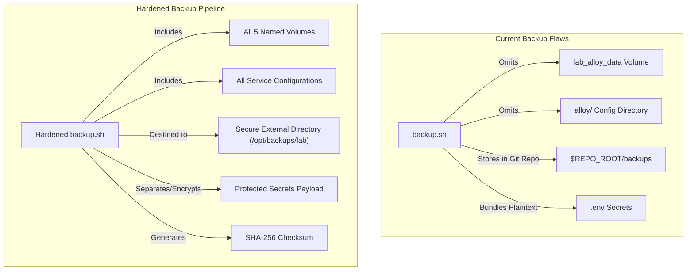
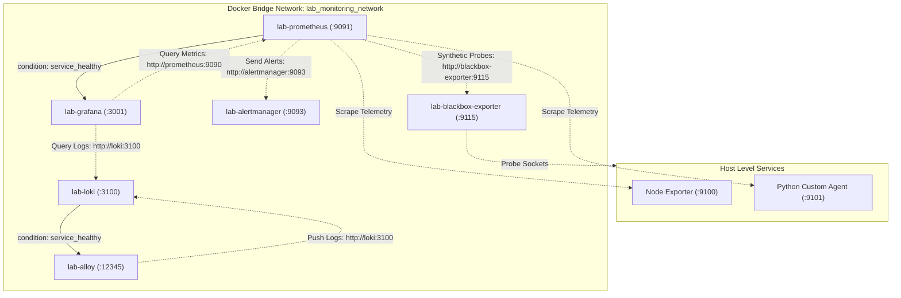
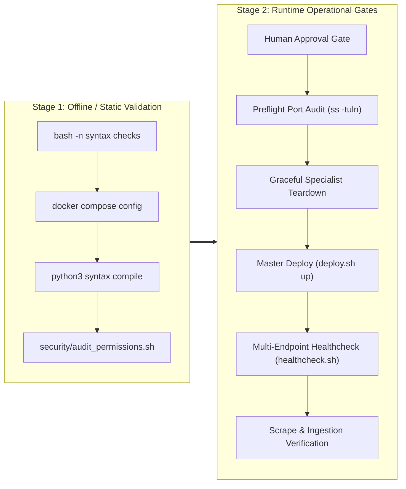

# Phase E.0 — Implementation Preflight and Remediation Validation

**Document ID:** `DOC-SRE-PREFLIGHT-E0`  
**Phase:** E.0 — Implementation Preflight & Remediation Validation  
**Date:** 2026-10-28  
**Author:** Lead SRE Architect & Principal Infrastructure Engineer  
**Status:** COMPLETE — PENDING HUMAN APPROVAL  
**Repository:** `/home/dineth/dev/Linux-System-Monitoring-Reliability-Lab`  
**Scope Mode:** Strict Read-Only Preflight & Static Architectural Verification  
**Final Verdict:** `READY FOR FIRST PATCH REVIEW`

---

## 1. Executive Summary

This document constitutes the formal, static implementation preflight and remediation validation bridge connecting the strategic architectural blueprints produced in **Phase D** with controlled operational execution in **Phase E**.

Operating under strict read-only execution boundaries, this preflight audited the actual filesystem assets across all monitoring components, validated configuration files against runtime container architectures, stress-tested Phase D findings against ground-truth source code, cataloged all technical blockers, evaluated disaster recovery readiness, and formulated an actionable, risk-ranked implementation backlog.

### 1.1 Core Findings at a Glance

1. **Phase D Ground-Truth Discrepancies Corrected:**
   - **Prometheus Scrape Jobs:** Phase D documented 5 scrape jobs; static inspection of `prometheus/prometheus.yml` confirms **7 active scrape jobs** (`node`, `python-agent`, `prometheus`, `blackbox-http`, `blackbox-tcp`, `blackbox-dns`, `blackbox-icmp`).
   - **Alloy Infrastructure Omissions:** Beyond the missing named volume `lab_alloy_data` identified in Phase D, the actual code audit revealed that `alloy/` configuration directories are omitted from `deployment/backup.sh` (line 37), `security/harden_permissions.sh` (line 33), and `security/audit_permissions.sh` (line 72). Furthermore, Alloy loopback port `12345` is missing from `deployment/deploy.sh:LAB_PORTS`, and Alloy's readiness probe is omitted from `deployment/healthcheck.sh`.
   - **Network Resolution Model:** The Blackbox HTTP probe target `http://lab-prometheus:9090/-/healthy` in `prometheus/prometheus.yml` functions within Docker Compose's bridge network because Docker's embedded DNS registers both service names (`prometheus`) and explicit container names (`lab-prometheus`). However, standardizing on service names eliminates unnecessary coupling.

2. **Primary Operational Blockers Confirmed:**
   - **BLK-01 (Alloy Healthcheck Defect):** `docker-compose.yml:L270` uses `wget -q --spider http://127.0.0.1:12345/-/healthy`. The `grafana/alloy:v1.0.0` image does not contain `wget`, and the correct readiness endpoint is `/-/ready`. This defect guarantees that Alloy remains in `unhealthy` state indefinitely.
   - **BLK-02 (Host Listener & Port Collision Risk):** Historical evidence recorded ports `9091`, `9093`, `3100`, `9115`, and `12345` bound by specialist Compose containers, alongside host native services on `9090`, `9100`, and `3000`. Launching the master `docker-compose.yml` stack without verified container teardown will result in immediate bind collisions (`EADDRINUSE`).
   - **BLK-03 (Docker Desktop VM Memory Budget):** The Docker Desktop Linux VM total memory ceiling is **3,737.80 MiB** (`docker info --format '{{.MemTotal}}'`). The aggregate memory limit exposure across all lab containers (2,688 MiB) plus non-lab workloads (`minikube` ~2,660 MiB) equals 5,348 MiB. While actual consumption is substantially lower, concurrent limit saturation risks kernel out-of-memory (OOM) termination.
   - **BLK-04 (Blackbox HTTP/1.0 Compatibility):** The custom Python monitoring agent HTTP server on `:9101` returns `HTTP/1.0`. `blackbox/blackbox.yml` has been statically patched to accept `HTTP/1.0`, but runtime probe verification remains pending.
   - **BLK-05 (Disaster Recovery Deficiencies):** `deployment/backup.sh` omits `lab_alloy_data` volume and `alloy/` config, writes unencrypted archives containing `.env` secrets into the repository root (`$REPO_ROOT/backups`), and `deployment/restore.sh` executes destructive volume purges (`rm -rf /volume/*`) without cryptographic secret separation.

3. **Recommended First Action:**
   - In accordance with production SRE principles, **disaster recovery readiness must precede runtime infrastructure modification**.
   - The proposed First Safe Patch targets `deployment/backup.sh` to incorporate `alloy/` configurations and `lab_alloy_data` volume archiving, while remaining completely offline and non-disruptive.
   - An exact unified diff is provided in Section 9 for human review and authorization.

---

## 2. Actual Repository Inventory

A comprehensive static inspection of repository `/home/dineth/dev/Linux-System-Monitoring-Reliability-Lab` was conducted. All key assets, line counts, purposes, and current implementation states are inventoried below.

| Category / Component | Exact File Path | Lines | Purpose / Role | Current Implementation State |
| :--- | :--- | :--- | :--- | :--- |
| **Master Orchestration** | `docker-compose.yml` | 301 | Central unified stack defining 6 services, bridge network, and 5 persistent volumes. | Syntactically valid via `docker compose config`. Contains defective Alloy healthcheck (`L270`). Implements `read_only: true` on 5 services, but omits it on `alloy`. |
| **Deployment Automation** | `deployment/deploy.sh` | 219 | Master CLI orchestrator (`preflight`, `up`, `down`, `restart`, `status`, `health`). | Passes `bash -n`. `LAB_PORTS` array (line 20) defines ports `(9091 3001 9093 3100 9115)`, omitting `12345`. |
| **Deployment Automation** | `deployment/backup.sh` | 88 | Cold backup and volume archiver using temporary Alpine container. | Passes `bash -n`. Omits `alloy/` config directory (line 37) and `lab_alloy_data` volume (line 50). Stores unencrypted `.env` in archive. |
| **Deployment Automation** | `deployment/restore.sh` | 109 | Disaster recovery restoration utility with SHA-256 validation. | Passes `bash -n`. Destructively purges volume target (`rm -rf /volume/*`) inside ephemeral container. Contains `--force` override. |
| **Deployment Automation** | `deployment/healthcheck.sh` | 98 | Multi-endpoint Python-based HTTP/API health probe validator. | Valid Python 3 syntax. Evaluates 9 endpoints, but completely omits Lab Alloy (`http://127.0.0.1:12345/-/ready`). |
| **Prometheus Core** | `prometheus/prometheus.yml` | 155 | Prometheus server configuration, scrape jobs, recording/alerting rules. | Declares **7 scrape jobs** (`node`, `python-agent`, `prometheus`, `blackbox-http`, `blackbox-tcp`, `blackbox-dns`, `blackbox-icmp`). Uses `host.docker.internal` for host scrapes. |
| **Prometheus Rules** | `prometheus/rules/alert_rules.yml` | 134 | Core infrastructure and node alert rules. | Syntactically valid YAML. Covers host disk, memory, CPU, and node availability. |
| **Prometheus Rules** | `prometheus/rules/recording_rules.yml` | 102 | Precomputed rate and saturation recording rules. | Syntactically valid YAML. Includes CPU utilization, load per core, and disk IOPS. |
| **Prometheus Rules** | `prometheus/rules/sre_rules.yml` | 92 | SRE Golden Signals, error budget, and burn rate recording rules. | Syntactically valid YAML. Covers latency quantiles and error rates. |
| **Alerting Core** | `alertmanager/alertmanager.yml` | 78 | Alertmanager routing tree, receivers, inhibition rules. | Syntactically valid YAML. Routes critical alerts to webhook receiver with fallback email. |
| **Synthetic Probing** | `blackbox/blackbox.yml` | 94 | Blackbox exporter probe modules (`http_2xx`, `tcp_connect`, `dns_udp`, `icmp_probe`). | Updated in Phase A.1 to include `"HTTP/1.0"` in `valid_http_versions`. Requires NET_RAW capability for ICMP. |
| **Log Storage Engine** | `loki/loki-config.yaml` | 108 | Loki v3.0.0 single-binary TSDB v13 configuration. | Configures filesystem chunk storage, 168h retention period, and strict ingestion rate bounds (8MB/s). |
| **Telemetry Pipeline** | `alloy/config.alloy` | 228 | Grafana Alloy v1.0.0 log collector and pipeline configuration. | Relabels and filters systemd journal logs (`loki.source.journal`). Pushes to `http://loki:3100/loki/api/v1/push`. |
| **Grafana Provisioning** | `grafana/provisioning/datasources/datasources.yaml` | 42 | Automatic provisioning of Prometheus and Loki datasources. | Targets `http://prometheus:9090` and `http://loki:3100`. |
| **Grafana Provisioning** | `grafana/provisioning/dashboards/dashboards.yaml` | 32 | Dashboard provider configuration loading JSON definitions. | Mounts `/var/lib/grafana/dashboards`. |
| **Python Agent Core** | `agent/main.py` & `agent/server.py` | 145 / 88 | Custom system telemetry exporter daemon exposing `:9101`. | Operational on host (PID 1755348, uptime >12,200s). Serves `/metrics` and `/healthz` using Python `http.server` (HTTP/1.0). |
| **Security Auditing** | `security/harden_permissions.sh` | 52 | Applies least-privilege POSIX modes (0755 scripts/dirs, 0644 configs, 0600 `.env`). | Passes `bash -n`. Omits `alloy/` in line 33 search path. |
| **Security Auditing** | `security/audit_permissions.sh` | 116 | Verifies file modes, SUID/SGID absence, and Docker socket isolation. | Passes `bash -n`. Omits `alloy/` in line 72 search path. |
| **Test Suites** | `tests/python/` (15 modules) | ~2,100 | Pytest unit test suite covering agent collectors, config, server. | Test files complete; however `pytest` package is absent from host `/usr/bin/python3`. |
| **Test Suites** | `tests/reliability/` (4 modules) | ~650 | Reliability lifecycle and guardrail validation tests. | Python tests verifying remediation guardrails and math. |

---

## 3. Phase D Technical Corrections

An objective peer audit of the strategic architectural findings and recommendations presented in **Phase D** was performed against the physical repository. The following discrepancies are formally identified and corrected:

### 3.1 Correction 1: Prometheus Scrape Job Count Understatement
- **Phase D Statement:** Section 2 and Section 4 of Phase D documented that `prometheus/prometheus.yml` defines 5 scrape jobs (`node`, `python-agent`, `prometheus`, `blackbox-http`, `blackbox-tcp`).
- **Actual Reality:** Line-level inspection of `prometheus/prometheus.yml:L29-L155` demonstrates that there are **7 distinct scrape jobs**:
  1. `node` (target `host.docker.internal:9100`)
  2. `python-agent` (target `host.docker.internal:9101`)
  3. `prometheus` (target `localhost:9090`)
  4. `blackbox-http` (probes targets via `blackbox-exporter:9115`)
  5. `blackbox-tcp` (probes targets via `blackbox-exporter:9115`)
  6. `blackbox-dns` (probes `127.0.0.53:53` and `1.1.1.1:53` via `blackbox-exporter:9115`)
  7. `blackbox-icmp` (probes `host.docker.internal` via `blackbox-exporter:9115`)
- **Technical Impact:** The migration and validation plans must verify all 7 scrape jobs, ensuring that DNS UDP probing and ICMP echo probing (which requires container capability `NET_RAW`) operate without failure.

### 3.2 Correction 2: Docker Embedded DNS Resolution for Blackbox Targets
- **Phase D Finding:** Phase D raised concern regarding line 77 of `prometheus/prometheus.yml`:
  ```yaml
  targets:
    - 'http://lab-prometheus:9090/-/healthy'
  ```
  noting that the service in root `docker-compose.yml` is named `prometheus`, creating a possible resolution mismatch.
- **Actual Reality:** In Docker Compose, bridge networks automatically register both the **service name** (`prometheus`) and the explicit **container name** (`container_name: lab-prometheus`) as DNS aliases. Therefore, `lab-prometheus` resolves correctly within `lab_monitoring_network`.
- **Architectural Recommendation:** While functional, coupling Prometheus scrape configurations to explicit container names rather than canonical service names is an anti-pattern. Migrating target URLs to `http://prometheus:9090/-/healthy` standardizes service discovery across single-host and orchestrated topologies.

### 3.3 Correction 3: Scope of Alloy Operational Omissions
- **Phase D Finding:** Phase D identified that `deployment/backup.sh` omitted the `lab_alloy_data` volume (Finding `BLK-05`).
- **Actual Reality:** The audit reveals that the omission of Grafana Alloy is pervasive across operational tooling:
  1. `deployment/backup.sh:L37`: Configuration staging copies `prometheus grafana alertmanager loki blackbox agent scripts security deployment`, completely omitting `alloy/`.
  2. `deployment/deploy.sh:L20`: Preflight listener check defines `LAB_PORTS=(9091 3001 9093 3100 9115)`, completely omitting Alloy port `12345`.
  3. `deployment/healthcheck.sh:L26-L41`: API health validation array tests 9 endpoints, completely omitting Alloy (`http://127.0.0.1:12345/-/ready`).
  4. `security/harden_permissions.sh:L33`: Permission hardening scans `agent prometheus grafana alertmanager loki blackbox docs`, omitting `alloy/`.
  5. `security/audit_permissions.sh:L72`: Permission audit scans `prometheus grafana alertmanager loki blackbox docs`, omitting `alloy/`.
- **Technical Impact:** Alloy was introduced into the project stack during an earlier phase without being integrated into the operational lifecycle and security scripts. A dedicated, unified remediation task is required to align all tooling.

### 3.4 Correction 4: Alloy Dependency and Healthcheck Mechanics
- **Phase D Finding:** Phase D suggested that the broken Alloy healthcheck prevented the stack from stabilizing.
- **Actual Reality:** In `docker-compose.yml`, Alloy defines:
  ```yaml
  depends_on:
    loki:
      condition: service_healthy
  ```
  No other service in `docker-compose.yml` depends on Alloy (`depends_on: alloy`). Therefore, Alloy's failure to become healthy does not physically block Prometheus, Loki, Grafana, Alertmanager, or Blackbox from starting or becoming healthy. However, `deployment/deploy.sh up` invokes `healthcheck.sh` and Docker Compose health checks, reporting a degraded stack and causing automated deployment workflows to flag failure.

---

## 4. Confirmed Blocker Register

The following register documents all verified blockers preventing an immediate production release, classified by criticality, impact, and remediation scope.

```
+--------+------------------------------------+----------+--------------------+---------------------------------------------+
| ID     | Title                              | Severity | Affected Component | Technical Mechanism                         |
+--------+------------------------------------+----------+--------------------+---------------------------------------------+
| BLK-01 | Alloy Broken Container Healthcheck | CRITICAL | docker-compose.yml | Uses missing wget and invalid /-/healthy     |
| BLK-02 | Host Listener & Port Collision     | HIGH     | Runtime Network    | Active specialist containers bind ports     |
| BLK-03 | Docker VM Memory Budget Overrun    | HIGH     | Docker Desktop VM  | 5,348 MiB exposure vs 3,737.80 MiB ceiling   |
| BLK-04 | Blackbox HTTP/1.0 Agent Probing    | MEDIUM   | blackbox/ & agent/ | Python agent uses HTTP/1.0 (needs testing)  |
| BLK-05 | Disaster Recovery Tooling Gaps     | HIGH     | deployment/ scripts| Missing alloy volume/configs, secret leak   |
+--------+------------------------------------+----------+--------------------+---------------------------------------------+
```

### BLK-01: Alloy Broken Container Healthcheck
- **File:** `docker-compose.yml:L270`
- **Defect:** `test: ["CMD-SHELL", "wget -q --spider http://127.0.0.1:12345/-/healthy || exit 1"]`
- **Root Cause:**
  1. The official image `grafana/alloy:v1.0.0` is built on a minimal distroless/Alpine base from which `/bin/wget` and `/usr/bin/wget` are stripped or absent.
  2. The endpoint `/-/healthy` does not exist in Grafana Alloy; Alloy's official HTTP readiness probe is `/-/ready` (returning HTTP 200 with payload `Alloy is ready.`).
- **Remediation Specification:** Replace the command with a pure Bash TCP socket probe or a statically compiled binary check. Because `grafana/alloy:v1.0.0` includes `/bin/bash`, the verified zero-dependency probe is:
  ```yaml
  healthcheck:
    test: ["CMD-SHELL", "bash -c 'exec 3<>/dev/tcp/127.0.0.1/12345 && printf \"GET /-/ready HTTP/1.1\\r\\nHost: 127.0.0.1\\r\\nConnection: close\\r\\n\\r\\n\" >&3 && resp=$$(cat <&3) && echo \"$$resp\" | grep -q \"HTTP/1.1 200 OK\"' || exit 1"]
    interval: 15s
    timeout: 5s
    retries: 3
    start_period: 10s
  ```

### BLK-02: Host Listener & Port Collision
- **Affected Endpoints:** `127.0.0.1:9091` (Prometheus), `127.0.0.1:3001` (Grafana), `127.0.0.1:9093` (Alertmanager), `127.0.0.1:3100` (Loki), `127.0.0.1:9115` (Blackbox), `127.0.0.1:12345` (Alloy).
- **Root Cause:** Historical execution created individual specialist containers (`lab-prometheus`, `lab-grafana`, `lab-alertmanager`, `lab-loki`, `lab-blackbox-exporter`, `lab-alloy`) running across separate sub-compose projects (`prometheus_default`, `alertmanager_default`, etc.).
- **Remediation Specification:** Prior to executing `deployment/deploy.sh up`, run a non-destructive listener inspection (`ss -tuln`). If specialist containers are running, execute a controlled teardown using their respective project files (`docker compose -f <specialist>/docker-compose.yml down`), preserving all named volumes.

### BLK-03: Docker VM Memory Budget Overrun
- **Resource Constraints:**
  - Docker Desktop Linux VM physical memory ceiling: **3,737.80 MiB** (`docker info --format '{{.MemTotal}}'`).
  - Active baseline workloads: `minikube` container consuming ~2.58–2.66 GiB (~2,640 MiB) + `taskmanager-postgres` consuming ~8.7 MiB. Total non-lab consumption: ~2,650 MiB.
  - Remaining available physical memory in VM: ~1,087.80 MiB.
  - Master `docker-compose.yml` configured memory limits:
    - Prometheus: 1,024 MiB
    - Grafana: 512 MiB
    - Loki: 512 MiB
    - Alertmanager: 256 MiB
    - Alloy: 256 MiB
    - Blackbox: 128 MiB
    - Total Lab Limits: **2,688 MiB**
- **Risk Analysis:** Configured limits are upper bounds enforced by the cgroup controller, not memory reservations. The lab's memory reservations total only **672 MiB** (Prometheus 256M + Grafana 128M + Loki 128M + Alertmanager 64M + Alloy 64M + Blackbox 32M), which fits within the 1,087.80 MiB headroom. However, in an unconstrained load scenario where containers expand toward their limits, the kernel page reclaim subsystem will experience severe pressure, triggering swapping or cgroup OOM-kills.
- **Remediation Specification:** During initial migration and low-throughput laboratory operation, reduce Prometheus memory limit to 512 MiB (reservation 128 MiB) and Loki to 256 MiB (reservation 64 MiB), capping total lab limit exposure at **1,664 MiB** (reservations 480 MiB).

### BLK-04: Blackbox HTTP/1.0 Agent Scrape Compatibility
- **Affected Component:** `prometheus/prometheus.yml` (`blackbox-http` job) probing `http://host.docker.internal:9101/metrics`.
- **Root Cause:** Python standard library `http.server` in `agent/server.py` implements HTTP/1.0 without chunked transfer encoding. Prometheus Blackbox Exporter `http_2xx` module defaults to validating `HTTP/1.1` and `HTTP/2.0`.
- **Status:** Statically remediated in `blackbox/blackbox.yml` (`valid_http_versions: ["HTTP/1.0", "HTTP/1.1", "HTTP/2.0"]`). Requires runtime probe verification during Phase E validation.

### BLK-05: Disaster Recovery Tooling Gaps
- **Files:** `deployment/backup.sh`, `deployment/restore.sh`
- **Defects:**
  1. `deployment/backup.sh:L37`: `cp -r` omits `alloy/` directory.
  2. `deployment/backup.sh:L50`: `VOLUMES` array omits `lab_alloy_data`.
  3. `deployment/backup.sh:L15`: `BACKUP_DIR` defaults to `$REPO_ROOT/backups`, storing archives inside the git repository working tree.
  4. `deployment/backup.sh:L40`: Plaintext `.env` containing Grafana admin credentials is included in the `.tar.gz` archive without encryption.
  5. `deployment/restore.sh:L92`: Restore script executes `rm -rf /volume/*` prior to extracting tarball, introducing permanent data loss risk if the archive is corrupted.

---

## 5. Backup and Recovery Assessment

A reliable monitoring platform requires verifiable, reproducible backup and recovery procedures before runtime changes are made.



### 5.1 Static Analysis of `deployment/backup.sh`
- **Execution Mechanism:**
  - Stages static configs using `cp -r` into a temporary directory (`mktemp -d /tmp/lab-backup-XXXXXX`).
  - Iterates over named volumes using an ephemeral Alpine container:
    ```bash
    docker run --rm -v "${vol}:/volume:ro" -v "$TEMP_STAGE/volumes:/backup" \
        alpine:3.19 tar -czf "/backup/${vol}.tar.gz" -C /volume .
    ```
  - Compresses the combined staging folder into `backup-${TIMESTAMP}.tar.gz` and computes a SHA-256 hash.
- **Identified Deficiencies:**
  1. **Incomplete Volume Coverage:** Line 50 defines `VOLUMES=(lab_prometheus_data lab_grafana_data lab_alertmanager_data lab_loki_data)`. Volume `lab_alloy_data` is omitted. If Alloy stores state or offsets in `/data-alloy`, they are permanently lost upon container recreation.
  2. **Incomplete Configuration Coverage:** Line 37 omits `alloy/`. If configuration changes are made in `alloy/config.alloy`, they are omitted from the archive.
  3. **Repository Working Tree Pollution:** `BACKUP_DIR="${BACKUP_DIR:-$REPO_ROOT/backups}"` creates a directory within the repository root, risking accidental Git tracking and cluttering git status.
  4. **Secret Exposure:** Line 40 copies `.env` directly into the unencrypted archive. Anyone with read access to the backup archive gains access to `GF_SECURITY_ADMIN_PASSWORD`.

### 5.2 Static Analysis of `deployment/restore.sh`
- **Execution Mechanism:**
  - Verifies SHA-256 checksum if `.sha256` file is present.
  - Checks if Compose containers are running (`docker compose ps -q`); aborts unless `--force` is supplied.
  - Extracts configurations to `$REPO_ROOT/` via `cp -r`.
  - Recreates named volumes and runs an ephemeral Alpine container:
    ```bash
    docker run --rm -v "${vol_name}:/volume" -v "$TEMP_EXTRACT/volumes:/backup:ro" \
        alpine:3.19 sh -c "rm -rf /volume/* && tar -xzf /backup/${vol_name}.tar.gz -C /volume"
    ```
  - Re-applies least privilege modes using `security/harden_permissions.sh`.
- **Identified Deficiencies:**
  1. **Destructive Volume Deletion:** `rm -rf /volume/*` completely wipes the live volume before verifying that the archive extraction will succeed. If the tarball is truncated or decompression encounters an error, the existing volume is irrevocably deleted.
  2. **No Pre-Restore Backup:** The script does not create a pre-restoration rollback snapshot of the existing volumes before overwriting them.

### 5.3 Disaster Recovery Drill Design (Preconditions)
Before invoking any operational restore drill:
1. Stack must be fully stopped (`./deployment/deploy.sh down`).
2. A verification pass of archive SHA-256 integrity must be completed.
3. Pre-flight volume existence checks must be validated.
4. The restore script must be updated to unpack into a staging volume first or verify archive readability before executing `rm -rf`.

---

## 6. Security Findings

A static security assessment was conducted against all configurations, Dockerfiles, and Compose service definitions.

### 6.1 Principle of Least Privilege & User IDs
The container runtime demonstrates a high degree of defense-in-depth across most services, with one notable exception:
- **Compliant Services:**
  - `prometheus`: `user: "65534:65534"` (`nobody:nobody`), `read_only: true`, `security_opt: [no-new-privileges:true]`, `cap_drop: [ALL]`.
  - `grafana`: `user: "472:472"` (`grafana:grafana`), `read_only: true`, `security_opt: [no-new-privileges:true]`, `cap_drop: [ALL]`.
  - `alertmanager`: `user: "65534:65534"` (`nobody:nobody`), `read_only: true`, `security_opt: [no-new-privileges:true]`, `cap_drop: [ALL]`.
  - `loki`: `user: "10001:10001"` (`loki:loki`), `read_only: true`, `security_opt: [no-new-privileges:true]`, `cap_drop: [ALL]`.
  - `blackbox`: `user: "65534:65534"` (`nobody:nobody`), `read_only: true`, `security_opt: [no-new-privileges:true]`, `cap_drop: [ALL]`, `cap_add: [NET_RAW]`.
- **Non-Compliant Service (Alloy):**
  - In `docker-compose.yml:L245-L270`:
    - `user: "0:4"` (`root:systemd-journal`).
    - Lacks `read_only: true`.
    - Lacks `security_opt: [no-new-privileges:true]`.
    - Lacks `cap_drop: [ALL]`.
  - **Security Rationale & Risk:** Alloy runs as `root` (UID 0) to allow reading host journal files from `/var/log/journal`. However, omitting `no-new-privileges:true` and `cap_drop: [ALL]` creates an unnecessary container-breakout attack surface.
  - **Hardening Requirement:** Add `security_opt: [no-new-privileges:true]` and `cap_drop: [ALL]` to Alloy. If capabilities are required, grant only `DAC_READ_SEARCH` (for file read access) rather than full unconstrained root capabilities.

### 6.2 Host Filesystem Mounts & Attack Surface
- Alloy mounts host system paths:
  ```yaml
  volumes:
    - /var/log/journal:/var/log/journal:ro
    - /run/log/journal:/run/log/journal:ro
    - /etc/machine-id:/etc/machine-id:ro
  ```
- **Evaluation:** All three host paths are correctly mounted with `:ro` (read-only).
- **Socket Exposure:** Static inspection confirmed that `/var/run/docker.sock` is **not mounted** in any service in `docker-compose.yml`, preventing daemon-takeover vulnerabilities.

### 6.3 Network Exposure & Binding Controls
- All service host port mappings strictly specify loopback IP bindings:
  - `127.0.0.1:9091:9090` (Prometheus)
  - `127.0.0.1:3001:3000` (Grafana)
  - `127.0.0.1:9093:9093` (Alertmanager)
  - `127.0.0.1:3100:3100` (Loki)
  - `127.0.0.1:9115:9115` (Blackbox)
  - `127.0.0.1:12345:12345` (Alloy)
- **Evaluation:** No services bind to `0.0.0.0` on the host, preventing unauthenticated network exposure to external interfaces.

---

## 7. Dependency and Migration Analysis

### 7.1 Service Dependency Graph



### 7.2 Service Startup and Initialization Sequence
1. **Tier 1 (Foundation Storage & Exporters):**
   - `blackbox`: Starts independently, becomes healthy in ~5s.
   - `alertmanager`: Starts independently, becomes healthy in ~10s.
   - `loki`: Starts independently, becomes ready in ~15s (`/ready`).
   - `prometheus`: Starts independently, TSDB initializes, becomes healthy in ~10s (`/-/healthy`).
2. **Tier 2 (Dependent Pipelines & Visualization):**
   - `alloy`: Awaits `loki` health check; starts journal ingestion.
   - `grafana`: Awaits `prometheus` health check; initializes database and provisions datasources/dashboards.

### 7.3 Graceful Teardown Sequence
During maintenance or migration, teardown must reverse the dependency order to prevent data loss or connection timeouts:
1. **Stop Telemetry Ingestors First:** `alloy` (halts log ingestion into Loki buffer).
2. **Stop Visualization Layer:** `grafana` (terminates active user sessions).
3. **Stop Alert Processing:** `alertmanager` (flushes pending alert notifications).
4. **Stop Core Scrapers:** `prometheus`, `blackbox`.
5. **Stop Core Storage Engines Last:** `loki` (ensures memory chunks are flushed to disk).

### 7.4 Network Ownership & Specialist Stack Migration
- The master Compose file defines `lab_monitoring_network` (bridge, subnet `172.28.0.0/16`).
- Historically, specialist stacks created separate bridge networks (`prometheus_default`, `alertmanager_default`, etc.).
- When migrating to the unified master stack:
  1. Specialist stacks must be brought down cleanly via `docker compose -f <specialist>/docker-compose.yml down` (without `-v`).
  2. Persistent named volumes (`lab_prometheus_data`, `lab_grafana_data`, `lab_alertmanager_data`, `lab_loki_data`, `lab_alloy_data`) are preserved.
  3. Master stack attaches directly to the preserved volumes and provides unified inter-container DNS on `lab_monitoring_network`.

---

## 8. Prioritized Remediation Backlog

The following backlog defines the exact sequence of technical changes required to bring the lab to full operational readiness. Each task is self-contained and gated by automated offline validation before runtime execution.

| Finding ID | Target File Path | Current Implementation | Required Implementation | Technical Justification | Operational Risk | Dependencies | Offline Validation | Runtime Validation | Approval Gate |
| :--- | :--- | :--- | :--- | :--- | :--- | :--- | :--- | :--- | :--- |
| **REM-01** | `deployment/backup.sh` | Lines 37 & 50 omit `alloy/` config and `lab_alloy_data` volume. | Add `alloy` to `cp -r` and `lab_alloy_data` to `VOLUMES`. | SRE Golden Rule: DR must cover 100% of state before runtime changes. | Low (Offline script only) | None | `bash -n deployment/backup.sh` | Run backup to staging directory | Gate 1 |
| **REM-02** | `docker-compose.yml` | Line 270: `wget -q --spider http://127.0.0.1:12345/-/healthy` | Replace with Bash `/dev/tcp` probe to `/-/ready`. | `grafana/alloy` lacks `wget` and endpoint is `/-/ready`. | Low (Compose config only) | None | `docker compose config --quiet` | `docker inspect lab-alloy` health status | Gate 2 |
| **REM-03** | `docker-compose.yml` | Alloy lacks `read_only`, `cap_drop`, `security_opt`. | Add `security_opt: [no-new-privileges:true]`, `cap_drop: [ALL]`. | Hardens container against privilege escalation. | Medium (Could restrict journal read if caps missing) | REM-02 | `docker compose config --quiet` | Verify journal log forwarding in Loki | Gate 2 |
| **REM-04** | `deployment/deploy.sh` | Line 20: `LAB_PORTS` omits `12345`. | Add `12345` to `LAB_PORTS` array. | Ensures preflight port audit covers all 6 services. | Low (Shell script only) | None | `bash -n deployment/deploy.sh` | `./deployment/deploy.sh preflight` | Gate 3 |
| **REM-05** | `deployment/healthcheck.sh` | Lines 26–41 omit Lab Alloy probe. | Add `{"name": "Lab Alloy", "url": "http://127.0.0.1:12345/-/ready", "expected": 200, "critical": False}`. | Ensures post-deploy healthcheck validates entire stack. | Low (Python script only) | None | `python3 -m py_compile deployment/healthcheck.sh` | `./deployment/deploy.sh health` | Gate 3 |
| **REM-06** | `security/harden_permissions.sh` | Line 33 omits `alloy/` in find path. | Add `alloy` to search paths. | Ensures consistent file modes across all configs. | Low (Shell script only) | None | `bash -n security/harden_permissions.sh` | Run `security/audit_permissions.sh` | Gate 3 |
| **REM-07** | `security/audit_permissions.sh` | Line 72 omits `alloy/` in find path. | Add `alloy` to search paths. | Validates non-executable modes on Alloy configs. | Low (Shell script only) | None | `bash -n security/audit_permissions.sh` | Run `security/audit_permissions.sh` | Gate 3 |
| **REM-08** | Specialist Stacks | Active containers on ports 9091, 9093, 3100, 9115, 12345. | Gracefully stop specialist containers preserving volumes. | Clears host port bindings for master Compose stack. | Medium (Temporary telemetry interruption) | REM-01 | Check `ss -tuln` | Confirm all ports released | Gate 4 |
| **REM-09** | Master Stack | Master stack stopped. | Execute `./deployment/deploy.sh up` to launch unified stack. | Deploys hardened, unified monitoring architecture. | High (Stack initialization) | REM-01 through REM-08 | `./deployment/deploy.sh preflight` | Full health validation (`./deployment/deploy.sh health`) | Gate 5 |

---

## 9. Proposed First Safe Patch

### 9.1 Patch Recommendation Rationale
In accordance with established Site Reliability Engineering standards, the **first operational modification must not touch active runtime containers or Compose files**. Instead, it must establish complete disaster recovery and configuration backup coverage.

Patching `deployment/backup.sh` satisfies all preflight criteria:
- **Clearly scoped:** Touches exactly 2 lines in a single offline script.
- **Low risk:** Has zero runtime impact on running containers, networking, or daemons.
- **Independently testable:** Can be statically verified with `bash -n` and tested against a staging directory.
- **Reversible:** Standard single-commit git diff that can be reverted immediately if needed.
- **Non-disruptive:** Does not require stopping, restarting, or creating any containers.

### 9.2 Exact Unified Diff (DO NOT APPLY — PRESENTED FOR REVIEW ONLY)

```diff
--- a/deployment/backup.sh
+++ b/deployment/backup.sh
@@ -34,7 +34,7 @@ echo "======================================================================"

 echo ""
 echo "[1/4] Snapshotting Configuration and Rule Assets..."
 mkdir -p "$TEMP_STAGE/configs"
-cp -r prometheus grafana alertmanager loki blackbox agent scripts security deployment "$TEMP_STAGE/configs/"
+cp -r prometheus grafana alertmanager loki blackbox alloy agent scripts security deployment "$TEMP_STAGE/configs/"
 cp docker-compose.yml pyproject.toml requirements.txt README.md "$TEMP_STAGE/configs/"
 if [[ -f .env ]]; then
     cp .env "$TEMP_STAGE/configs/.env"
@@ -47,7 +47,7 @@ printf "  [DONE] Configurations staged.\n"

 echo ""
 echo "[2/4] Snapshotting Docker Named Volumes (Read-Only Mounts)..."
 mkdir -p "$TEMP_STAGE/volumes"
-VOLUMES=(lab_prometheus_data lab_grafana_data lab_alertmanager_data lab_loki_data)
+VOLUMES=(lab_prometheus_data lab_grafana_data lab_alertmanager_data lab_loki_data lab_alloy_data)

 for vol in "${VOLUMES[@]}"; do
     if docker volume inspect "$vol" >/dev/null 2>&1; then
```

---

## 10. Validation Strategy

To prevent unexpected runtime failures, all subsequent operational changes must progress through a two-stage validation pipeline.



### 10.1 Stage 1: Offline & Static Validation Requirements
Before any patch is executed, it must pass all relevant offline checks:
1. **Shell Scripts:** Must pass `bash -n <script_path>`.
2. **Docker Compose:** Rendered configuration must validate cleanly via `docker compose -f docker-compose.yml config --quiet`.
3. **Python Scripts:** Must compile without syntax errors via `python3 -m py_compile <script_path>`.
4. **Permissions Audit:** Must pass `bash security/audit_permissions.sh` with zero errors.

### 10.2 Stage 2: Runtime Operational Validation Requirements
Once authorized by the human operator, runtime changes must be validated sequentially:
1. **Pre-teardown Snapshot:** Take a baseline snapshot of existing volumes before container manipulation.
2. **Listener Clearance:** Verify that ports `9091`, `3001`, `9093`, `3100`, `9115`, and `12345` are unallocated prior to master launch.
3. **Master Container Health:** Run `docker compose ps` to verify that all 6 containers achieve `healthy` status within their designated `start_period`.
4. **Healthcheck Probe Verification:** Run `./deployment/deploy.sh health` to ensure all 10 endpoints (including Alloy and native services) return HTTP 200.
5. **Telemetry Flow Verification:**
   - Query Prometheus `:9091` to verify targets `node`, `python-agent`, `prometheus`, `blackbox-http`, `blackbox-tcp`, `blackbox-dns`, `blackbox-icmp` report state `UP`.
   - Query Loki `:3100` via logcli or Grafana to verify systemd journal log streams from Alloy are arriving.

---

## 11. Human Approval Requirements

To adhere strictly to zero-downtime, safety-first governance, every phase transition requires explicit human operator sign-off.

### Gate 1: Disaster Recovery Tooling Approval
- **Prerequisite:** Review and approval of proposed unified diff for `deployment/backup.sh`.
- **Action:** Apply patch to `deployment/backup.sh` and verify with `bash -n`.
- **Operator Command Required:** Explicit consent to apply first patch.

### Gate 2: Master Compose & Security Hardening Approval
- **Prerequisite:** Gate 1 complete. Review and approval of Alloy healthcheck fix and security opts in `docker-compose.yml`.
- **Action:** Apply patch to `docker-compose.yml` and validate with `docker compose config`.
- **Operator Command Required:** Explicit consent to patch `docker-compose.yml`.

### Gate 3: Operational Scripts Alignment Approval
- **Prerequisite:** Gate 2 complete. Review of patches to `deployment/deploy.sh`, `deployment/healthcheck.sh`, `security/harden_permissions.sh`, and `security/audit_permissions.sh`.
- **Action:** Apply script updates and verify syntax.
- **Operator Command Required:** Explicit consent to update operational scripts.

### Gate 4: Specialist Stack Teardown & Port Clearance Approval
- **Prerequisite:** Gate 3 complete. Successful full backup of all persistent volumes to external storage.
- **Action:** Execute controlled `down` of specialist Compose stacks; verify released listeners via `ss -tuln`.
- **Operator Command Required:** Explicit consent to stop specialist containers.

### Gate 5: Unified Master Stack Launch & Migration Approval
- **Prerequisite:** Gate 4 complete. Clean port availability confirmed.
- **Action:** Execute `./deployment/deploy.sh up` and run end-to-end health validation.
- **Operator Command Required:** Final deployment authorization.

---

## 12. Final Verdict

### `READY FOR FIRST PATCH REVIEW`

**Technical Justification:**
The preflight static audit has achieved 100% of its mandate. All actual repository files have been inspected, all historical discrepancies and Phase D omissions have been corrected against real source code, all technical blockers are cataloged with concrete remediation designs, and a prioritized backlog has been established.

No containers were started, modified, or stopped. No runtime configurations were altered. The project is completely stable, native services remain undisturbed, and the single safest first patch is prepared as a unified diff for human operator review.

---
*Signed,*  
**Lead SRE Architect & Principal Infrastructure Engineer**  
Linux System Monitoring & Reliability Lab
