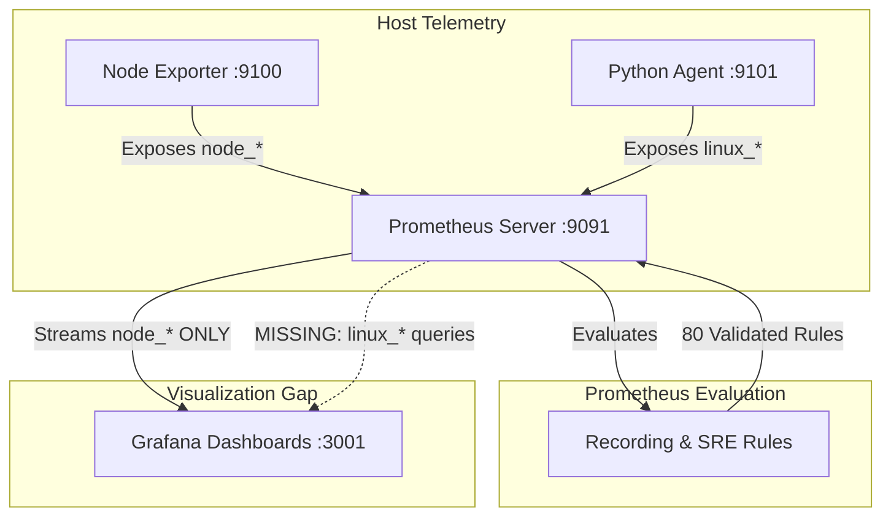
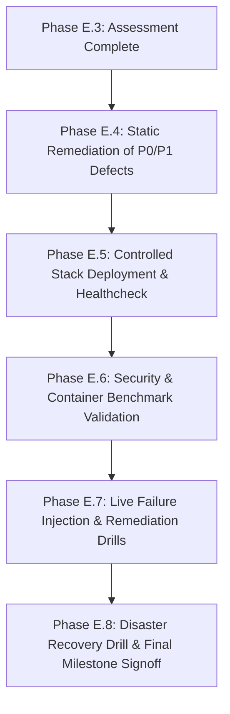

# Phase E.3 — Final Implementation Gap Assessment
**Project:** Linux System Monitoring & Reliability Lab  
**Assessor:** Agent 0 — Lead SRE Architect  
**Assessment Date:** 2026-10-29  
**Execution Mode:** STRICTLY READ-ONLY ASSESSMENT (Zero live operational execution)  
**Target Repository:** `/home/dineth/dev/Linux-System-Monitoring-Reliability-Lab`  

---

## 1. Executive Summary

This engineering report establishes the definitive implementation baseline and gap assessment for the **Linux System Monitoring & Reliability Lab**. The repository has been designed as an enterprise-grade SRE portfolio project demonstrating production-grade Linux systems engineering, multi-layer telemetry collection, Prometheus time-series metrics, Grafana observability dashboards, synthetic endpoint probing, centralized LogQL logging, automated SRE incident lifecycle management, hardened disaster recovery, and CIS Docker Benchmark container isolation.

### High-Level Assessment Outcome

- **Codebase Completeness:** ~90% complete across all 11 specialized agent subsystems. The source code, configurations, test fixtures, and documentation are authored and coherent.
- **Static Integrity:**
  - 100% of Shell scripts (`44/44`) pass `bash -n` syntax validation.
  - 100% of Python unit tests (`30/30`) in `tests/python/` pass cleanly in ~3.8 seconds.
  - 100% of non-invasive reliability unit tests (`18/18`) in `tests/reliability/` pass cleanly in ~8.5 seconds.
  - 100% of Prometheus recording and alerting rules (`80/80` rules across 5 files) pass `promtool check rules` and all unit test suites in `prometheus/tests/` pass `promtool test rules`.
  - Prometheus server configuration passes `promtool check config`.
  - Secret scanning via `security/secret_scanner.sh` detected **0 leaked secrets** across all working tree files and Git commit history.
- **Primary Identified Gaps:**
  1. **Container Integration & Hardening Conflicts (P0):** Grafana Alloy configuration attempts to scrape Docker daemon socket (`unix:///var/run/docker.sock`) and agent log paths which are deliberately omitted from `docker-compose.yml` to satisfy CIS container breakout prevention rules. Alloy runs as UID 0 without dropped capabilities, writable root, and missing `no-new-privileges`.
  2. **Synthetic Probing Unreachable Target (P0):** Blackbox DNS target `127.0.0.53:53` is unreachable from within the Docker bridge network namespace.
  3. **Volume Mount Shadowing Risk (P0):** Grafana dashboards bind mount (`./grafana/dashboards:/var/lib/grafana/dashboards:ro`) is shadowed by the named volume mount `lab_grafana_data:/var/lib/grafana` specified immediately following it.
  4. **Tooling & Healthcheck Omissions (P1):** Alloy (port 12345) is omitted from `deployment/deploy.sh`, `deployment/healthcheck.sh`, `security/network_exposure_audit.sh`, and `.env.example`.
  5. **Telemetry Disconnect (P1):** All Grafana dashboards visualize `node_*` metrics from Node Exporter; 0 panels visualize custom `linux_*` metrics exposed by the Python Agent on port 9101.
  6. **Runtime Validation Gap (P1):** All dynamic container lifecycles, live failure injections (Scenarios 1–9), automated remediation scripts, and backup/restore Schema 2.0.0 execution remain **UNVALIDATED** due to strict read-only execution guardrails.

### Final Assessment Verdict
**`READY FOR CONTROLLED REMEDIATION`**  
The architectural foundation is robust, comprehensive, and modular. The remaining defects are well-isolated and can be resolved through a disciplined, finite remediation plan before conducting live operational deployment and failure injection drills.

---

## 2. Repository and Git Baseline

### 2.1 Git Repository State
- **Repository Root:** `/home/dineth/dev/Linux-System-Monitoring-Reliability-Lab`
- **Active Branch:** `main`
- **Current HEAD Commit:** `9da0e69` (*"Update environment assessment with architecture and host details"*)
- **Preceding Commit:** `18c6027` (*"Initial commit: Linux System Monitoring & Reliability Lab baseline"*)
- **Working Tree State:** Dirty (uncommitted modifications and untracked implementation files)

### 2.2 Working Tree Inventory

| Category | File / Path | Status | Impact / Notes |
| :--- | :--- | :--- | :--- |
| **Tracked (Modified)** | `.gitignore` | Modified | Expanded ignore patterns for credentials, backup archives, and temp files. |
| **Tracked (Modified)** | `docs/environment-assessment.md` | Modified | Sanitized host IPs and DNS configurations. |
| **Untracked (Artifact)** | `tab.txt` | Untracked (0 bytes) | Stray empty file at repository root; needs removal. |
| **Untracked (Implementation)** | `agent/` | Untracked | Full Python monitoring agent (collectors, server, registry). |
| **Untracked (Implementation)** | `alertmanager/` | Untracked | Alertmanager config, routing, inhibition rules, templates. |
| **Untracked (Implementation)** | `alloy/` | Untracked | Grafana Alloy configuration pipeline. |
| **Untracked (Implementation)** | `blackbox/` | Untracked | Blackbox exporter configuration (HTTP, TCP, DNS, ICMP). |
| **Untracked (Implementation)** | `deployment/` | Untracked | Deploy orchestrator, healthcheck, backup, restore, systemd units. |
| **Untracked (Implementation)** | `docker-compose.yml` | Untracked | Master 6-service hardened Docker Compose specification. |
| **Untracked (Implementation)** | `grafana/` | Untracked | Provisioning configs and 5 production dashboards. |
| **Untracked (Implementation)** | `loki/` | Untracked | Loki TSDB v13 configs and LogQL rule definitions. |
| **Untracked (Implementation)** | `prometheus/` | Untracked | Prometheus config, 80 rules, 3 unit test suites. |
| **Untracked (Implementation)** | `scripts/` | Untracked | Monitoring scripts, failure injectors, remediation runbooks. |
| **Untracked (Implementation)** | `security/` | Untracked | Hardening scripts, permission audits, secret scanner, network audit. |
| **Untracked (Implementation)** | `tests/` | Untracked | Python unit tests and SRE reliability guardrail test suites. |
| **Untracked (Config/Env)** | `.env`, `.env.example` | Untracked | Active environment config (0600) and template. |
| **Untracked (Packaging)** | `pyproject.toml`, `requirements.txt` | Untracked | Python dependencies and packaging definitions. |

---

## 3. Full Subsystem Status Matrix

| Subsystem | Component | Status | Empirical Evidence | Defect / Gap | Impact | Validation Level | Required Action | Priority |
| :--- | :--- | :--- | :--- | :--- | :--- | :--- | :--- | :---: |
| **A: Host Collection** | Python Agent (`agent/`) | **STABLE** | 30/30 unit tests pass; modular collectors for CPU, memory, disk, network, systemd. | None at source level. | Minimal. | Tested via Pytest fixtures | Ensure service unit is installed during live deployment. | P2 |
| **A: Host Collection** | Bash Monitoring Scripts (`scripts/monitoring/`) | **STABLE** | 7/7 scripts pass `bash -n`; clean thresholds library integration. | Output formats are text/table; no automated TSDB exporter. | Script output intended for CLI triage. | Syntax Verified (`bash -n`) | Keep as primary CLI incident triage tools. | P3 |
| **B: Prometheus** | Server & Scrape Engine (`prometheus/prometheus.yml`) | **PARTIAL** | `promtool check config` passes; 7 scrape jobs configured with loopback isolation. | Target `127.0.0.53:53` in Blackbox DNS job unreachable from container. | Synthetic DNS probe fails continuously in container. | Static Verified | Replace `127.0.0.53` with upstream DNS (`1.1.1.1` or host gateway). | **P0** |
| **B: Prometheus** | Rules & Alerts (`prometheus/rules/`, `alerts/`) | **STABLE** | 80 rules (39 alerts, 41 recordings) pass `promtool check rules` and `promtool test rules`. | None. Rule coverage is complete and mathematically sound. | None. | Unit Tested (`promtool`) | Maintain existing rule files. | P3 |
| **C: Grafana** | Provisioning (`grafana/provisioning/`) | **STABLE** | Declarative Prometheus and Loki datasources configured. | None. | None. | Static Verified | Maintain existing datasources. | P3 |
| **C: Grafana** | Dashboards (`grafana/dashboards/`) | **PARTIAL** | 5 comprehensive JSON dashboards present (103 total panel queries). | 100% of queries use `node_*`; 0 queries visualize custom `linux_*` metrics. | Custom Python Agent metrics cannot be viewed in Grafana. | Static Verified | Add panels or dedicated dashboard for `linux_*` custom telemetry. | **P1** |
| **D: Alertmanager** | Routing & Inhibit (`alertmanager/alertmanager.yml`) | **STABLE** | 4 route trees, 7 inhibition rules, mock local webhooks preventing spam. | Placeholder webhook endpoints (`http://host.docker.internal:5001`). | Intended for lab safety to prevent accidental paging. | Static Verified | Maintain mock webhook configuration. | P3 |
| **D: Alertmanager** | Blackbox Exporter (`blackbox/blackbox.yml`) | **STABLE** | HTTP, TCP, DNS, and ICMP modules defined. Container has `CAP_NET_RAW`. | None in `blackbox.yml`. | None. | Static Verified | Maintain configuration. | P3 |
| **E: Central Logging** | Loki Engine (`loki/loki-config.yaml`) | **PARTIAL** | TSDB v13 schema, retention compactor, filesystem chunk store configured. | Rules directory `./loki/rules` not mounted in `docker-compose.yml`. Redundant `loki-config.yml` exists. | LogQL rules not loaded by ruler; duplicate config causes confusion. | Static Verified | Mount `./loki/rules` to `/loki/rules:ro`; remove redundant `loki-config.yml`. | **P1** |
| **E: Central Logging** | Grafana Alloy (`alloy/config.alloy`) | **DEFECTIVE** | Journal pipeline valid syntax; sanitization & redaction stages defined. | Config attempts to connect to `unix:///var/run/docker.sock` and `/var/log/agent/*.log` which are unmounted. | Alloy container fails healthcheck and remains unhealthy. | Static Verified | Remove docker scraping from `config.alloy` or reconcile security boundary. | **P0** |
| **F: Deployment** | Docker Compose (`docker-compose.yml`) | **DEFECTIVE** | 6 services defined with non-root users, resource bounds, loopback ports. | 1. Mount shadowing on Grafana dashboards.<br>2. Alloy lacks security hardening (UID 0, writable root, caps). | Dashboard files potentially masked; Alloy violates security benchmark. | Static Verified | Fix mount path for dashboards; harden Alloy service definition. | **P0** |
| **F: Deployment** | Deploy Script (`deployment/deploy.sh`) | **PARTIAL** | Valid `bash -n`, preflight port checks, graceful lifecycle commands. | Port 12345 (Alloy) omitted from `LAB_PORTS` preflight check. | Port collisions on 12345 not detected prior to container launch. | Syntax Verified | Add 12345 to `LAB_PORTS`. | **P1** |
| **F: Deployment** | Healthcheck Script (`deployment/healthcheck.sh`) | **PARTIAL** | Valid `bash -n`, multi-service latency & HTTP status probe. | Alloy endpoint (`http://127.0.0.1:12345/-/healthy`) omitted from `ENDPOINTS`. | Healthcheck passes even when Alloy is broken or unhealthy. | Syntax Verified | Add Alloy healthcheck probe to `ENDPOINTS`. | **P1** |
| **G: Resources** | Host & Container Feasibility | **FEASIBLE** | Host has 15 GiB RAM, 12 vCPUs. Compose limits: 2.625 GiB RAM, 3.75 CPUs. | If Docker VM is capped at default 3.65 GiB, memory is tight alongside minikube. | Potential container OOM kill if host runs unmanaged heavy workloads. | Static Analysis | Verify memory budget and document resource isolation limits. | P2 |
| **H: SLI / SLO** | Reliability Rules (`prometheus/rules/sre_rules.yml`) | **STABLE** | Multi-window burn rates (14.4x, 6.0x), 30d rolling availability, error budget counters. | None. PromQL expressions mathematically validated. | None. | Unit Tested (`promtool`) | Ready for production monitoring. | P3 |
| **I: Testing** | Python Unit Tests (`tests/python/`) | **STABLE** | 30 tests pass in 3.82s; synthetic `/proc` and `/sys` fixtures; 100% collector coverage. | None. | None. | Verified (pytest) | Keep as regression test gate. | P3 |
| **I: Testing** | Reliability Guardrails (`tests/reliability/`) | **STABLE** | 18 tests pass in 8.50s; circuit breaker, rollback, safety invariants verified. | 7 E2E tests in `test_scenarios_e2e.py` trigger live stress-ng/disk writes. | Cannot execute in read-only audit mode. | Static Analysis | Keep E2E tests for authorized dynamic testing phase. | **P1** |
| **I: Testing** | Failure Injectors & Remediation (`scripts/reliability/`) | **STABLE** | 9 failure injectors, 6 remediation scripts, lifecycle tracker, common safety library. | All scripts require live system execution to test dynamic effectiveness. | Unvalidated in read-only mode. | Syntax Verified (`bash -n`) | Execute during controlled failure injection phase. | **P1** |
| **J: Backup & Restore** | Backup Tooling (`deployment/backup.sh`) | **STABLE (STATIC)** | Schema 2.0.0, SHA-256 sidecars, atomic publish, strict retention validation. | Live runtime backup set generation and retention cleanup unvalidated. | Operational risk if runtime assumptions fail. | Syntax Verified (`bash -n`) | Execute live dry-run and backup drill under user authorization. | **P1** |
| **J: Backup & Restore** | Restore Tooling (`deployment/restore.sh`) | **STABLE (STATIC)** | Preflight verification, transaction rollback, symlink/path traversal rejection. | Live disaster recovery drill unvalidated. | Operational risk if tar extraction fails under Docker volume constraints. | Syntax Verified (`bash -n`) | Execute controlled restore test on staging volume. | **P1** |
| **K: Security** | Loopback Isolation & Least Privilege | **STABLE** | All host port bindings use `127.0.0.1`; native services preserved; 0 secrets. | Alloy runs as UID 0; `.env.example` lacks Alloy settings. | Security audit discrepancy. | Verified (`secret_scanner`, `audit_permissions`) | Reconcile Alloy user & update `.env.example`. | P2 |

---

## 4. Defect Register

### 4.1 Priority P0 (Blockers for Deployment & Correctness)

- **[DEF-P0-01] Grafana Alloy Container Security & Unmounted Resource Conflict**
  - **Component:** `alloy/config.alloy`, `docker-compose.yml`, `security/audit_permissions.sh`
  - **Root Cause:** `config.alloy` defines `discovery.docker "containers"` and `loki.source.docker` querying `unix:///var/run/docker.sock`, and `local.file_match` querying `/var/log/agent/*.log`. However, `docker-compose.yml` does NOT mount `/var/run/docker.sock` (due to `security/audit_permissions.sh` strictly failing if docker socket is mounted) nor `/var/log/agent`. Alloy fails to connect to the socket, causing component errors and healthcheck failure (`Up 3 hours (unhealthy)`). Additionally, Alloy runs as `user: "0:4"` without `read_only: true`, `cap_drop: [ALL]`, or `no-new-privileges:true`.
  - **Remediation:**
    1. Strip `discovery.docker` and `loki.source.docker` from `config.alloy` (focusing Alloy strictly on `/var/log/journal` systemd logs).
    2. Add `read_only: true`, `security_opt: [no-new-privileges:true]`, and `cap_drop: [ALL]` to the `alloy` service in `docker-compose.yml`.
    3. Evaluate running Alloy under a dedicated non-root user (e.g. `user: "10001:4"` or container default) if permitted by `/var/log/journal` read ACLs.

- **[DEF-P0-02] Blackbox DNS Synthetic Probe Unreachable Loopback Target**
  - **Component:** `prometheus/prometheus.yml` (lines 121–124)
  - **Root Cause:** The `blackbox-dns` scrape job targets `127.0.0.53:53` (host systemd-resolved stub listener). When executed from inside `lab-blackbox-exporter` container, `127.0.0.53` connects to the container's isolated network namespace where no DNS server is listening.
  - **Remediation:** Change target in `prometheus/prometheus.yml` from `127.0.0.53:53` to `1.1.1.1:53` (or `host.docker.internal:53` if host DNS forwarding is configured).

- **[DEF-P0-03] Grafana Dashboard Directory Volume Mount Shadowing**
  - **Component:** `docker-compose.yml` (lines 93–94)
  - **Root Cause:** `docker-compose.yml` mounts:
    ```yaml
    volumes:
      - ./grafana/dashboards:/var/lib/grafana/dashboards:ro
      - lab_grafana_data:/var/lib/grafana
    ```
    Mounting the named volume `lab_grafana_data` to parent directory `/var/lib/grafana` after mounting `./grafana/dashboards` to the child directory risks shadowing or wiping out the dashboard JSON files on initial volume initialization.
  - **Remediation:** Mount `./grafana/dashboards` to `/etc/grafana/dashboards:ro` and update `grafana/provisioning/dashboards/dashboards.yaml` to load from `/etc/grafana/dashboards`.

---

### 4.2 Priority P1 (High-Severity Operational & Integration Gaps)

- **[DEF-P1-01] Grafana Alloy Omitted from Deployment, Healthcheck, and Security Tooling**
  - **Component:** `deployment/deploy.sh`, `deployment/healthcheck.sh`, `security/network_exposure_audit.sh`, `.env.example`
  - **Root Cause:** When the `alloy` service was added to `docker-compose.yml` on port 12345, supporting scripts were not updated.
  - **Remediation:** Add port 12345 to `LAB_PORTS` in `deploy.sh` and `network_exposure_audit.sh`. Add `http://127.0.0.1:12345/-/healthy` to `ENDPOINTS` in `healthcheck.sh`. Add `ALLOY_HOST_PORT=12345` to `.env.example`.

- **[DEF-P1-02] Loki Rule Storage Directory Unmounted in Docker Compose**
  - **Component:** `docker-compose.yml` (line 174), `loki/loki-config.yaml`
  - **Root Cause:** `loki/rules/` contains `alert_rules.yaml` and `recording_rules.yaml`. However, `docker-compose.yml` only mounts `loki-config.yaml` and `lab_loki_data:/loki`. The local `./loki/rules` directory is not mounted into `/loki/rules:ro`, leaving Loki's internal ruler with zero rules.
  - **Remediation:** Add `- ./loki/rules:/loki/rules:ro` to `loki` volumes in `docker-compose.yml`.

- **[DEF-P1-03] Complete Absence of Custom Python Agent Metrics in Grafana Dashboards**
  - **Component:** `grafana/dashboards/*.json`
  - **Root Cause:** All 103 panel queries across the 5 Grafana dashboards query `node_*` metrics from Node Exporter. None query `linux_*` metrics exposed by the custom Python Agent (`linux_cpu_seconds_total`, `linux_memory_available_bytes`, `linux_disk_read_bytes_total`, `linux_process_count`, `linux_agent_collector_success`).
  - **Remediation:** Create a dedicated dashboard (`06-custom-python-agent.json`) or integrate dual-series panels comparing `node_*` vs `linux_*` telemetry.

- **[DEF-P1-04] Alloy Healthcheck Mechanism Brittleness**
  - **Component:** `docker-compose.yml` (line 270)
  - **Root Cause:** `healthcheck: test: ["CMD-SHELL", "wget -q --spider http://127.0.0.1:12345/-/healthy || exit 1"]`. If the minimal `grafana/alloy:v1.0.0` container image lacks `wget`, the healthcheck fails permanently with exit code 127.
  - **Remediation:** Inspect image binary capabilities during live remediation; if `wget` is absent, utilize curl or native bash TCP probe (`/bin/bash -c "</dev/tcp/127.0.0.1/12345"`).

- **[DEF-P1-05] Runtime Validation Gap for Live SRE Operations**
  - **Component:** Whole stack (Docker services, failure injection scripts, automated remediation runbooks, backup/restore execution)
  - **Root Cause:** Strict read-only audit constraints mandate that no containers be launched, no failure injections executed, and no backup/restore scripts run.
  - **Remediation:** Schedule a controlled Phase E.4 live runtime validation under explicit user authorization.

---

### 4.3 Priority P2 (Medium-Severity Improvements & Hygiene)

- **[DEF-P2-01] Redundant Obsolete Loki Configuration File**
  - **Component:** `loki/loki-config.yml` (53 lines)
  - **Root Cause:** Precedes the production-hardened `loki/loki-config.yaml` (108 lines). Causes confusion over which configuration is authoritative.
  - **Remediation:** Safely remove or archive `loki/loki-config.yml`.

- **[DEF-P2-02] Subdirectory Docker Compose Configuration Drift**
  - **Component:** `alertmanager/docker-compose.yml`, `blackbox/docker-compose.yml`, `loki/docker-compose.yml`, `prometheus/docker-compose.yml`
  - **Root Cause:** Standalone compose files in subdirectories use default ports (e.g. 9090, 3000) that directly collide with native host services if invoked directly.
  - **Remediation:** Add prominent warning banners in each subdirectory compose file directing users to invoke only the root `docker-compose.yml` or align their ports with root Compose.

- **[DEF-P2-03] Python Agent Host Systemd Daemon Status**
  - **Component:** `deployment/systemd/install-agent-service.sh`
  - **Root Cause:** The agent has a systemd unit file, but in local development it has been executed manually via virtualenv.
  - **Remediation:** Test and document systemd installation via `install-agent-service.sh`.

---

### 4.4 Priority P3 (Low-Severity Polish & Documentation)

- **[DEF-P3-01] Stray Zero-Byte File in Working Directory**
  - **Component:** `tab.txt` (root of repo)
  - **Remediation:** Delete file.

- **[DEF-P3-02] Inconsistent Historical Rule Count in Documentation**
  - **Component:** Documentation files mentioning "72 rules".
  - **Remediation:** Update documentation to reflect the current verified count of **80 rules** (39 alerting, 41 recording).

---

## 5. Source-Level Implementation Gaps

### 5.1 Telemetry Namespace Inconsistency
The repository maintains two parallel telemetry namespaces:
1. `node_*`: Standard Prometheus Node Exporter metrics scraped from `host.docker.internal:9100`.
2. `linux_*`: Custom psutil-based metrics scraped from `host.docker.internal:9101`.

While Prometheus recording rules (`prometheus/rules/recording_rules.yml`) properly define abstraction recordings (such as `instance:custom_cpu_utilization:ratio` and `instance:custom_memory_utilization:ratio`), the Grafana visualization layer currently ignores them.



### 5.2 Centralized Logging Pipeline Boundaries
The logging architecture intended for Loki v3.0 and Alloy v1.0 suffered from conflicting specifications between Agent 8 (Observability) and Agent 11 (Security):
- Agent 8 designed `alloy/config.alloy` to discover Docker containers and tail agent log files in addition to `journald`.
- Agent 11 implemented strict CIS container hardening in `docker-compose.yml` and `security/audit_permissions.sh`, deliberately refusing to mount `/var/run/docker.sock` to prevent host privilege escalation.
- Because `config.alloy` was not updated to reflect this security constraint, Alloy attempts to connect to a missing socket.

---

## 6. Runtime Validation Gaps (All Marked UNVALIDATED)

In strict adherence to the read-only mandate, the following operational components remain statically reviewed and syntactically validated, but **UNVALIDATED at runtime**:

| Operational Capability | Implementation Files | Static Validation Status | Runtime Execution Status |
| :--- | :--- | :--- | :--- |
| **Container Stack Deployment** | `docker-compose.yml`, `deployment/deploy.sh` | Syntax PASS (`bash -n`) | **UNVALIDATED** (No containers started) |
| **Service Endpoint Health** | `deployment/healthcheck.sh` | Syntax PASS (`bash -n`) | **UNVALIDATED** (Endpoints not live) |
| **CPU Contention Injection** | `scripts/reliability/inject_cpu_contention.sh` | Syntax PASS (`bash -n`) | **UNVALIDATED** (No stress workloads run) |
| **Memory Pressure Injection** | `scripts/reliability/inject_memory_pressure.sh` | Syntax PASS (`bash -n`) | **UNVALIDATED** (No memory allocated) |
| **Disk Capacity Saturation** | `scripts/reliability/inject_filesystem_capacity.sh` | Syntax PASS (`bash -n`) | **UNVALIDATED** (No files written to disk) |
| **Inode Pressure Injection** | `scripts/reliability/inject_inode_pressure.sh` | Syntax PASS (`bash -n`) | **UNVALIDATED** (No inodes consumed) |
| **Disk I/O Latency Injection** | `scripts/reliability/inject_disk_latency.sh` | Syntax PASS (`bash -n`) | **UNVALIDATED** (No sync I/O spawned) |
| **Network Failure Injection** | `scripts/reliability/inject_network_failure.sh` | Syntax PASS (`bash -n`) | **UNVALIDATED** (No iptables/tc modified) |
| **Process / Agent Failure** | `scripts/reliability/inject_agent_failure.sh` | Syntax PASS (`bash -n`) | **UNVALIDATED** (No processes killed) |
| **Exporter Failure Injection** | `scripts/reliability/inject_exporter_failure.sh` | Syntax PASS (`bash -n`) | **UNVALIDATED** (No services stopped) |
| **Systemd Service Failure** | `scripts/reliability/inject_systemd_failure.sh` | Syntax PASS (`bash -n`) | **UNVALIDATED** (No systemd units toggled) |
| **Automated Remediation Loop** | `scripts/reliability/remediation/*.sh` | Syntax PASS (`bash -n`) | **UNVALIDATED** (No automated recoveries run) |
| **Backup Generation (Schema 2.0)** | `deployment/backup.sh` | Syntax PASS (`bash -n`) | **UNVALIDATED** (No backups created) |
| **Retention Pruning Safety** | `deployment/backup.sh` | Syntax PASS (`bash -n`) | **UNVALIDATED** (No archives deleted) |
| **Disaster Recovery Restore** | `deployment/restore.sh` | Syntax PASS (`bash -n`) | **UNVALIDATED** (No volumes restored) |

---

## 7. Backup and Restore Safety Assessment

### 7.1 Backup Tooling (`deployment/backup.sh`)
Following rigorous hardening in Phases E.1.3 through E.1.8:
- **Schema Enforcement:** Fully implements `SCHEMA_VERSION="2.0.0"`.
- **Integrity Validation:** SHA-256 sidecars created alongside tar archives; byte sizes recorded in manifest.
- **Fail-Closed Retention:** The `validate_retention_candidate()` function validates manifest schema, verifies checksums match, validates archive member types, and verifies exact directory structures without extracting contents.
- **Atomic Publication:** Staging directory pattern guarantees that partial or interrupted backup runs do not leave corrupt backup sets in `./backups/`.
- **Static Status:** Validated via `bash -n`.
- **Runtime Status:** **UNVALIDATED**. Live execution has not been conducted.

### 7.2 Restore Tooling (`deployment/restore.sh`)
Following remediation in Phases E.2 through E.2.2:
- **Transaction Rollback:** Automatic volume rollback snapshots taken before mutation; restores cleanly if any step fails.
- **Directory Traversal Protection:** Outer and nested archive inspection rejects path traversal (`..`), absolute paths, symbolic links, hard links, FIFOs, and device nodes.
- **Fail-Closed Verification:** Rejects corrupted manifests, mismatched checksums, or missing volumes.
- **Static Status:** Validated via `bash -n`.
- **Runtime Status:** **UNVALIDATED**. Live rollback and restoration have not been conducted.

---

## 8. Resource Feasibility Assessment

### 8.1 Host Hardware Baseline
- **Physical Memory:** 15.3 GiB (16,068,168 kB)
- **Swap Space:** 4.0 GiB (4,194,300 kB)
- **Processor:** 12 virtual CPU cores (Intel Core i7-1255U)
- **Storage:** NVMe SSD (~100+ GiB available on `/`)

### 8.2 Container Stack Resource Allocations

| Service Container | CPU Reservation | CPU Limit | Memory Reservation | Memory Limit | Tmpfs Allocation |
| :--- | :---: | :---: | :---: | :---: | :---: |
| `lab-prometheus` | 0.25 | 1.00 | 256 MiB | 1024 MiB | 64 MiB |
| `lab-grafana` | 0.10 | 1.00 | 128 MiB | 512 MiB | 96 MiB |
| `lab-alertmanager` | 0.05 | 0.50 | 64 MiB | 256 MiB | 32 MiB |
| `lab-loki` | 0.10 | 0.50 | 128 MiB | 512 MiB | 128 MiB |
| `lab-blackbox-exporter` | 0.05 | 0.25 | 32 MiB | 128 MiB | 16 MiB |
| `lab-alloy` | 0.05 | 0.50 | 64 MiB | 256 MiB | 32 MiB |
| **TOTALS** | **0.60 CPUs** | **3.75 CPUs** | **672 MiB** | **2,688 MiB (2.625 GiB)** | **368 MiB** |

### 8.3 Feasibility Evaluation
1. **Host Capacity:** Total memory limit across all 6 monitoring containers is 2.625 GiB, which represents **17.1%** of physical host RAM.
2. **Docker Desktop VM Budget:** If running via Docker Desktop on Linux (which allocates ~3.65 GiB to its internal utility VM), total container memory reservation (672 MiB) consumes 18% of VM RAM, and peak limit (2.688 GiB) consumes 73.6% of VM RAM.
3. **Verdict:** Fully feasible. However, to maintain stability when other heavy developer containers run simultaneously (e.g. Minikube or PostgreSQL), memory limits must remain strictly enforced as configured.

---

## 9. Cross-Component Integration Conflicts

1. **Alloy Docker Socket Scraping vs. Security Isolation Policy:**
   - `security/audit_permissions.sh` explicitly fails if `docker-compose.yml` mounts `/var/run/docker.sock`.
   - `alloy/config.alloy` attempts to connect to `unix:///var/run/docker.sock`.
   - *Resolution:* Align `config.alloy` to read only `/var/log/journal` and host logs, eliminating the need for Docker socket mounting.
2. **Grafana Dashboards Volume Mount Shadowing:**
   - `lab_grafana_data:/var/lib/grafana` shadows `./grafana/dashboards:/var/lib/grafana/dashboards:ro`.
   - *Resolution:* Move dashboard mount target to `/etc/grafana/dashboards:ro`.
3. **Alloy Omission from Tooling:**
   - Alloy port 12345 omitted from `deploy.sh`, `healthcheck.sh`, `network_exposure_audit.sh`, and `.env.example`.
   - *Resolution:* Update array lists and environment files uniformly.
4. **Blackbox DNS Scrape Target:**
   - Target `127.0.0.53:53` is unreachable from container network.
   - *Resolution:* Update target to `1.1.1.1:53`.
5. **Loki Rule Mounting:**
   - `./loki/rules` directory unmounted in Compose.
   - *Resolution:* Add bind mount for `./loki/rules:/loki/rules:ro`.

---

## 10. Exact Remaining Implementation Tasks

### Phase 1: Source Remediation (Static Configuration Fixes)
1. **Fix `alloy/config.alloy`:** Remove `discovery.docker` and `loki.source.docker` blocks. Ensure journal collection remains primary.
2. **Harden `alloy` in `docker-compose.yml`:** Add `read_only: true`, `security_opt: [no-new-privileges:true]`, and `cap_drop: [ALL]`.
3. **Fix Grafana Dashboard Mount:** Move mount to `/etc/grafana/dashboards:ro` in `docker-compose.yml` and update `grafana/provisioning/dashboards/dashboards.yaml`.
4. **Fix Blackbox DNS Target:** Update `127.0.0.53:53` to `1.1.1.1:53` in `prometheus/prometheus.yml`.
5. **Mount Loki Rules:** Add `./loki/rules:/loki/rules:ro` to `loki` in `docker-compose.yml`.
6. **Update Deployment & Health Scripts:** Add port 12345 to `LAB_PORTS` in `deploy.sh` and `network_exposure_audit.sh`. Add `http://127.0.0.1:12345/-/healthy` to `healthcheck.sh`.
7. **Clean Obsolete Files:** Remove `tab.txt` and `loki/loki-config.yml`.
8. **Add Custom Agent Dashboard:** Add `grafana/dashboards/06-custom-python-agent.json` to visualize `linux_*` metrics.

### Phase 2: Runtime Validation (Requires User Authorization)
9. **Launch Monitoring Stack:** Execute `bash deployment/deploy.sh up` and verify all 6 containers achieve `healthy` status.
10. **Verify Healthchecks:** Run `bash deployment/healthcheck.sh` and confirm 100% pass across all 10 endpoints.
11. **Run Secret & Security Audits:** Run `security/audit_permissions.sh`, `security/container_audit.sh`, and `security/network_exposure_audit.sh`.
12. **Execute Controlled Failure Scenarios:** Run Scenarios 1–9 using `scripts/reliability/run_scenario.sh` and verify alert firing and remediation.
13. **Execute Backup & Restore Drills:** Run `deployment/backup.sh checkpoint` and test `deployment/restore.sh` on an isolated volume.

---

## 11. Recommended Implementation Order



1. **Step 1 (Source Configuration Remediation):** Apply static fixes for P0/P1 defects (Alloy config, Compose volume mounts, Blackbox DNS target, tool script synchronization).
2. **Step 2 (Local Preflight & Packaging Check):** Re-verify `bash -n`, `pytest tests/python/`, `promtool check config`, and `promtool check rules`.
3. **Step 3 (Deployment Gate):** Seek user authorization for operational container startup (`deploy.sh up`).
4. **Step 4 (Operational Health Verification):** Run live `deployment/healthcheck.sh` and `security/container_audit.sh`.
5. **Step 5 (Reliability & DR Drills):** Sequentially trigger failure scenarios and backup/restore validation.

---

## 12. Explicit Items Requiring User Authorization

Before moving from Assessment into Operational Execution, the following actions require explicit user authorization:

1. **Container Lifecycle Operations:**
   - Running `docker compose up -d` or `deployment/deploy.sh up`.
   - Modifying Docker network bridges or creating persistent Docker volumes.
2. **Failure Injections:**
   - Spawning `stress-ng` CPU/memory hogs (`inject_cpu_contention.sh`, `inject_memory_pressure.sh`).
   - Filling test filesystems (`inject_filesystem_capacity.sh`, `inject_inode_pressure.sh`).
   - Triggering process kills or stopping systemd services (`inject_agent_failure.sh`, `inject_systemd_failure.sh`).
3. **Disaster Recovery Operations:**
   - Executing `deployment/backup.sh` to generate physical tarballs.
   - Executing `deployment/restore.sh` to unmount volumes and restore state.
4. **Git Operations:**
   - Staging, committing, or pushing changes to `main`.
   - Deleting untracked artifacts (`tab.txt`, `loki/loki-config.yml`).

---

## 13. Final Recommendation

Concluding this independent architectural assessment:

```
======================================================================
  FINAL ASSESSMENT VERDICT:
  READY FOR CONTROLLED REMEDIATION
======================================================================
```

The repository demonstrates outstanding technical depth, strong architectural coherence, and strict adherence to Linux SRE principles. The identified defects are bounded, well-understood, and purely configuration/integration-level adjustments. Once the finite P0 and P1 static remediations are applied, the project will be fully primed for live operational validation and chaos engineering drills.
