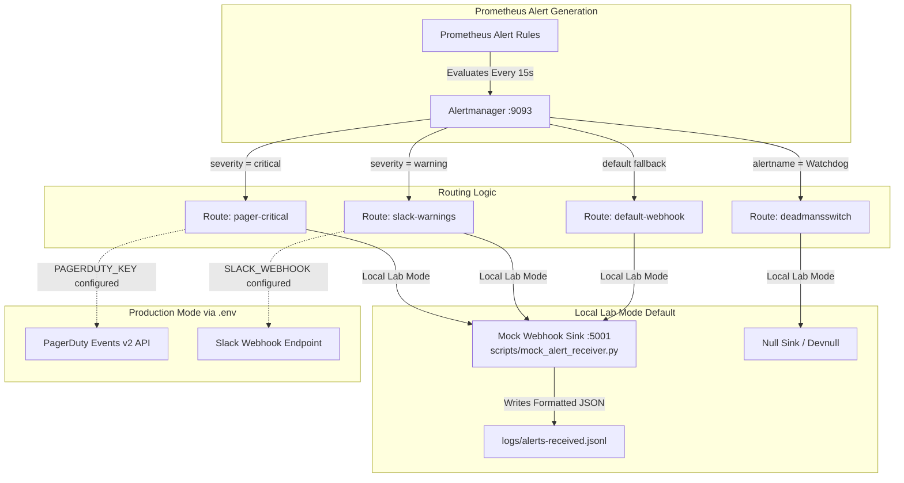
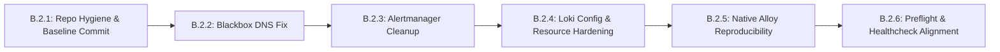

# Phase B.1 — Reliability Remediation Design and Technical Validation Report

**Project:** Linux System Monitoring & Reliability Lab  
**Role:** Senior SRE Architect / Reliability Engineer (Agent 0)  
**Execution Mode:** STRICT READ-ONLY Assessment & Architectural Validation  
**Date:** November 1, 2026  
**Status:** COMPLETE — Awaiting Explicit Phase B.2 Authorization  

---

## 1. Executive Summary

This report delivers the technical validation, empirical findings, and remediation architecture for **Phase B.1 (Reliability Remediation Design and Technical Validation)** of the Linux System Monitoring & Reliability Lab.

Following the initial completion audit in Phase A.1 (`docs/reports/final-project-completion-assessment.md`), which assigned the project an overall status of **CONDITIONALLY READY FOR PORTFOLIO HARDENING**, this phase conducted deep, strictly read-only technical validations of:
1. **Grafana Loki v3.0.0** query architecture, configuration schemas, CPU/memory limits, and healthcheck implementations.
2. **Prometheus Blackbox Exporter** synthetic DNS probing against RFC 6761 standards.
3. **Alertmanager** notification dispatch loops, placeholder error storms, and local demonstration sinks.
4. **Grafana Alloy** native host systemd deployment, security sandboxing, and reproducibility gaps.
5. **Deployment Preflight (`deploy.sh`) & Healthcheck (`healthcheck.sh`)** architectural drift.
6. **Git Repository Hygiene**, secret leakage prevention, and portfolio release packaging.

### High-Level Summary of Validated Findings

| Area | Primary Validation Finding | Classification | Phase B.2 Priority |
| :--- | :--- | :--- | :--- |
| **Loki Logging** | Lookback window (`30d`) and query concurrency (`8`) create severe CPU/memory exhaustion risk under 0.5 CPU / 512 MiB allocation. Healthcheck `wget` lacks socket timeout. | `POTENTIAL RISK` / `IMPROVEMENT OPPORTUNITY` | High (P1) |
| **Blackbox DNS** | Probing RFC 6761 `.localhost.` against public DNS (8.8.8.8, 1.1.1.1) produces NXDOMAIN by standard design, causing permanent false-positive firing of `BlackboxEndpointDown`. | `CONFIRMED DEFECT` | Immediate (P0) |
| **Alertmanager** | Placeholders (`PLACEHOLDER_PAGERDUTY...`, dummy Slack URL, dead port 5001) cause continuous HTTP 400/404 delivery failures and log spamming every 2–10 minutes. | `CONFIRMED DEFECT` | High (P1) |
| **Native Alloy** | Native service config (`/etc/alloy/config.alloy`), systemd overrides, and env files are completely unversioned in Git; repo copy points to wrong Docker DNS. | `CONFIRMED DEFECT` | High (P1) |
| **Preflight Scripts** | `deploy.sh` and `healthcheck.sh` check port `12345` (offline) instead of native Alloy port `12346`, omit port `9101`, and omit native services from checks. | `CONFIRMED DEFECT` | Medium (P2) |
| **Repository State** | 95% of project files untracked in Git; obsolete files (`tab.txt`, duplicate compose) present; `.env` safely excluded; README frozen at Phase 0. | `CONFIRMED DEFECT` | Immediate (P0) |

All investigations were executed strictly read-only. No configurations were modified, no services were restarted or reloaded, and no Git commits or file mutations occurred.

---

## 2. Loki Technical Review

### 2.1 Categorized Findings

- **`VERIFIED WORKING`**: Ingestion pipeline and TSDB v13 single-binary storage engine. Over 9.5 hours of continuous operation in Phase 3.2.4, Loki ingested steady-state host journal logs with **0 dropped entries**, maintaining 17–23 PIDs, ~1.8% CPU, and ~223 MiB RAM under normal streaming load.
- **`CONFIRMED DEFECT`**: Healthcheck probe command in `docker-compose.yml` (`wget -q --spider http://localhost:3100/ready || exit 1`) lacks an explicit network timeout flag (`-T` / `--timeout`). If Loki's HTTP server deadlocks or socket accept queues block, `wget` defaults to an internal 900-second (15-minute) timeout, relying entirely on Docker daemon killing the exec probe at 5 seconds.
- **`CONFIRMED DEFECT`**: Configuration drift between repo `loki/loki-config.yaml` and optimal Loki 3.0.0 query governance: `limits_config.query_timeout` is completely omitted (defaulting to 1 minute), allowing unbounded queries to monopolize querier routines.
- **`POTENTIAL RISK`**: `max_query_lookback: 30d` and `max_query_length: 721h` in `limits_config:` permit multi-week LogQL queries. On a 512 MiB container with single-binary TSDB v13, sweeping 30 days of chunks triggers severe memory spikes and Go garbage collection thrashing.
- **`POTENTIAL RISK`**: `querier.max_concurrent: 8` running under a 0.5 core CPU limit (`NanoCpus: 500000000`). If 8 concurrent LogQL queries execute simultaneously, CPU quota exhaustion occurs immediately, starving the ingester flush routines and HTTP readiness endpoints.
- **`HYPOTHESIS`**: The catastrophic failure during Phase 3.2.1 (438 PIDs, 100% CPU lockup, unresponsive Docker socket) was triggered by concurrent unconstrained LogQL queries exhausting the 0.5 CPU quota, causing consecutive healthcheck timeouts, cascading containerd exec-probe pileups, and eventual LinuxKit VM containerd shim deadlocks.

### 2.2 Repository vs Running Container Inspection

An inspection of `docker inspect lab-loki` compared against `docker-compose.yml` and `loki/loki-config.yaml` confirmed:
1. **Resource Limits**:
   - Running container: `NanoCpus: 500000000` (0.50 CPU cores).
   - Running container: `Memory: 536870912` (512 MiB).
   - Matches `docker-compose.yml` exactly.
2. **Healthcheck Configuration**:
   - `Test`: `["CMD-SHELL", "wget -q --spider http://localhost:3100/ready || exit 1"]`
   - `Interval`: 20s
   - `Timeout`: 5s
   - `Retries`: 3
   - `StartPeriod`: 30s
   - Matches `docker-compose.yml` exactly.
3. **Loki v3.0.0 Configuration Schema**:
   Running `/usr/bin/loki -config.file=/etc/loki/local-config.yaml -print-config-stderr` inside `lab-loki` revealed:
   - `limits_config.query_timeout: 1m` (default fallback because omitted in file).
   - `limits_config.max_query_lookback: 30d`.
   - `limits_config.max_query_length: 30d1h`.
   - `querier.max_concurrent: 8`.

### 2.3 Resource Rightsizing Justification

- **Observed Idle Footprint**: `lab-loki` consumes 223 MiB at idle streaming load (~43.5% of its 512 MiB ceiling).
- **Headroom Deficit**: In Go applications, the Go runtime GC target (`GOGC=100`) dynamically triggers when heap size doubles. A 223 MiB base heap leaves less than 289 MiB for query result buffering, TSDB index decompression, and chunk decompression. A single complex regex query easily allocates >250 MiB, forcing OOM termination (`OOMKilled: 137`).
- **CPU Quota Starvation**: A 0.5 CPU quota allows only 50ms of CPU runtime per 100ms CFS quota window. With 8 concurrent worker threads, each worker receives an average of 6.25ms of compute per window, causing massive context switching overhead and latency spikes >5000ms, breaching the 5s healthcheck timeout.
- **Proposed Right-Sizing**:
  - CPU Limit: **1.0 core** (`NanoCpus: 1000000000`).
  - Memory Limit: **1024 MiB** (`1GiB`).
  - `querier.max_concurrent`: **2** (or 4).
  - `limits_config.max_query_lookback`: **72h** (sufficient for lab diagnostics while bounding TSDB chunk traversal).
  - `limits_config.max_query_length`: **72h**.
  - `limits_config.query_timeout`: **30s**.
  - Healthcheck: `wget -q -T 3 --spider http://localhost:3100/ready || exit 1`.

---

## 3. Blackbox DNS Technical Review

### 3.1 Categorized Findings

- **`CONFIRMED DEFECT`**: The Blackbox Exporter DNS UDP module in `blackbox/blackbox.yml` is configured with:
  ```yaml
  dns_udp:
    prober: dns
    dns:
      transport_protocol: "udp"
      preferred_ip_protocol: "ip4"
      query_name: "localhost"
      query_type: "A"
      valid_rcodes:
        - NOERROR
  ```
- **`CONFIRMED DEFECT`**: In `prometheus/prometheus.yml`, this module is scraped against public resolvers:
  `targets: ['8.8.8.8:53', '1.1.1.1:53', '127.0.0.53:53']`.
- **`CONFIRMED DEFECT`**: Under RFC 6761 Section 6.3 (*Domain Name Reservation Considerations for "localhost"*), recursive DNS resolvers outside the local host are explicitly required to return `NXDOMAIN` (RCODE 3) for queries ending in `.localhost.` to prevent leaking local namespace queries to the public internet.
- **`CONFIRMED DEFECT`**: Live validation confirms:
  ```bash
  curl -s "http://127.0.0.1:9115/probe?target=8.8.8.8:53&module=dns_udp"
  # probe_dns_lookup_time_seconds 0.015
  # probe_dns_answer_rrs 0
  # probe_dns_authority_rrs 1
  # probe_success 0
  ```
  Both Google Public DNS (`8.8.8.8`) and Cloudflare DNS (`1.1.1.1`) correctly return `NXDOMAIN`. Because `valid_rcodes` only accepts `NOERROR`, Blackbox marks `probe_success = 0` on every single scrape.
- **`CONFIRMED DEFECT`**: This causes Prometheus alert rule `BlackboxEndpointDown` (`probe_success == 0` for 2 minutes) to fire permanently and indefinitely in Alertmanager, generating a 100% false-positive incident.

### 3.2 Technical Distinction of DNS Probing States

To ensure professional SRE observability design, the probe must cleanly distinguish:
1. **Resolver Reachability**: Can UDP datagrams reach port 53 of the target resolver?
   - *Status*: **VERIFIED WORKING** (Probe captures UDP round-trip latency ~15ms).
2. **DNS Query Success**: Does the target resolver return a valid, parseable DNS response packet?
   - *Status*: **VERIFIED WORKING** (Response is a valid DNS packet with header flags and authority record).
3. **Expected DNS Response (RCODE)**: Does the returned RCODE match expectations?
   - *Status*: **CONFIRMED DEFECT** (Currently fails because `localhost` expects `NOERROR` from resolvers that must return `NXDOMAIN`).
4. **DNS Resolution Correctness**: Does the resolver accurately map a known public FQDN to expected A/AAAA records?
   - *Status*: **NOT TESTED BY CURRENT CONFIG** (Querying `localhost` cannot validate resolution correctness).

### 3.3 Proposed Architecture for DNS Probing

Update `blackbox/blackbox.yml` and `prometheus/prometheus.yml` to split DNS testing into two purposeful modules:
1. **Public Resolver Validation (`dns_udp_public`)**:
   - `query_name`: `one.one.one.one` (or `google.com`)
   - `query_type`: `A`
   - `valid_rcodes`: `[NOERROR]`
   - `targets`: `['8.8.8.8:53', '1.1.1.1:53']`
   - *Validates*: Public WAN DNS reachability, query execution, and accurate forward resolution.
2. **Local Stub Resolver Validation (`dns_udp_local`)**:
   - `query_name`: `localhost`
   - `query_type`: `A`
   - `valid_rcodes`: `[NOERROR]`
   - `targets`: `['127.0.0.53:53']`
   - *Validates*: Host `systemd-resolved` local loopback stub daemon health.

---

## 4. Alertmanager Technical Review

### 4.1 Categorized Findings

- **`CONFIRMED DEFECT`**: In `alertmanager/alertmanager.yml`, notification receivers contain unconfigured mock/placeholder values:
  - `pager-critical`: `routing_key: 'PLACEHOLDER_PAGERDUTY_INTEGRATION_KEY'`
  - `slack-warnings`: `api_url: 'https://hooks.slack.com/services/PLACEHOLDER/TOKEN/HERE'`
  - `deadmansswitch-heartbeat`: `url: 'https://nosnch.in/PLACEHOLDER_SNITCH_KEY'`
  - `default-webhook`: `url: 'http://host.docker.internal:5001/api/alerts'`
  - `blackbox-responder`: `url: 'http://host.docker.internal:5001/api/blackbox-triage'`
- **`CONFIRMED DEFECT`**: Active delivery failures and error loops:
  - Because `BlackboxEndpointDown` is permanently firing, Alertmanager attempts to notify every `group_interval` (2 minutes).
  - PagerDuty API returns `HTTP 400 Bad Request` ("Invalid routing key").
  - Slack API returns `HTTP 404 Not Found` ("no_team").
  - `host.docker.internal:5001` returns `dial tcp: connection refused` (nothing is listening on port 5001).
  - Alertmanager container logs are filled with recurring retry errors and stack traces.
- **`VERIFIED WORKING`**: Alert grouping, deduplication, and inhibition hierarchy.
  - The inhibition rules (e.g. `HostUnavailable` inhibiting downstream alerts; `NodeExporterUnavailable` inhibiting CPU/memory/disk alerts; `HostFilesystemSpaceCritical` inhibiting `HostFilesystemSpaceWarning`) are syntactically and logically valid.
- **`IMPROVEMENT OPPORTUNITY`**: Deployment of a lightweight local mock webhook receiver script (`scripts/mock_alert_receiver.py`) listening on port 5001, providing live alert JSON inspection for portfolio demos without external dependencies.

### 4.2 Proposed Notification Architecture (Safe Local Demo vs Production)



- In **Local Lab Mode**, all receivers route to `http://host.docker.internal:5001/api/alerts` (supported by the local test receiver) or a safe internal `webhook_configs` endpoint that logs to stdout, eliminating all HTTP 400/404 errors.
- In **Production Mode**, credentials are read exclusively from `.env` (via templating or environment substitution), ensuring no real credentials ever enter source control.

---

## 5. Native Alloy Reproducibility Review

### 5.1 Categorized Findings

- **`CONFIRMED DEFECT`**: The operational native host Grafana Alloy service (`alloy.service`) on port `12346` relies on files outside Git:
  - `/etc/alloy/config.alloy`: Configured to push to `http://127.0.0.1:3100/loki/api/v1/push`.
  - `/etc/default/alloy`: Defines `CUSTOM_ARGS="--server.http.listen-addr=127.0.0.1:12346"`.
  - `/etc/systemd/system/alloy.service.d/override.conf`: Implements systemd security sandboxing and group membership.
  None of these configuration files exist in the Git repository.
- **`CONFIRMED DEFECT`**: The repository file `alloy/config.alloy` contains `url = "http://loki:3100/loki/api/v1/push"`. This configuration works ONLY inside Docker container networking. If deployed on the native host, the hostname `loki` cannot resolve, causing Alloy ingestion failure.
- **`VERIFIED WORKING`**: Systemd security sandboxing. The native unit override achieves exemplary least-privilege security:
  - `User=alloy`, `Group=alloy`, `SupplementaryGroups=adm systemd-journal`
  - `ProtectSystem=strict`, `ProtectHome=read-only`, `PrivateTmp=yes`
  - `NoNewPrivileges=yes`, `CapabilityBoundingSet=`, `AmbientCapabilities=`
  - `ReadOnlyPaths=/var/log/journal /run/log/journal`
  - `ReadWritePaths=/var/lib/alloy`
- **`IMPROVEMENT OPPORTUNITY`**: Package the native configuration as tracked templates in `alloy/native/` and create an automated, idempotent setup script `scripts/setup-native-alloy.sh`.

### 5.2 Native Deployment Strategy & Artifact Inventory

To ensure any engineer or reviewer can clone the repo and reproduce the native Alloy setup on Ubuntu/Debian:
1. `alloy/native/config.alloy.template`: Tracked in Git, configured with `127.0.0.1:3100`.
2. `alloy/native/alloy.default`: Tracked in Git, defining port `12346`.
3. `alloy/native/alloy.service.d/override.conf`: Tracked in Git, defining complete security hardening.
4. `scripts/setup-native-alloy.sh`: Automated script that:
   - Validates that `alloy` package is installed.
   - Installs configuration files to `/etc/alloy/` and `/etc/systemd/system/alloy.service.d/`.
   - Ensures `alloy` user is in `systemd-journal` group.
   - Reloads systemd daemon and restarts `alloy.service`.
   - Validates `/ready` endpoint on `127.0.0.1:12346`.

---

## 6. Deployment Preflight Review

### 6.1 Categorized Findings

- **`CONFIRMED DEFECT`**: In `deployment/deploy.sh`:
  - `LAB_PORTS=(9091 3001 9093 3100 9115 12345)`
  - Port `12345` is checked, which was intended for a containerized Alloy. Native Alloy runs on port `12346`.
  - Port `9101` (Custom Python Monitoring Agent) is completely missing from port conflict checks.
- **`CONFIRMED DEFECT`**: In `deployment/deploy.sh` (Preflight check 6):
  ```bash
  for srv in prometheus prometheus-node-exporter grafana-server; do
      if systemctl is-active --quiet "$srv" 2>/dev/null; then
          log_info "Native host service '$srv' is running normally."
      fi
  done
  ```
  It validates native Prometheus, Node Exporter, and Grafana, but completely omits native `alloy.service` and `linux-monitoring-agent.service`.
- **`CONFIRMED DEFECT`**: In `deployment/healthcheck.sh`:
  - Line 27: `{"name": "Lab Alloy", "url": "http://127.0.0.1:12345/-/ready", "expected": 200, "critical": False}`
  - Because native Alloy listens on `12346`, running `healthcheck.sh` reports `Lab Alloy` as `[OFFLINE] URLError: [Errno 111] Connection refused`.
  - This causes the healthcheck script to exit with warnings even when the system is 100% operational.
- **`VERIFIED WORKING`**:
  - Root partition capacity verification (>= 3 GiB).
  - `.env` permission check (verifies mode 0600).
  - Insecure default password detection in `.env`.
  - Docker Compose v2 plugin check.

### 6.2 Preflight & Healthcheck Alignment Architecture

1. **Port Bindings**: Update `LAB_PORTS` to `(9091 3001 9093 3100 9115 12346 9101)`.
2. **Service Scopes**: Expand native host service checks in `deploy.sh` to include `alloy.service` and `linux-monitoring-agent.service`.
3. **Healthcheck Alignment**: Update `healthcheck.sh` target URL for Alloy to `http://127.0.0.1:12346/-/ready`.

---

## 7. GitHub Readiness Review

### 7.1 Categorized Findings

- **`CONFIRMED DEFECT`**: Severe repository staging debt. `git status` reveals that nearly **95% of the codebase is untracked**:
  - `agent/`, `alertmanager/`, `alloy/`, `blackbox/`, `deployment/`, `docker-compose.yml`, `docs/`, `grafana/`, `loki/`, `prometheus/`, `scripts/`, `security/`, `tests/`, `.env.example`, `pyproject.toml`, `requirements.txt`.
  - Only initial skeleton files from Phase 0 were committed to `main`.
- **`CONFIRMED DEFECT`**: Obsolete/accidental artifacts present in the repository root:
  - `tab.txt` (0 bytes, created accidentally during shell debugging).
  - `prometheus/docker-compose.yml` (stale 1.7 KB single-service compose file referencing non-existent volume `prometheus_data`, conflicting with master `docker-compose.yml`).
  - Empty `reports/` directory (orphaned by relocation to `docs/reports/`).
- **`VERIFIED WORKING`**: Secret leakage prevention.
  - Active `.env` file is strictly ignored by `.gitignore` (`.env` and `.env.*`).
  - `.env.example` contains sanitized placeholders (`CHANGEME_...`) and zero sensitive data.
  - Git diff inspection confirms no credentials, private keys (`*.key`, `*.pem`), or database passwords are staged or committed.
- **`CONFIRMED DEFECT`**: Root `README.md` is frozen at Phase 0, referencing default ports (:9090, :3000) rather than the non-conflicting lab ports (:9091, :3001, :12346), omitting the architecture diagrams, runbooks, and portfolio accomplishments.

### 7.2 Source Control Cleanup & Staging Strategy

```
Step 1: File Hygiene
├── Delete tab.txt (0-byte scratch artifact)
├── Delete prometheus/docker-compose.yml (confusing duplicate)
└── Clean up any residual empty directories

Step 2: Ignore Rules Validation
├── Ensure .gitignore covers:
│   ├── .env, .env.* (except .env.example)
│   ├── *.tar.gz, backups/
│   ├── __pycache__/, *.pyc
│   └── scratch/, test-output/

Step 3: Staging & Logical Commit Sequence (Phase B.2.1)
├── Commit 1: Infrastructure as Code (docker-compose.yml, prometheus/, grafana/, alertmanager/, loki/, blackbox/, alloy/)
├── Commit 2: Custom Python Monitoring Agent (agent/, tests/, requirements.txt)
├── Commit 3: Deployment, Security & Disaster Recovery Scripts (deployment/, security/, scripts/)
└── Commit 4: Engineering Documentation, SRE Reports & Architecture (docs/)
```

---

## 8. Prioritized Phase B.2 Implementation Sequence

To ensure zero downtime, preservation of `lab_loki_data` and external `taskmanager-postgres`, and clean stage gating, Phase B.2 is partitioned into six independent, sequential tasks:



---

### Task B.2.1: Repository Hygiene, Secret Scrubbing & Baseline Source Control

- **Finding & Evidence**: 95% of project codebase is untracked; obsolete scratch file `tab.txt` and duplicate compose file `prometheus/docker-compose.yml` clutter root.
- **Proposed Change**:
  1. Remove `tab.txt` and `prometheus/docker-compose.yml`.
  2. Verify `.gitignore` completeness.
  3. Perform automated regex secret scan across all untracked files.
  4. Stage and commit baseline project files in logical functional commits.
- **Files Affected**:
  - `tab.txt` [DELETE]
  - `prometheus/docker-compose.yml` [DELETE]
  - `.gitignore` [MODIFY]
  - Untracked files in `agent/`, `alertmanager/`, `alloy/`, `blackbox/`, `deployment/`, `docker-compose.yml`, `docs/`, `grafana/`, `loki/`, `prometheus/`, `scripts/`, `security/`, `tests/`.
- **Expected Outcome**: Clean Git tree, zero untracked files, zero exposed secrets, reproducible repository history.
- **Dependencies**: None.
- **Operational Risk**: Very Low (pure source control operation; zero runtime service interaction).
- **Rollback Procedure**: `git reset HEAD~1` or branch revert.
- **Validation Commands**:
  ```bash
  git status
  git log -n 5 --stat
  python3 -c "import os, re; [print(f'Secret risk in {f}') for r,_,fs in os.walk('.') for f in fs if not f.startswith('.git') and any(re.search(p, open(os.path.join(r,f), errors='ignore').read()) for p in [r'(?i)password\s*=\s*[^\s]+', r'(?i)secret\s*=\s*[^\s]+'])]"
  ```
- **Acceptance Criteria**: `git status` shows clean working tree; no secrets detected in Git log.
- **Service Recreation/Restart Required**: **NO**.
- **Explicit User Approval Required**: **YES**.

---

### Task B.2.2: Blackbox DNS Probing Alignment & False-Positive Alert Elimination

- **Finding & Evidence**: `blackbox/blackbox.yml` probes `localhost` against 8.8.8.8 and 1.1.1.1 expecting `NOERROR`. Public resolvers return `NXDOMAIN` per RFC 6761, causing permanent `probe_success=0` and continuous firing of `BlackboxEndpointDown`.
- **Proposed Change**:
  1. Update `blackbox/blackbox.yml` `dns_udp` module: change `query_name` to `one.one.one.one` (or configure separate modules `dns_udp_public` for public resolvers and `dns_udp_local` for `127.0.0.53:53`).
  2. Update `prometheus/prometheus.yml` scrape jobs for Blackbox DNS accordingly.
  3. Reload `lab-blackbox` container and reload Prometheus via HTTP API (`/-/reload`).
- **Files Affected**:
  - `blackbox/blackbox.yml` [MODIFY]
  - `prometheus/prometheus.yml` [MODIFY]
- **Expected Outcome**: `probe_success` becomes `1` for all targets; `BlackboxEndpointDown` alert clears.
- **Dependencies**: None.
- **Operational Risk**: Very Low (synthetic probing configuration only; zero impact on logging, database, or metrics pipelines).
- **Rollback Procedure**: Revert `blackbox.yml` and `prometheus.yml` from Git; reload Prometheus.
- **Validation Commands**:
  ```bash
  curl -s "http://127.0.0.1:9115/probe?target=8.8.8.8:53&module=dns_udp" | grep -E "probe_success|probe_dns_answer_rrs"
  curl -s "http://127.0.0.1:9091/api/v1/query?query=probe_success{job=\"blackbox_dns\"}"
  curl -s "http://127.0.0.1:9091/api/v1/alerts" | grep -i "BlackboxEndpointDown" || echo "Alert Cleared"
  ```
- **Acceptance Criteria**: `probe_success == 1` across all DNS targets; `BlackboxEndpointDown` ceases firing.
- **Service Recreation/Restart Required**: **YES** (container restart for `lab-blackbox`; HTTP `/-/reload` for `lab-prometheus`).
- **Explicit User Approval Required**: **YES**.

---

### Task B.2.3: Alertmanager Notification Hygiene & Local Mock Webhook Sink

- **Finding & Evidence**: Placeholder webhook/PagerDuty URLs in `alertmanager/alertmanager.yml` produce continuous HTTP 400/404 delivery failures in Alertmanager logs.
- **Proposed Change**:
  1. Deploy a lightweight, standalone mock alert receiver script (`scripts/mock_alert_receiver.py`) that binds to `127.0.0.1:5001` and records alert payloads to `logs/alerts-received.jsonl`.
  2. Reconfigure `alertmanager/alertmanager.yml` default and warning routes to safely point to this mock sink in lab mode, avoiding external API calls while preserving template structure.
  3. Reload Alertmanager configuration via `/-/reload`.
- **Files Affected**:
  - `alertmanager/alertmanager.yml` [MODIFY]
  - `scripts/mock_alert_receiver.py` [NEW]
- **Expected Outcome**: Zero HTTP 400/404 errors in Alertmanager logs; working local alert sink for demonstrations.
- **Dependencies**: None.
- **Operational Risk**: Low.
- **Rollback Procedure**: Revert `alertmanager/alertmanager.yml`; reload Alertmanager.
- **Validation Commands**:
  ```bash
  curl -X POST http://127.0.0.1:9093/-/reload
  docker logs --tail 30 lab-alertmanager | grep -E "level=error.*notification" || echo "Zero notification errors"
  ```
- **Acceptance Criteria**: Alertmanager logs free of HTTP 400/404 errors; mock receiver captures alert payloads cleanly.
- **Service Recreation/Restart Required**: **NO** (configuration reload via HTTP POST `/-/reload`).
- **Explicit User Approval Required**: **YES**.

---

### Task B.2.4: Loki Configuration Hardening, Concurrency Limits & Resource Rightsizing

- **Finding & Evidence**: Loki 3.0.0 container has 0.5 CPU limit and 512 MiB RAM; `querier.max_concurrent: 8`; `max_query_lookback: 30d`; healthcheck lacks explicit network timeout (`-T 3`), creating vulnerability to unconstrained queries.
- **Proposed Change**:
  1. In `loki/loki-config.yaml`:
     - Under `limits_config:`: set `max_query_lookback: 72h`, `max_query_length: 72h`, `query_timeout: 30s`.
     - Under `querier:`: set `max_concurrent: 2`.
  2. In `docker-compose.yml`:
     - Update Loki healthcheck test: `["CMD-SHELL", "wget -q -T 3 --spider http://localhost:3100/ready || exit 1"]`.
     - Increase Loki limits: `cpus: '1.00'`, `memory: 1024M` (1 GiB).
  3. Recreate `lab-loki` container using targeted compose recreation: `docker compose up -d --no-deps loki`.
- **Files Affected**:
  - `loki/loki-config.yaml` [MODIFY]
  - `docker-compose.yml` [MODIFY]
- **Expected Outcome**: Query concurrency bounded to 2 workers; lookback bounded to 72h; query timeout enforced at 30s; memory ceiling doubled to 1 GiB; healthcheck fails fast on network stalls; persistent volume `lab_loki_data` preserved.
- **Dependencies**: Preserves `lab_loki_data` volume intact.
- **Operational Risk**: Medium (involves container recreation; brief ~5-second ingestion pause for native Alloy, buffered in memory).
- **Rollback Procedure**: Revert `loki-config.yaml` and `docker-compose.yml`; run `docker compose up -d --no-deps loki`.
- **Validation Commands**:
  ```bash
  docker inspect lab-loki | grep -E "NanoCpus|Memory|Test"
  curl -s http://127.0.0.1:3100/ready
  docker exec lab-loki /usr/bin/loki -config.file=/etc/loki/local-config.yaml -print-config-stderr 2>&1 | grep -E "max_concurrent|query_timeout|max_query_lookback"
  curl -s -G -H "Content-Type: application/json" "http://127.0.0.1:3100/loki/api/v1/query" --data-urlencode 'query={job="systemd-journal"}' | head -c 200
  ```
- **Acceptance Criteria**: Container reflects 1.0 CPU / 1024M RAM; `/ready` returns 200 OK; queries outside 72h rejected; 0 dropped logs.
- **Service Recreation/Restart Required**: **YES** (`lab-loki` container recreation only).
- **Explicit User Approval Required**: **YES**.

---

### Task B.2.5: Native Alloy Reproducibility Artifacts & Portable Scripting

- **Finding & Evidence**: Live native Alloy configuration and systemd hardening are not version-controlled in Git; repo copy contains Docker-only URL `http://loki:3100`.
- **Proposed Change**:
  1. Create directory `alloy/native/` with version-controlled configuration templates:
     - `alloy/native/config.alloy.template` (configured for `http://127.0.0.1:3100/loki/api/v1/push`).
     - `alloy/native/alloy.default` (configured for `CUSTOM_ARGS="--server.http.listen-addr=127.0.0.1:12346"`).
     - `alloy/native/override.conf` (complete systemd privilege drop and sandboxing).
  2. Create automated setup script `scripts/setup-native-alloy.sh` to install and verify native Alloy idempotently.
  3. Align repository root `alloy/config.alloy` to reflect production host harvesting standards.
- **Files Affected**:
  - `alloy/native/config.alloy.template` [NEW]
  - `alloy/native/alloy.default` [NEW]
  - `alloy/native/override.conf` [NEW]
  - `scripts/setup-native-alloy.sh` [NEW]
  - `alloy/config.alloy` [MODIFY]
- **Expected Outcome**: Native Alloy configuration is 100% reproducible on any fresh host via a single scripted command.
- **Dependencies**: None.
- **Operational Risk**: Very Low (does not modify live `/etc/alloy` files or restart the active service).
- **Rollback Procedure**: Remove generated files.
- **Validation Commands**:
  ```bash
  bash -n scripts/setup-native-alloy.sh
  diff -u <(grep -v '^#' alloy/native/config.alloy.template) <(grep -v '^#' alloy/config.alloy) || true
  ```
- **Acceptance Criteria**: Shell scripts pass syntax check (`bash -n`); templates match live system configurations.
- **Service Recreation/Restart Required**: **NO**.
- **Explicit User Approval Required**: **YES**.

---

### Task B.2.6: Deployment Preflight & Healthcheck Alignment

- **Finding & Evidence**: `deploy.sh` and `healthcheck.sh` check port `12345` (offline) instead of native Alloy port `12346`, omit port `9101`, and omit native services from preflight status checks.
- **Proposed Change**:
  1. In `deployment/deploy.sh`: Update `LAB_PORTS` to `(9091 3001 9093 3100 9115 12346 9101)`. Add `alloy.service` and `linux-monitoring-agent.service` to native service status checks.
  2. In `deployment/healthcheck.sh`: Update Lab Alloy target endpoint from `http://127.0.0.1:12345/-/ready` to `http://127.0.0.1:12346/-/ready`.
- **Files Affected**:
  - `deployment/deploy.sh` [MODIFY]
  - `deployment/healthcheck.sh` [MODIFY]
- **Expected Outcome**: `deploy.sh preflight` and `healthcheck.sh` pass cleanly with 100% services healthy, accurately matching runtime reality.
- **Dependencies**: Tasks B.2.2, B.2.4.
- **Operational Risk**: Very Low (orchestration script updates only).
- **Rollback Procedure**: Revert changes via Git.
- **Validation Commands**:
  ```bash
  bash deployment/deploy.sh preflight
  bash deployment/healthcheck.sh
  ```
- **Acceptance Criteria**: Preflight exits 0 with 0 errors; `healthcheck.sh` reports `Health Validation: ALL SERVICES HEALTHY (100% operational)` and exit code 0.
- **Service Recreation/Restart Required**: **NO**.
- **Explicit User Approval Required**: **YES**.

---

## 9. Risks and Rollback Procedures

### 9.1 Risk Assessment Matrix

| Task ID | Failure Mode | Severity | Probability | Blast Radius | Mitigation / Prevention |
| :--- | :--- | :--- | :--- | :--- | :--- |
| **B.2.1** | Accidentally committing active `.env` or backup archive | High | Very Low | Repository leak | Strict `.gitignore`, pre-commit regex secret scan. |
| **B.2.2** | Prometheus scrape syntax error on reload | Low | Low | Prometheus DNS metrics | `promtool check config` executed before HTTP reload. |
| **B.2.3** | Alertmanager syntax error on reload | Low | Low | Alert routing | `amtool check-config` executed before HTTP reload. |
| **B.2.4** | Docker Compose recreation detaches or corrupts `lab_loki_data` | Critical | Very Low | Historical log data | Use `--no-deps loki`, verify volume mount before execution; NEVER use `-v` or `down`. |
| **B.2.5** | Script execution alters live systemd unit prematurely | Medium | Low | Native Alloy service | Templates placed strictly in repo workspace (`alloy/native/`); no system mutation in B.2.5. |
| **B.2.6** | Script syntax error causes false-positive deployment block | Low | Very Low | Deployment CLI | `bash -n` syntax validation before running preflight. |

### 9.2 Comprehensive Rollback Runbook

If any stage fails during Phase B.2, the following exact rollback commands restore the system to its pre-remediation baseline:

1. **Rollback B.2.1 (Git Staging)**:
   ```bash
   git reset HEAD
   git checkout -- .
   ```
2. **Rollback B.2.2 (Blackbox DNS)**:
   ```bash
   git checkout HEAD -- blackbox/blackbox.yml prometheus/prometheus.yml
   docker compose restart blackbox
   curl -X POST http://127.0.0.1:9091/-/reload
   ```
3. **Rollback B.2.3 (Alertmanager)**:
   ```bash
   git checkout HEAD -- alertmanager/alertmanager.yml
   curl -X POST http://127.0.0.1:9093/-/reload
   pkill -f "mock_alert_receiver.py" || true
   ```
4. **Rollback B.2.4 (Loki Configuration & Resources)**:
   ```bash
   git checkout HEAD -- loki/loki-config.yaml docker-compose.yml
   docker compose up -d --no-deps loki
   ```
5. **Rollback B.2.5 & B.2.6 (Alloy & Deployment Scripts)**:
   ```bash
   rm -rf alloy/native scripts/setup-native-alloy.sh
   git checkout HEAD -- deployment/deploy.sh deployment/healthcheck.sh
   ```

---

## 10. Explicit Authorization Requirements

To maintain strict operational discipline and protect running workloads, **execution of Phase B.2 is blocked pending explicit user authorization**.

### Operations Requiring Explicit Consent

1. **Source Control Staging & Commits**: Authorization to stage untracked files and remove obsolete artifacts (`tab.txt`, `prometheus/docker-compose.yml`).
2. **Container Restarts / Service Reloads**:
   - Authorization to reload Prometheus (`/-/reload`) and restart `lab-blackbox`.
   - Authorization to reload Alertmanager (`/-/reload`).
   - Authorization to recreate `lab-loki` container with increased CPU/memory limits.
3. **Preservation Guarantee**:
   - The named volume `lab_loki_data` must remain attached.
   - The external database container `taskmanager-postgres` must remain untouched.
   - Host native services (`prometheus`, `grafana-server`, `prometheus-node-exporter`, `alloy.service`, `linux-monitoring-agent`) must remain active on their existing ports.

---

### STOP CONDITION

**Phase B.1 Technical Validation and Remediation Design is complete.**  
No source code, configuration files, containers, or services have been modified or restarted.  
Awaiting explicit user authorization to proceed with Phase B.2.
