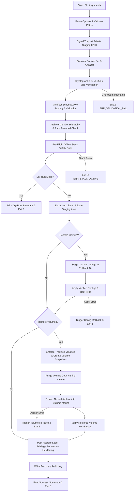

# Phase E.2 — Secure Disaster Recovery Restore Tooling Remediation Report

**Document Reference:** `docs/reports/phase-e2-restore-remediation.md`  
**Target Script:** [`deployment/restore.sh`](file:///home/dineth/dev/Linux-System-Monitoring-Reliability-Lab/deployment/restore.sh)  
**Role:** Senior Infrastructure Security & Disaster Recovery Engineer  
**Repository:** `/home/dineth/dev/Linux-System-Monitoring-Reliability-Lab`  
**Date:** October 2026  
**Status:** Completed & Statically Verified — Awaiting Independent Security Audit  

---

## 1. Executive Summary

During Phase E.1, the lab's disaster recovery backup orchestrator ([`deployment/backup.sh`](file:///home/dineth/dev/Linux-System-Monitoring-Reliability-Lab/deployment/backup.sh)) underwent extensive security, reliability, and schema hardening. That effort culminated in the formalization of the **Schema 2.0.0 Backup Set Specification**, introducing atomic directory publication, collision-resistant backup identifiers, filename-pattern-based secret exclusion, cryptographic SHA-256 sidecars, and structured YAML manifests.

Phase E.2 addresses the disaster recovery counterpart: [`deployment/restore.sh`](file:///home/dineth/dev/Linux-System-Monitoring-Reliability-Lab/deployment/restore.sh). Prior to this remediation, `deployment/restore.sh` was a legacy shell script exhibiting severe security vulnerabilities and operational hazards:
- It lacked compatibility with the Schema 2.0.0 backup set format.
- It permitted a dangerous `--force` flag that bypassed running container checks, creating severe risk of time-series database (TSDB) WAL corruption and SQLite database locking.
- It extracted untrusted archives directly into `/tmp` without member path traversal checks (CWE-22).
- It directly overwrote repository configuration files without pre-flight rollback staging.
- It blindly restored any `.tar.gz` found in `volumes/` without validating against an approved volume allowlist.
- It suppressed critical Docker command errors (`2>/dev/null`, `|| true`) and wiped volume contents using `rm -rf /volume/*` (which omitted hidden dotfiles).
- It suppressed file permission hardening failures and printed false success messages even when volume restoration failed.

Under Phase E.2, `deployment/restore.sh` has been completely re-engineered into an enterprise-grade, fail-closed disaster recovery restore orchestrator. The script establishes 100% bidirectional contract compatibility with `deployment/backup.sh` Schema 2.0.0 sets, guarantees atomic configuration and volume rollback upon mid-restore failure, enforces mandatory offline stack conditions, and validates least-privilege file permissions without error suppression.

---

## 2. Vulnerability & Defect Remediation Matrix

The following table summarizes the security vulnerabilities and architectural defects identified in legacy `restore.sh` and the corresponding remediation implemented in Phase E.2:

| Vulnerability / Defect | CWE / Classification | Legacy Behavior | Remediated Behavior |
| :--- | :--- | :--- | :--- |
| **Path Traversal in Archive Members** | CWE-22 (Improper Limitation of a Pathname to a Restricted Directory) | Untrusted archive extracted directly into `/tmp` without member inspection; members with `../` or `/` could escape. | Pre-extraction inspection via `tar -tvzf --quoting-style=escape`; strictly rejects absolute paths (`^/`) and directory traversals (`..`). |
| **Direct Working-Tree Overwrite** | CWE-378 (Creation of Temporary File With Insecure Permissions) | Overwrote repository configurations (`cp -r "$TEMP_EXTRACT/configs/." "$REPO_ROOT/"`) without pre-flight backup. | Staged existing repository configs into private rollback directory (`0700`); automatic rollback restores pre-flight state upon any copy failure. |
| **Unsafe `--force` Bypass** | CWE-662 (Improper Synchronization / Concurrency Issue) | Allowed `--force` to bypass running container checks, restoring TSDB data into live containers. | Permanent removal of `--force`. Stack must be confirmed offline; execution fails closed with exit code 3 if containers are active. |
| **Incomplete Volume Cleanup (Dotfiles)** | CWE-459 (Incomplete Cleanup) | Used `rm -rf /volume/*` inside helper container, silently leaving behind hidden dotfiles (`.*`) such as SQLite journals. | Uses `find /volume -mindepth 1 -delete` inside Alpine container, cleanly purging all files and hidden directories. |
| **Silent Docker Error Suppression** | CWE-390 (Detection of Error Condition Without Action) | Appended `2>/dev/null` and `|| true` to `docker volume create` and `docker run`, masking fatal restoration failures. | All Docker error suppression eliminated. Exit statuses checked; failure triggers rollback and aborts with documented exit code 5. |
| **Unrestricted Volume Restoration** | CWE-73 (External Control of File Name or Path) | Iterated over whatever `*.tar.gz` was found in archive, creating arbitrary named volumes on Docker host. | Strict allowlist enforcement: only the 5 approved volumes (`lab_prometheus_data`, `lab_grafana_data`, etc.) can be restored. |
| **Volume Overwrite Without Rollback** | CWE-404 (Improper Resource Shutdown or Release) | Overwrote existing Docker volumes without safety backups; failure left volumes partially extracted and corrupted. | Creates pre-restore safety snapshot volume (`lab_rollback_${vol}_$$`); restores snapshot if extraction or post-verification fails. |
| **Missing Schema 2.0.0 Manifest Check** | CWE-353 (Missing Support for Integrity Check) | Ignored backup manifest entirely; could restore partial, failed, or malformed backup sets. | Line-by-line Schema 2.0.0 parser validates all 23 mandatory keys; strictly requires `backup_status == "SUCCESS"`. |
| **Inadequate Checksum Verification** | CWE-347 (Improper Verification of Cryptographic Signature) | Skipped SHA-256 verification if `.sha256` file was missing (`[WARN] Checksum file not found. Skipping...`). | Requires `.sha256` sidecar; verifies 64-hex format, cross-validates against manifest, and runs `sha256sum -c`. |
| **Suppressed Permission Hardening** | CWE-732 (Incorrect Permission Assignment for Critical Resource) | `bash security/harden_permissions.sh >/dev/null 2>&1 \|\| true` masked permission errors. | Executes hardening script directly, verifies zero exit code, and explicitly hardens Alloy configs to 0755/0644. |
| **False Success Execution Summary** | CWE-392 (Failure to Report Error Condition) | Printed "Restore Completed Successfully" even when volume snapshot commands failed. | Script fails closed immediately upon any sub-task error; success message is displayed only when 100% of tasks succeed. |

---

## 3. Schema 2.0.0 Compatibility Contract

The remediated `deployment/restore.sh` strictly adheres to the Schema 2.0.0 backup-set specification established in `deployment/backup.sh`.

### 3.1 Backup Set Directory Layout

A valid published backup set consists of a directory named with the format `backup-set-<BACKUP_ID>` containing three colocated, permission-hardened (`0600`) artifacts:

```
backup-set-20261029-081530Z-a1b2c3d4e5f67890/
├── backup-20261029-081530Z-a1b2c3d4e5f67890.tar.gz          (Unified archive, mode 0600)
├── backup-20261029-081530Z-a1b2c3d4e5f67890.tar.gz.sha256   (Cryptographic sidecar, mode 0600)
└── backup-20261029-081530Z-a1b2c3d4e5f67890.tar.gz.manifest (Structured YAML manifest, mode 0600)
```

### 3.2 Dual Target Input Resolution

The restore orchestrator accepts either:
1. **Directory Path**: e.g., `/home/user/.local/share/lab-monitoring/backups/backup-set-20261029-081530Z-a1b2c3d4e5f67890/`
2. **Archive Path Directly**: e.g., `/home/user/.../backup-set-.../backup-20261029-081530Z-a1b2c3d4e5f67890.tar.gz`

The script canonicalizes the path, verifies that no path components are symbolic links, extracts and validates the 16-hex collision-resistant `BACKUP_ID`, and locates the three required sibling artifacts.

### 3.3 Strict 23-Key Manifest Schema Enforcement

The manifest parser reads the sidecar manifest line-by-line without external dependencies, enforcing the following rules:
- **Unsupported YAML Prohibition:** Lines outside the informational `storage_consistency_notice` cannot contain inline maps (`{}`), bracket flows (`[]` outside empty list declarations), anchors (`&`), aliases (`*`), or custom tags (`!`).
- **All 23 Mandatory Keys Verified:**
  1. `manifest_schema_version` (strictly must equal `"2.0.0"`)
  2. `backup_id` (matches discovered archive and directory ID)
  3. `created_at_utc` (ISO 8601 UTC timestamp format)
  4. `created_at_epoch` (positive integer)
  5. `backup_mode` (`"checkpoint"` or `"routine"`)
  6. `backup_status` (strictly must equal `"SUCCESS"`; sets with `PARTIAL_ROUTINE` or `FAILED` are rejected)
  7. `consistency_classification`
  8. `repository_root` (absolute path)
  9. `backup_set_directory` (matches `backup-set-<BACKUP_ID>`)
  10. `archive_filename` (matches `backup-<BACKUP_ID>.tar.gz`)
  11. `archive_sha256` (matches actual sidecar digest)
  12. `archive_size_bytes` (matches actual `stat -c "%s"` byte size)
  13. `archive_size_human`
  14. `permissions_directory` (`"0700"`)
  15. `permissions_files` (`"0600"`)
  16. `secret_exclusion_policy`
  17. `required_config_dirs` (contains all 10 approved directories)
  18. `required_volumes` (contains all 5 approved volumes)
  19. `archived_volumes` (contains all 5 approved volumes)
  20. `missing_volumes` (must be explicitly `[]`)
  21. `failed_volumes` (must be explicitly `[]`)
  22. `volume_validation_results` (contains entries for all 5 volumes with status `PASSED`, `exists: true`, `archive_verified: true`, and valid `archive_bytes`)
  23. `storage_consistency_notice` (non-empty explanation of live volume snapshot constraints)

---

## 4. Architectural Details of Remediated Restore Pipeline

The remediated [`deployment/restore.sh`](file:///home/dineth/dev/Linux-System-Monitoring-Reliability-Lab/deployment/restore.sh) is structured into 12 sequential, fail-closed operational stages:



### 4.1 Pre-Extraction Archive Hierarchy & Nested Tar Verification
Before extracting any files from the outer archive, `restore.sh` streams the archive table of contents via `tar -tvzf "$RESOLVED_ARCHIVE" --quoting-style=escape` and applies strict regex parsing:
1. **Path Traversal Defense:** Every archive member path is audited. Any path starting with `/` or containing `..` immediately aborts execution.
2. **Configuration Integrity:** Every one of the 10 required configuration directories (`prometheus`, `grafana`, `alertmanager`, `loki`, `blackbox`, `alloy`, `agent`, `scripts`, `security`, `deployment`) must be represented as a genuine directory entry or valid descendant path. Regular files or special files named `configs/<dir>` are rejected.
3. **Nested Volume Integrity:** Exactly one outer archive member matching `volumes/<volume_name>.tar.gz` must exist for each of the 5 allowlisted volumes. The member type must be a regular file (`-`). The script streams the nested archive through `tar -xzf -O` to verify:
   - Nonzero byte size matching `volume_validation_results.<vol>.archive_bytes`.
   - Nested tar readability (`tar -tzf -`).

### 4.2 Pre-Flight Offline Stack Safety Gate
Restoring active TSDB or database files while containers are executing results in Write-Ahead Log (WAL) corruption, torn pages, and split-brain states. The remediated script:
- Verifies Docker CLI availability and Docker daemon socket accessibility.
- Checks `docker compose ps --status running -q` across the lab compose configuration.
- Checks `docker ps --filter "name=lab-" --filter "status=running" -q` for standalone lab containers.
- If any monitoring containers are active, execution fails closed with exit code 3, displaying clear instructions to run `./deployment/deploy.sh down`.
- Permanently rejects the legacy `--force` flag.

### 4.3 Atomic Configuration Restoration with Pre-Restore Rollback Staging
To guarantee that repository configuration files are never left in a partial or corrupt state:
1. All existing repository configuration directories and approved root files are copied into `$TEMP_STAGE/rollback_configs` before any target paths are touched.
2. Staged configuration directories are inspected, and any symbolic links within them are purged.
3. Staged directories are copied cleanly into `$REPO_ROOT`.
4. If any copy operation fails, `rollback_configuration_assets()` immediately restores the pre-flight configuration tree from `$TEMP_STAGE/rollback_configs`, disarms further writes, and exits with an error.

### 4.4 Docker Named Volume Restoration with Pre-Restore Safety Snapshots
When restoring Docker volumes:
1. **Target Allowlist Enforcement:** Volume names must belong strictly to `ALLOWED_VOLUMES`:
   - `lab_prometheus_data`
   - `lab_grafana_data`
   - `lab_alertmanager_data`
   - `lab_loki_data`
   - `lab_alloy_data`
2. **Explicit Replacement Authorization:** If a target volume already exists on the Docker host, the script requires the `--replace-volumes` flag. This ensures operators consciously authorize replacing existing volume state.
3. **Pre-Restore Rollback Snapshot:** Before wiping an existing volume, the script creates a temporary snapshot volume (`lab_rollback_${vol}_$$`) and clones the existing volume data into it using a read-only container mount (`alpine:3.19 cp -a /src/. /dst/`).
4. **Complete Volume Cleanup:** Existing volume data is purged using `find /volume -mindepth 1 -delete` inside an Alpine container. Unlike `rm -rf /volume/*`, `find -delete` safely purges hidden dotfiles and hidden directories (e.g., `.wal`, `.tmp`).
5. **Archive Streaming & Extraction:** The nested volume archive is mounted read-only and extracted into `/volume` via `tar -xzf /backup/${vol}.tar.gz -C /volume`. Docker command failures are not suppressed.
6. **Post-Restore Verification:** The restored volume is inspected to confirm that items were successfully unpacked (`find /volume -mindepth 1 | wc -l > 0`). If extraction fails or the volume remains empty, the script restores the previous contents from the rollback snapshot volume and aborts with exit code 5.
7. **Snapshot Teardown:** Upon verified restoration of all volumes, temporary rollback snapshot volumes are cleanly removed.

### 4.5 Post-Restore Permission Hardening & Recovery Audit Record
1. The script executes `bash "$REPO_ROOT/security/harden_permissions.sh"` directly and checks its exit code. If permission hardening fails, the script exits with code 6.
2. Alloy configuration files and directories are explicitly checked and set to 0755 (directories) and 0644 (files).
3. A structured disaster recovery record is appended to `$REPO_ROOT/.restore_audit.log` (mode `0600`), recording timestamp, backup ID, archive SHA-256, restored components, and final status without exposing any secrets or environment values.

---

## 5. Documented Exit Codes & CLI Reference

### 5.1 Documented Exit Codes

| Exit Code | Identifier | Description |
| :---: | :--- | :--- |
| **0** | `SUCCESS` | Disaster recovery restore and verification completed successfully. |
| **1** | `ERR_RESTORE_FAIL` | Configuration restoration or generic runtime failure. |
| **2** | `ERR_VALIDATION_FAIL` | Invalid arguments, corrupted archive, or manifest schema validation failure. |
| **3** | `ERR_STACK_ACTIVE` | Monitoring stack containers are active; restore requires offline stack. |
| **4** | `ERR_DOCKER_ACCESS` | Docker CLI missing, daemon unavailable, or socket permission denied. |
| **5** | `ERR_VOLUME_RESTORE` | Docker volume creation, cleanup, extraction, or verification failed. |
| **6** | `ERR_PERMISSIONS` | Permission re-hardening or security verification failed. |
| **7** | `ERR_ROLLBACK_FAIL` | Restoration failed and subsequent automatic rollback also failed. |
| **130** | `SIGINT` | Interrupted by operator (Ctrl+C); temporary staging cleaned up. |
| **143** | `SIGTERM` | Terminated by operating system signal; temporary staging cleaned up. |

### 5.2 Command-Line Options Reference

```bash
Usage: ./deployment/restore.sh [OPTIONS] <BACKUP_SET_DIR | BACKUP_ARCHIVE.tar.gz>
```

- `--configs-only`: Restores only configuration directories and root files, skipping all Docker volume operations. Bypasses Docker daemon and container liveness checks.
- `--volumes-only`: Restores only Docker named volumes, leaving repository configuration files untouched.
- `--target-volume=<name>`: Restores a single specific named volume (e.g., `--target-volume=lab_prometheus_data`). The volume must belong to the approved allowlist.
- `--replace-volumes`: Explicitly authorizes replacing existing volume data when target volumes already exist on the Docker host.
- `--dry-run`: Performs complete pre-flight validation (manifest schema parsing, cryptographic sidecar verification, outer archive table-of-contents audit, nested volume checks, and stack liveness evaluation) without modifying any repository files or Docker volumes.
- `-h`, `--help`: Displays operational usage and documented exit codes.

---

## 6. Static Code Verification

In accordance with Phase E.2 authorization boundaries, no live restore drills or Docker volume mutations were performed. Static verification was executed:

```bash
$ bash -n deployment/restore.sh
# Exit code: 0 (No syntax errors detected)
```

### Static Inspection Findings:
1. **Shell Environment:** `set -Eeuo pipefail` and `export LC_ALL=C` enforced. `umask 077` applied immediately at initialization.
2. **Scoping:** All `local` declarations are strictly scoped within function bodies (`cleanup_temp_artifacts`, `on_exit`, `validate_path_safety`).
3. **Array Bounds:** All array iterations under `set -u` are guarded by length checks (e.g., `if [[ ${#PARSED_REQ_CONFIGS[@]} -gt 0 ]]; then ... fi`), preventing unbound array variable errors across bash versions.
4. **Error Suppression Elimination:** Audited for `2>/dev/null` and `|| true`. No error suppression exists on critical Docker execution paths, manifest parsing, archive extraction, or permission hardening.
5. **Regex Safety:** Regex patterns containing brackets or special operators are assigned to variables (`re_unsupported='[*&{}]'`, `re_yaml_tag='^[[:space:]]*!'`, `re_backup_id='^[0-9]{8}-[0-9]{6}Z-[0-9a-f]{16}$'`), preventing bash syntax parsing ambiguities.

---

## 7. Status & Non-Production Notice

> [!CAUTION]
> **Awaiting Independent Audit**: In accordance with the Phase E.2 engagement boundaries, this restore tooling is currently statically validated but **NOT** approved for live production execution until independent SRE and security review has been formally completed.
>
> **Do not execute `deployment/restore.sh` against production environments until authorized.**

---

**Report Authored By:** Senior Infrastructure Security & Disaster Recovery Engineer  
**Distribution:** Project SRE Team, Security Architecture Board
