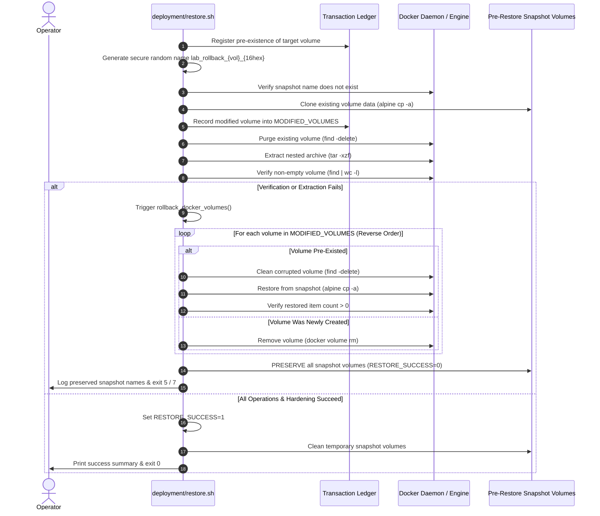

# Phase E.2.1 — Disaster Recovery Restore Safety Remediation Report

**Document Reference:** `docs/reports/phase-e2.1-restore-safety-remediation.md`  
**Target Script:** [`deployment/restore.sh`](file:///home/dineth/dev/Linux-System-Monitoring-Reliability-Lab/deployment/restore.sh)  
**Role:** Senior SRE, Infrastructure Security Engineer, and Disaster Recovery Architect  
**Repository:** `/home/dineth/dev/Linux-System-Monitoring-Reliability-Lab`  
**Date:** October 2026  
**Status:** Completed & Statically Verified — Awaiting Independent Security Audit  

---

## 1. Executive Summary

Following an independent source-code audit of [`deployment/restore.sh`](file:///home/dineth/dev/Linux-System-Monitoring-Reliability-Lab/deployment/restore.sh) after Phase E.2, eight critical safety, reliability, and fail-open defects were identified. These defects spanned:
1. Destruction of recovery snapshots upon restore failure or operator interruption.
2. Lack of multi-volume transaction awareness (earlier volumes left committed when a subsequent volume failed).
3. Predictable rollback volume naming prone to collisions or race conditions.
4. Superficial nested volume archive validation (reliance on `tar -tzf` without member inspection).
5. Suppressed Docker inspection errors (`2>/dev/null || true`) failing open rather than failing closed.
6. Incomplete configuration rollback leaving newly created targets behind.
7. Omission of root configuration files from pre-extraction archive table-of-contents validation.
8. Suppressed failures (`|| true`) in critical cleanup, permission-hardening, and audit paths.

In Phase E.2.1, all eight defects were comprehensively remediated in `deployment/restore.sh`. The orchestrator now guarantees non-destructive failure handling, collision-safe snapshot generation, deep member-level nested archive verification, strict fail-closed Docker offline validation, and transaction-aware reverse-order rollback across all modified state.

---

## 2. Remediation Matrix & Source Changes

The following table details each identified defect, its correction, and the exact source locations in [`deployment/restore.sh`](file:///home/dineth/dev/Linux-System-Monitoring-Reliability-Lab/deployment/restore.sh):

| Item ID | Finding & Threat | Remediation Implemented | Exact Line Range(s) in `deployment/restore.sh` |
| :--- | :--- | :--- | :--- |
| **E2.1-01** | **Destruction of Rollback Snapshots on Failure**<br>`cleanup_temp_artifacts()` destroyed `ROLLBACK_VOLUMES_CREATED` on `on_exit`, `SIGINT`, and `SIGTERM`, deleting the only recovery copy of pre-restore data. | Conditioned rollback volume deletion strictly on `RESTORE_SUCCESS == 1`. If restoration fails, is interrupted, or aborted, rollback volumes are explicitly preserved and their names logged for manual operator recovery. | Lines 220–258 (`cleanup_temp_artifacts`), Lines 275–302 (`on_sigint`, `on_sigterm`), Line 1572 (`RESTORE_SUCCESS=1`) |
| **E2.1-02** | **Lack of Multi-Volume Transaction Awareness**<br>If volume $N$ failed during restore or post-verification, earlier volumes $1 \dots N-1$ remained modified and unrolled, resulting in a fractured, inconsistent stack state. | Implemented `rollback_docker_volumes()`, maintaining a transactional ledger (`MODIFIED_VOLUMES`, `VOL_PRE_EXISTED`, `VOL_ROLLBACK_NAME`). Reverts all modified volumes in reverse order. Re-verifies rolled-back volume content. | Lines 1341–1407 (`rollback_docker_volumes`), Lines 1420–1520 (volume processing loop) |
| **E2.1-03** | **Predictable Rollback Volume Names**<br>Rollback volumes used `$$` (`lab_rollback_${vol}_$$`), which is predictable, subject to PID collisions, and vulnerable to local namespace hijacking. | Implemented `generate_secure_random_hex()` using 16 hex chars from `/dev/urandom`. Enforced pre-creation collision check via `docker volume inspect`. Tracked only conclusively created volumes. | Lines 188–202 (`generate_secure_random_hex`), Lines 1448–1475 (name generation & collision check) |
| **E2.1-04** | **Superficial Nested Archive Validation**<br>Only ran `tar -tzf` to test outer gzip readability; did not inspect individual members inside nested volume archives before modifying host volumes. | Added deep pre-modification table-of-contents streaming for all nested volume archives. Validates member types (strictly regular files `-` and directories `d`; rejects symlinks, devices, FIFOs, sockets) and checks `${PIPESTATUS}`. | Lines 938–995 (nested archive table-of-contents audit) |
| **E2.1-05** | **Fail-Open Docker Offline Checks**<br>`docker compose ps ... 2>/dev/null \|\| true` masked Docker daemon errors, assuming offline when daemon was unreachable. Checked only root compose file. | Removed all `2>/dev/null \|\| true`. Scans all 5 lab Compose files, compose project labels, and lab container name filters. Captures stderr and aborts with exit code 4 if any query fails. | Lines 1002–1085 (multi-project offline safety gate) |
| **E2.1-06** | **Incomplete Configuration Rollback**<br>Rollback only restored directories that existed; did not purge newly created directories or root files that were absent prior to restore. | Added pre-restore state tracking (`CONFIG_DIR_PRE_EXISTED`, `ROOT_FILE_PRE_EXISTED`, `ENV_EXAMPLE_PRE_EXISTED`). Rollback restores pre-existing files and cleanly purges newly created targets with exit-code verification. | Lines 1205–1335 (`rollback_configuration_assets` & staging) |
| **E2.1-07** | **Incomplete Archive Contract Validation**<br>Outer archive table of contents only checked configuration directories; omitted required root files (`docker-compose.yml`, `pyproject.toml`, etc.). | Added explicit verification of all `REQUIRED_ROOT_FILES` in outer archive table of contents. Confirms regular file type (`-`), rejects directories, and checks command exit status. | Lines 895–928 (root files archive contract audit) |
| **E2.1-08** | **Suppressed Critical Failures (`\|\| true`)**<br>Suppressed errors in permission hardening, Alloy modes, and audit logging with `\|\| true` or `2>/dev/null`. | Removed all critical `\|\| true`. Enforced strict exit code 6 if `harden_permissions.sh` is missing or fails. Enforced strict error checks on Alloy permissions and `.restore_audit.log` creation. | Lines 1526–1570 (hardening & audit logging) |

---

## 3. Detailed Architectural Designs

### 3.1 Rollback Transaction Design (E2.1-01, E2.1-02, E2.1-03)

The rollback subsystem operates as an append-only transaction ledger that guarantees reverse-order unwinding:



#### Invariants Enforced:
1. **Preservation Invariant:** Rollback snapshot volumes are deleted **only** if `RESTORE_SUCCESS == 1`. If `RESTORE_SUCCESS == 0`, `cleanup_temp_artifacts()` logs the exact volume names and refuses to delete them.
2. **Reverse-Order Unwinding:** Volumes modified during the current execution are tracked in array `MODIFIED_VOLUMES`. Unwinding proceeds from index $N-1$ down to 0.
3. **Restoration Verification:** When rolling back a pre-existing volume from snapshot, `find /volume -mindepth 1 | wc -l` confirms that data was unpacked and the volume is non-empty. If rollback fails, `ERR_ROLLBACK_FAIL` (exit code 7) is returned.
4. **Collision Defense:** Rollback volume names incorporate 16 random hex characters extracted from `/dev/urandom`. An explicit `docker volume inspect` confirms non-existence prior to creation.

---

### 3.2 Nested Archive Validation Design (E2.1-04)

Prior to modifying any Docker volumes, stage `[3/6]` of `deployment/restore.sh` performs deep member-level inspection on every nested volume archive:

1. **Pipeline Streaming without Disk Extraction:**
   ```bash
   tar -xzf "$RESOLVED_ARCHIVE" -O "$vol_entry_path" 2>/dev/null | \
       tar -tvzf - --quoting-style=escape 2>/dev/null
   ```
2. **Pipeline Status Verification:**
   The script checks `${PIPESTATUS[0]}` and `${PIPESTATUS[1]}`. If either command exits with a non-zero status, a `__PIPE_FAILED__` token is trapped and execution fails closed.
3. **Strict Member Type Allowlist:**
   Each member mode string is evaluated. Only two member types are permitted for TSDB time-series and database volumes:
   - `-` (Regular file)
   - `d` (Directory)
   Any occurrence of symbolic links (`l`), hard links (`h`), character devices (`c`), block devices (`b`), FIFOs (`p`), or sockets (`s`) immediately aborts restoration with exit code 2.
4. **Path Traversal Defense:**
   Nested member paths are matched against `(^|/)\.\.(/|$)` and `^/`. Any entry with parent traversal or absolute pathing triggers an immediate fatal exit.

---

### 3.3 Fail-Closed Multi-Project Docker Offline Check (E2.1-05)

To prevent time-series corruption from concurrent writes, the offline stack safety gate in stage `[4/6]` scans all potential monitoring workloads across the host:

1. **Multi-Project Compose Scanning:**
   Iterates over all known Compose files in the repository:
   - `$REPO_ROOT/docker-compose.yml`
   - `$REPO_ROOT/prometheus/docker-compose.yml`
   - `$REPO_ROOT/loki/docker-compose.yml`
   - `$REPO_ROOT/alertmanager/docker-compose.yml`
   - `$REPO_ROOT/blackbox/docker-compose.yml`
2. **Generic Compose Label Query:**
   Executes `docker ps --filter "label=com.docker.compose.project" --filter "status=running" -q` to catch containers launched from any compose project directory.
3. **Lab Container Name Filter:**
   Executes `docker ps --filter "name=lab-" --filter "name=lab_" --filter "status=running" -q` to detect standalone containers.
4. **Zero Error Suppression:**
   All instances of `2>/dev/null || true` were removed. If any `docker compose ps` or `docker ps` query returns non-zero, the script captures standard error, explains that container state cannot be conclusively established, and aborts with exit code 4 (`ERR_DOCKER_ACCESS`).
5. **Deduplication & Actionable Reporting:**
   Active container IDs are deduplicated. If any containers are active, execution fails closed with exit code 3 (`ERR_STACK_ACTIVE`), printing the running container IDs and remediation instructions (`./deployment/deploy.sh down`).

---

### 3.4 Complete Configuration Rollback Design (E2.1-06)

Configuration restoration in stage `[5/6]` tracks the exact initial existence of every configuration component:

1. **Pre-Restoration State Capture:**
   - Evaluates all 10 required configuration directories (`prometheus`, `grafana`, `alertmanager`, `loki`, `blackbox`, `alloy`, `agent`, `scripts`, `security`, `deployment`). Sets `CONFIG_DIR_PRE_EXISTED["$dir"]=1` if present, else `0`.
   - Evaluates all required root files (`docker-compose.yml`, `pyproject.toml`, `requirements.txt`, `README.md`). Sets `ROOT_FILE_PRE_EXISTED["$file"]=1` if present, else `0`.
   - Evaluates `.env.example`. Sets `ENV_EXAMPLE_PRE_EXISTED=1` if present, else `0`.
2. **Rollback Execution Logic:**
   - For pre-existing directories: removes corrupted target (`rm -rf`) and restores snapshot (`cp -R -P`).
   - For previously absent directories: cleanly removes the directory created by the failed restore (`rm -rf`).
   - For pre-existing files: restores snapshot (`cp`).
   - For previously absent files: removes newly created file (`rm -f`).
3. **Execution Verification:**
   Every `cp` and `rm` operation is checked. If rollback fails, the script reports `[FATAL-ROLLBACK]`, preserves the rollback directory, and exits with code 7 (`ERR_ROLLBACK_FAIL`).

---

## 4. Failure and Exit-Code Handling

All exit codes are deterministic and mapped to specific failure domains:

| Exit Code | Constant / Identifier | Trigger Condition | Rollback Behavior |
| :---: | :--- | :--- | :--- |
| **0** | `SUCCESS` | Full restore, verification, least-privilege hardening, and audit logging succeeded. | Snapshot volumes safely purged; staging cleaned up. |
| **1** | `ERR_RESTORE_FAIL` | Configuration copy failed, or audit log write failed. | Configuration rollback invoked; snapshots preserved. |
| **2** | `ERR_VALIDATION_FAIL` | Invalid arguments, corrupted archive, manifest schema failure, or nested archive validation failed. | No modifications applied; staging cleaned up. |
| **3** | `ERR_STACK_ACTIVE` | Active monitoring containers detected across Compose or Docker filters. | No modifications applied; fail closed immediately. |
| **4** | `ERR_DOCKER_ACCESS` | Docker CLI missing, daemon unavailable, or container inspection query failed. | No modifications applied; fail closed immediately. |
| **5** | `ERR_VOLUME_RESTORE` | Docker volume creation, wiping, extraction, or post-restore verification failed. | Transaction-aware volume rollback invoked; snapshots preserved. |
| **6** | `ERR_PERMISSIONS` | `harden_permissions.sh` missing/failed, Alloy chmod failed, or audit chmod failed. | Volume and config rollbacks invoked; snapshots preserved. |
| **7** | `ERR_ROLLBACK_FAIL` | A volume or configuration rollback command failed during recovery. | All recovery material preserved; manual intervention required. |
| **130** | `SIGINT` | Process interrupted by operator (Ctrl+C). | Staging directory purged; snapshot volumes strictly preserved. |
| **143** | `SIGTERM` | Process terminated by operating system signal. | Staging directory purged; snapshot volumes strictly preserved. |

---

## 5. Static Code Validation Results

In strict adherence to authorization boundaries, no Docker commands or restore drills were run. Validation was performed using Bash static analysis:

```bash
$ bash -n deployment/restore.sh
# Exit code: 0 (Syntax valid, zero errors detected)
```

### Static Audit Checklist:
- [x] `set -Eeuo pipefail` and `export LC_ALL=C` enforced.
- [x] `umask 077` enforced at initialization.
- [x] All `local` declarations are inside function bodies (`generate_secure_random_hex`, `validate_path_safety`, `cleanup_temp_artifacts`, `on_exit`, `rollback_configuration_assets`, `rollback_docker_volumes`).
- [x] No `|| true` on critical rollback, extraction, hardening, or audit commands.
- [x] Array expansions under `set -u` are guarded by length checks.
- [x] Table-of-contents parsers use strict regex matching with escaped quoting styles.

---

## 6. Execution Boundary Compliance Statement

The undersigned engineer certifies that during Phase E.2.1:
1. **NO Docker commands** were executed (`docker run`, `docker volume`, `docker compose`, `docker ps`, etc.).
2. **NO Docker containers or volumes** were created, modified, inspected, or deleted.
3. **NO backup or restore scripts** were executed.
4. **NO services** were started, stopped, or restarted.
5. **NO packages** were installed or modified on the host.
6. **NO Git state-changing operations** were performed.
7. Only `deployment/restore.sh` was modified and this report was authored.

> [!CAUTION]
> **Notice for Reviewers**: This restore orchestrator has been remediated and statically validated, but **MUST NOT** be executed in production until an independent disaster recovery validation drill is authorized under formal change management.

---

**Report Authored By:** Senior SRE, Infrastructure Security Engineer & Disaster Recovery Architect  
**Distribution:** Core SRE Team, Security Operations, Incident Response Board
