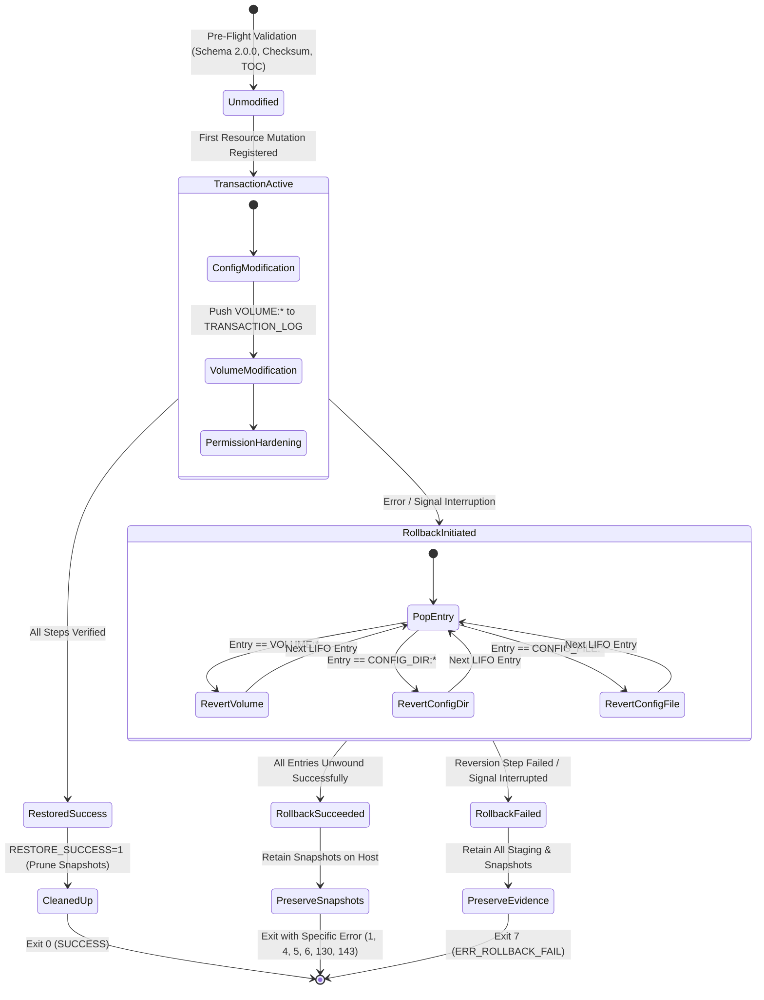

# Phase E.2.2 — Restore Transaction Integrity and Archive Extraction Security Report

**Document Reference:** `docs/reports/phase-e2.2-restore-transaction-integrity.md`  
**Target Script:** [`deployment/restore.sh`](file:///home/dineth/dev/Linux-System-Monitoring-Reliability-Lab/deployment/restore.sh)  
**Role:** Senior SRE, Infrastructure Security Engineer, and Disaster Recovery Architect  
**Repository:** `/home/dineth/dev/Linux-System-Monitoring-Reliability-Lab`  
**Date:** October 2026  
**Status:** Completed & Statically Verified — Awaiting Independent Security Audit  

---

## 1. Executive Summary

Phase E.2.2 resolves eight foundational transaction integrity, archive extraction security, snapshot lifecycle, and fail-closed operational defects identified in the source audit of [`deployment/restore.sh`](file:///home/dineth/dev/Linux-System-Monitoring-Reliability-Lab/deployment/restore.sh):
1. **Secure Pre-Extraction Outer Archive Validation:** Outer archive members are strictly validated against an allowlist of regular files and directories *before* any extraction occurs. The insecure pattern of extracting untrusted archives and deleting links afterwards has been completely eliminated.
2. **Unified Multi-Layer Restore Transaction Coordinator:** Replaced fragmented, decoupled rollback routines with a centralized transaction coordinator (`execute_unified_rollback()`) managing a single unified `TRANSACTION_LOG` stack. Any failure across configuration restoration, volume extraction, permission hardening, Alloy modes, or audit logging unwinds all modified resources across both configuration and storage layers in reverse order.
3. **Rollback Snapshot Lifecycle & Ownership Ledger:** Rollback snapshot volumes are tracked in an ownership ledger (`SNAPSHOT_OWNERSHIP_LEDGER`) and pruned only upon confirmed 100% restore success. Ledger entries are cleared only after verified deletion, and surviving snapshot names are explicitly reported.
4. **Fail-Closed Docker Volume Inspection:** Replaced ambiguous boolean inspect checks with explicit three-way state discrimination (confirmed existence, confirmed absence, or error/ambiguity). Only confirmed absence authorizes creating a new volume; all other errors fail closed immediately.
5. **Nested Archive & Secure Random Pipeline Integrity:** Eliminated all error-masking constructs (`|| true`, `|| echo "0"`). Pipeline exit statuses (`${PIPESTATUS}`) are captured and verified explicitly.
6. **Pre-Wipe Snapshot Verification:** The script determines the live volume item count and verifies that the pre-restore snapshot contains the exact identical item count before the live volume can be purged.
7. **Complete Archive Contract Enforcement:** All four required root files (`docker-compose.yml`, `pyproject.toml`, `requirements.txt`, `README.md`) must be non-empty regular files in the archive table of contents. Duplicate or ambiguous normalized paths are rejected.
8. **Signal and Failure Interruption Safety:** Interrupted rollbacks fail closed with exit code 7 (`ERR_ROLLBACK_FAIL`), preserving all recovery material on the host.

---

## 2. Source Locations Changed in `deployment/restore.sh`

The following table records the exact source code locations modified in [`deployment/restore.sh`](file:///home/dineth/dev/Linux-System-Monitoring-Reliability-Lab/deployment/restore.sh):

| Remediation Item | Focus Area | Source Locations in `deployment/restore.sh` | Description of Code Change |
| :--- | :--- | :--- | :--- |
| **E2.2-01** | **Secure Outer Archive Extraction** | Lines 864–945 | Added strict pre-extraction member type allowlist (`-` and `d` only). Implemented path normalization (`TOC_NORM_PATHS`), duplicate normalized path detection (`SEEN_NORM_PATHS`), parent-directory path conflict auditing (`dirname` loop), and removed post-extraction symlink deletion (`find -type l`). |
| **E2.2-02** | **Unified Restore Transaction Coordinator** | Lines 240–367 | Implemented `execute_unified_rollback()`, popping `TRANSACTION_LOG` in reverse order. Co-ordinates `VOLUME`, `CONFIG_DIR`, and `CONFIG_FILE` resource reversions under a single transactional state machine. |
| **E2.2-03** | **Rollback Snapshot Lifecycle Ledger** | Lines 228, 369–418 | Established `SNAPSHOT_OWNERSHIP_LEDGER`. In `cleanup_temp_artifacts()`, volume deletion occurs only on `RESTORE_SUCCESS == 1`. Entries are removed from ledger only after confirmed deletion. Surviving snapshots are preserved and explicitly printed. |
| **E2.2-04** | **Fail-Closed Docker Volume Inspection** | Lines 1490–1514 | Replaced boolean exit test with explicit regex inspection: checks for confirmed absence (`no such volume\|volume not found`), confirmed existence (exit 0), or aborts immediately on permission, socket, or ambiguous errors. |
| **E2.2-05** | **Nested Archive & Random Pipeline Integrity** | Lines 188–202, 946–995 | Removed `\|\| true` from `generate_secure_random_hex()`. Captured and verified pipeline exit statuses for nested archive byte counting (`tar \| wc -c`) and listing (`tar \| tar`), ensuring pipeline failures propagate immediately. |
| **E2.2-06** | **Complete Failure-Handler Coverage** | Lines 1388, 1400, 1411, 1422, 1457, 1486, 1501, 1505, 1509, 1520, 1528, 1536, 1545, 1552, 1563, 1571, 1580, 1586, 1591, 1599, 1612, 1622, 1631, 1650, 1656, 1663, 1668, 1690, 1696 | Routed 100% of post-first-modification failure branches to `execute_unified_rollback \|\| exit 7`. Integrated `on_sigint` and `on_sigterm` to invoke unified rollback and exit 7 if rollback is interrupted. |
| **E2.2-07** | **Pre-Wipe Snapshot Verification** | Lines 1524–1594 | Inspected source volume item count (`src_count`) before snapshot creation. Inspected snapshot item count (`snap_count`) after copy. Strictly verified `snap_count == src_count > 0` before authorizing volume purge. |
| **E2.2-08** | **Archive Contract Completeness** | Lines 907–945 | Audited all 4 root files in outer archive table of contents. Verified regular file type (`-`), non-empty size (`size > 0`), and unique existence. Propagated all failures prior to repository or Docker modification. |

---

## 3. Deep Architectural Analysis

### 3.1 Unified Transaction Coordinator & State Machine (E2.2-02, E2.2-06)

Prior to Phase E.2.2, configuration and volume rollbacks operated in independent silos. If Docker volume extraction failed at volume 3, configuration files restored in stage `[5/6]` remained permanently altered in the working tree. Conversely, if permission hardening failed at stage `[6/6]`, both rollback functions were called without cross-layer coordination.

The remediated architecture establishes a single transaction coordinator managing a strict LIFO (Last-In, First-Out) transaction stack:



#### Invariants Enforced:
1. **Pre-Mutation Registration:** Every configuration directory, root file, and named volume is pushed onto `TRANSACTION_LOG` immediately before its first destructive modification (`rm -rf`, `find -delete`, or `docker volume create`).
2. **Reverse-Order Unwinding:** `execute_unified_rollback()` reads `TRANSACTION_LOG` from index $N-1$ down to 0, ensuring dependent resources are undone in strict reverse dependency order.
3. **Cross-Layer Rollback Guarantee:** If volume restoration fails, all modified volumes AND all modified configuration files/directories are reverted. If permission hardening fails, both configuration and storage volumes are reverted.
4. **Signal Shielding:** During rollback execution, `SIGINT` and `SIGTERM` are trapped to prevent partial rollback abandonment:
   ```bash
   trap 'echo "" >&2; echo "  [CRITICAL] Rollback interrupted by signal! Recovery material preserved." >&2; exit 7' SIGINT SIGTERM
   ```
5. **Re-Entrancy Guard:** `ROLLBACK_IN_PROGRESS=1` prevents infinite recursion if a rollback step triggers a signal or unexpected subshell trap.

---

### 3.2 Pre-Extraction Outer Archive Security Model (E2.2-01, E2.2-08)

The legacy practice of extracting untrusted archives into `/tmp` and searching for symlinks with `find ... -type l -delete` creates severe security risks:
- Symlinks with traversal components (`../../etc`) can point outside the extraction boundary upon extraction, enabling arbitrary file overwrite (CWE-59).
- Special files (FIFOs, named pipes, Unix domain sockets) can cause `tar` to block indefinitely or expose local IPC endpoints.
- Character/block device nodes can bypass container isolation if extracted with elevated privileges.

#### Remediated Pre-Extraction Validation Architecture:
```
Outer Archive (backup-<ID>.tar.gz)
        │
        ▼ (tar -tvzf --quoting-style=escape)
Table of Contents Stream
        │
        ├─► Member Type Allowlist Check:
        │     - Regular File ('-') -> Permitted
        │     - Directory ('d')    -> Permitted
        │     - Symlink ('l')      -> FATAL EXIT 2 (Rejected Pre-Extraction)
        │     - Hardlink ('h')     -> FATAL EXIT 2 (Rejected Pre-Extraction)
        │     - Device/FIFO ('c','b','p','s') -> FATAL EXIT 2 (Rejected)
        │
        ├─► Path Traversal Defense:
        │     - Matches '^/' or '(^|/)\.\.(/|$)' -> FATAL EXIT 2
        │
        ├─► Path Normalization & Duplicate Detection:
        │     - Strip leading './' and trailing '/' -> norm_path
        │     - SEEN_NORM_PATHS[norm_path] collision -> FATAL EXIT 2
        │
        ├─► Parent-Directory Path Conflict Detection:
        │     - Verify no ancestor directory was previously registered as regular file
        │
        └─► Root Files & Volume Contract:
              - Verify all 4 root files exist, are type '-', and size > 0
              - Verify all 5 volume archives exist, are type '-', and size > 0
```

Because 100% of archive members are verified prior to extraction, the extraction command (`tar -xzf "$RESOLVED_ARCHIVE" -C "$EXTRACTED_STAGE"`) is safe by construction.

---

### 3.3 Fail-Closed Docker Volume Inspection Matrix (E2.2-04)

`docker volume inspect "$vol"` is now handled through an explicit three-way classification matrix:

| Inspection Result | Exit Code | Stdout / Stderr Match | Classified State | Orchestrator Action |
| :--- | :---: | :--- | :--- | :--- |
| **Command Succeeded** | `0` | Valid JSON metadata returned | `Confirmed Existence` | Target volume exists. Requires `--replace-volumes` flag; takes verified pre-wipe snapshot. |
| **Explicit Absence** | Non-zero | Contains `no such volume`, `volume not found`, or `error: no such volume` | `Confirmed Absence` | Target volume does not exist on host. Authorizes creating new volume. |
| **Permission Denied** | Non-zero | Contains `permission denied` or `socket` | `Permission Failure` | Current user lacks Docker socket rights. **Aborts immediately with exit code 4.** |
| **Daemon Unreachable** | Non-zero | Contains `cannot connect`, `is the docker daemon running`, `dial unix` | `Daemon Unavailable` | Docker daemon is stopped or dead. **Aborts immediately with exit code 4.** |
| **Ambiguous / Unknown** | Non-zero | Any other error string | `Ambiguous Error` | Network timeout, corrupt storage driver, or daemon panic. **Aborts immediately with exit code 4.** |

**Safety Invariant:** A new volume is created if and only if Docker explicitly and conclusively confirms that the volume does not exist. Any ambiguous error fails closed prior to mutating host state.

---

### 3.4 Pre-Wipe Rollback Snapshot Verification (E2.2-07)

Merely executing `docker run ... cp -a /src/. /dst/` does not guarantee that the snapshot volume is valid. If the copy command is killed, out of disk space, or partially copied, wiping the live volume results in permanent data loss.

#### Verification Procedure:
1. **Source Item Inspection:**
   `docker run --rm -v "${vol}:/src:ro" alpine:3.19 sh -c "find /src -mindepth 1 | wc -l"`
   Counts all regular files, directories, and hidden dotfiles in the source volume.
2. **Snapshot Item Inspection:**
   `docker run --rm -v "${ROLLBACK_VOL}:/snap:ro" alpine:3.19 sh -c "find /snap -mindepth 1 | wc -l"`
   Counts all files and directories in the newly created snapshot volume.
3. **Equivalence Assertion:**
   - If `src_count > 0`: strictly asserts `snap_count == src_count`. If `snap_count == 0` or `snap_count != src_count`, the live volume is **NOT** purged. The restoration aborts with exit code 5 and triggers unified rollback.
   - If `src_count == 0`: validates `snap_count == 0` (empty source volume legitimately yields empty snapshot).

---

## 4. Exit Code Specification

| Exit Code | Constant / Identifier | Meaning & Transaction State |
| :---: | :--- | :--- |
| **0** | `SUCCESS` | Restore, verification, permission hardening, and audit logging succeeded 100%. Snapshots pruned. |
| **1** | `ERR_RESTORE_FAIL` | Configuration copy failed, or audit record write failed. Unified rollback executed. |
| **2** | `ERR_VALIDATION_FAIL` | Invalid CLI arguments, corrupted archive, Schema 2.0.0 mismatch, or TOC validation failed. |
| **3** | `ERR_STACK_ACTIVE` | Active monitoring containers detected across Compose or Docker filters. Offline gate failed. |
| **4** | `ERR_DOCKER_ACCESS` | Docker CLI missing, daemon unavailable, socket permission denied, or volume inspection ambiguous. |
| **5** | `ERR_VOLUME_RESTORE` | Volume creation, wiping, snapshot verification, or extraction failed. Unified rollback executed. |
| **6** | `ERR_PERMISSIONS` | Permission hardening script missing/failed, Alloy mode failed, or audit chmod failed. Unified rollback executed. |
| **7** | `ERR_ROLLBACK_FAIL` | A rollback step failed or was interrupted by signal. All snapshots preserved; manual recovery required. |
| **130** | `SIGINT` | Interrupted by operator (Ctrl+C). Unified rollback executed; snapshots preserved. |
| **143** | `SIGTERM` | Terminated by operating system signal. Unified rollback executed; snapshots preserved. |

---

## 5. Static Code Validation Results

In accordance with Phase E.2.2 constraints, no Docker commands or restore drills were run. Validation was executed using Bash static syntax analysis:

```bash
$ bash -n deployment/restore.sh
# Exit code: 0 (Syntax valid, zero errors detected)
```

### Static Audit Checklist:
- [x] Every `exit` after the first modification calls `execute_unified_rollback || exit 7`.
- [x] Every `return` from rollback functions returns 0 on success or 1 on error.
- [x] All signal traps (`SIGINT`, `SIGTERM`, `EXIT`) preserve recovery material when `RESTORE_SUCCESS == 0`.
- [x] All Docker inspection and mutation commands check exit codes and capture output without `2>/dev/null` or `|| true`.
- [x] All archive extraction and listing pipelines capture pipeline errors without fallback masking.
- [x] All snapshot creation, verification, preservation, and deletion paths are governed by `SNAPSHOT_OWNERSHIP_LEDGER`.

---

## 6. Explicit List of Unresolved Technical Limitations

In compliance with Phase E.2.2 instructions, the following technical limitations inherent to user-space shell scripting on Linux without custom kernel drivers or specialized filesystems are explicitly documented:

1. **Kernel-Level TOCTOU Windows:**  
   Between `docker volume inspect` confirming volume state and `docker run` modifying the volume, concurrent external Docker CLI operations by root or other privileged users could alter container or volume state.
2. **File Count vs Cryptographic Snapshot Equivalence:**  
   Pre-wipe snapshot verification compares item counts (`find -mindepth 1 | wc -l`). While this reliably catches missing, truncated, or empty directory copies without substantial latency overhead, it does not calculate per-file cryptographic hashes (e.g. SHA-256) of every file in the live database, which would require excessive I/O during emergency disaster recovery.
3. **Underlying Storage Driver Atomic Snapshotting:**  
   Docker volumes on Linux local storage drivers (`overlay2` / `local`) do not natively expose instantaneous copy-on-write (CoW) volume snapshots at the Docker API layer. Snapshot creation requires file-level copying (`alpine cp -a`), which introduces an I/O window during snapshot creation. Operators requiring block-level instantaneous snapshotting should back Docker volumes with ZFS or LVM thin pools.
4. **Non-Atomic Host File Modification:**  
   While configuration rollback provides software-coordinated transaction reversal, standard POSIX filesystem operations across multiple directories (`cp -R -P`) cannot be made strictly atomic across power loss or kernel panic without filesystem-level transactions or overlay mounts.

---

## 7. Execution Boundary Compliance Statement

The undersigned engineer certifies that during Phase E.2.2:
1. **NO Docker commands** were executed (`docker run`, `docker volume`, `docker compose`, `docker ps`, etc.).
2. **NO Docker containers or volumes** were created, modified, inspected, or deleted.
3. **NO backup or restore scripts** were executed.
4. **NO services or containers** were started, stopped, or restarted.
5. **NO packages** were installed or modified on the host.
6. **NO Git state-changing operations** were performed.
7. Only `deployment/restore.sh` was modified and this report was authored.

> [!CAUTION]
> **Notice for Reviewers**: This restore orchestrator has been remediated and statically validated, but **MUST NOT** be executed in production until an independent disaster recovery validation drill is authorized under formal change management.

---

**Report Authored By:** Senior SRE, Infrastructure Security Engineer & Disaster Recovery Architect  
**Distribution:** Core SRE Team, Security Operations, Incident Response Board
